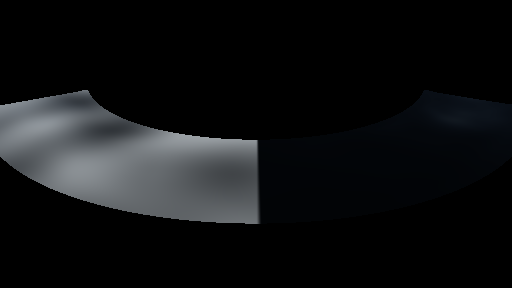
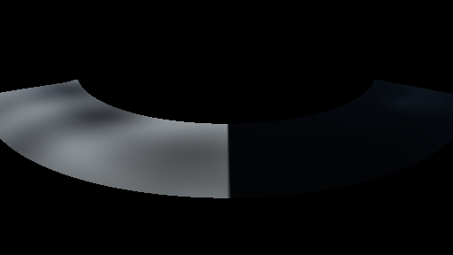

# GPU-PROBE b8e91ace — GRÜN

Zweig `tiere-im-blick` · Kopf b8e91acec1d1ff8cce44b0fcee7639d8a0e131c2 · Läufer gtx1050-desktop · 25.11. 09:46 · Wanduhr ab Push 441 s · Lauf https://github.com/MiguellD/AnazhRealm/actions/runs/45578152365

Ruf: `gate:tier-gang gate:wasser-leben:bild gate:webgl-probe`

## Läufer gtx1050-desktop — GRÜN

GPU NVIDIA GeForce GTX 1050 · npm ci 54 s (package-lock bd40e656)
Schloss /c/Users/User/AppData/Local/Temp/claude/gpu-schloss hält „ci-runner 45578152365/1 probe“
- Hook 2026-11-25 09:39:29 start ci-runner 45578152365/1 probe: Schloss genommen (refs/heads/tiere-im-blick b8e91acec1d1ff8cce44b0fcee7639d8a0e131c2 ws=C:\actions-runner\_work\AnazhRealm\AnazhRealm)

### gate:tier-gang — GRÜN · 179 s · Läufer gtx1050-desktop

Adapter: [linse-gpu] nvidia/pascal

```text
  ✅ Gangart Labor bear v̂ 0.74 · trab [0 0.5 0.5 1] · Tastgrad 0.49 · Welt − Labor 0.00 Zyklus · Satz − Labor 0.00 Zyklus
  ✅ Gangart Labor bear v̂ 1.2 · trab [0 0.5 0.5 1] · Tastgrad 0.5 · Welt − Labor 0.00 Zyklus · Satz − Labor 0.01 Zyklus
  ✅ Gangart Labor bear v̂ 3.5 · galopp [0 0.15 0.6 0.45] · Tastgrad 0.31 · Welt − Labor 0.01 Zyklus · Satz − Labor 0.02 Zyklus
  ✅ Gangart Labor bear v̂ 0.67 · trab [0 0.5 0.5 1] · Tastgrad 0.5 · Welt − Labor 0.00 Zyklus · Satz − Labor 0.00 Zyklus
  ✅ Gangart Labor deer v̂ 0.3 · schritt-lateral [0 0.5 0.25 0.75] · Tastgrad 0.65 · Welt − Labor 0.01 Zyklus · Satz − Labor 0.00 Zyklus
  ✅ Gangart Labor deer v̂ 0.74 · trab [0 0.5 0.5 1] · Tastgrad 0.5 · Welt − Labor 0.00 Zyklus · Satz − Labor 0.00 Zyklus
  ✅ Gangart Labor deer v̂ 1.2 · trab [0 0.5 0.5 1] · Tastgrad 0.49 · Welt − Labor 0.00 Zyklus · Satz − Labor 0.00 Zyklus
  ✅ Gangart Labor deer v̂ 3.5 · galopp [0 0.16 0.6 0.45] · Tastgrad 0.28 · Welt − Labor 0.01 Zyklus · Satz − Labor 0.01 Zyklus
  ✅ Gangart Labor deer v̂ 0.67 · trab [0 0.5 0.5 1] · Tastgrad 0.5 · Welt − Labor 0.00 Zyklus · Satz − Labor 0.00 Zyklus
✅ GRÜN — jede Gattung setzt ihre Pfoten (Schlupf ≤ 0.05) in Schritt, Trab und Galopp; der Mensch geht und läuft nach demselben Gesetz (Kadenz ≥ 1.5, Töne ± 15 %), in der Welt und im Körper-Studio.
```

### gate:wasser-leben:bild — GRÜN · 57 s · Läufer gtx1050-desktop

Adapter: [linse-gpu] nvidia/pascal

```text
  ✅ B8 Weißkappe: Flaute 0.00 % · Wind 0,8 4.21 % der See · B9 Glanz der Zenit-Sonne: frei 37.36 · hinter dem Grat 3.67 (Luma-Mittel der Mitte)
WASSER-LEBEN GRÜN
```






### gate:webgl-probe — GRÜN · 92 s · Läufer gtx1050-desktop

Adapter: [linse-gpu] webgl2/NVIDIA GeForce GTX 1050 (0x00001C81) Direct3D11 vs_5_0 ps_5_0

```text
✅ GRÜN — die Kein-WebGPU-Geschichte ist BEWIESEN: der erzwungene WebGL2-Rückfall bootet eine LEBENDE, sichtbare Welt; die WGSL-Konsumenten + Bundles ruhen hinter der EINEN Backend-Wand, der Rückfall ist LAUT benannt, der Fern-Ring trägt auf CPU.
```
