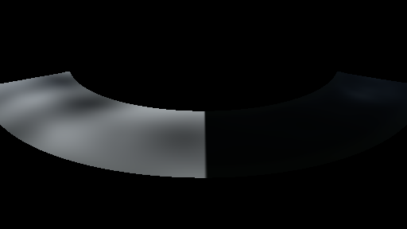
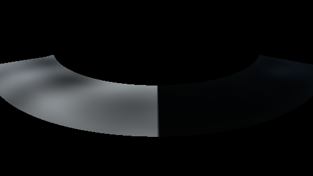
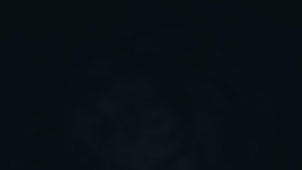

# GPU-PROBE d708188d — GRÜN

Zweig `unter-wasser` · Kopf d708188d26aa25556425623310c7b9996fe3776c · Läufer omen-gtx1060 · 25.11. 18:47 · Wanduhr ab Push 1416 s · Lauf https://github.com/MiguellD/AnazhRealm/actions/runs/45664308904

Ruf: `gate:wasser-leben:bild gate:pruefbuehne-licht gate:weltbild-frost:echt gate:tag-achse:echt gate:webgl-probe`

## Läufer omen-gtx1060 — GRÜN

GPU NVIDIA GeForce GTX 1060 · npm ci 44 s (package-lock b6d5d1ab)
Schloss /c/Users/micha/AppData/Local/Temp/claude/gpu-schloss hält „ci-runner 45664308904/1 probe“
- Hook 2026-11-25 18:34:21 start ci-runner 45664308904/1 probe: wartet auf Schloss von 'omen-punkte-gtx-sitzung'
- Hook 2026-11-25 18:37:37 start ci-runner 45664308904/1 probe: Schloss genommen (refs/heads/unter-wasser d708188d26aa25556425623310c7b9996fe3776c ws=C:\actions-runner\_work\AnazhRealm\AnazhRealm)

### gate:wasser-leben:bild — GRÜN · 42 s · Läufer omen-gtx1060

Adapter: [linse-gpu] nvidia/pascal

```text
  ✅ B8 Weißkappe: Flaute 0.00 % · Wind 0,8 4.45 % der See · B9 Glanz der Zenit-Sonne: frei 45.92 · hinter dem Grat 3.67 (Luma-Mittel der Mitte)
WASSER-LEBEN GRÜN
```








### gate:pruefbuehne-licht — GRÜN · 51 s · Läufer omen-gtx1060

Adapter: [linse-gpu] nvidia/pascal

```text
  S0 BODEN-PROGRAMM 1/1: 108011 Zeichen WGSL (gebuchter Stand 108011, ±0 — Auskunft, kein Urteil) · Pipeline asynchron → GRÜN · kalt 1213 · 1243 · 1129 · 1139 · 1157 · 1200 · 1112 · 1073 · 1082 ms, Median 1139 ms · ÷ K17 derselben Sitzung 0,78 (Auskunft, kein Zeit-Urteil)
  SELBSTTEST S0 NACHT (die Sicht des Mondes): getroffen — ohne Mond-Sicht „S0 Nacht: das Licht der Nacht trifft keinen Boden 1–3 m (Mond-Sicht 0 an jedem Pixel des Rings, Mond 22.08°)“ · schwarz 8 % im Licht → ROT · schwarz 8 % allein im Schatten grün
✅ S0 BILD GRÜN: die Feuerstelle trägt den Feuerkreis aus 2 m in der Ausgabe · Nacht {"luma":44.2,"schwarz":0,"gesetz":48.52} (43 s, nvidia/pascal · Holz kienspan)
```

### gate:weltbild-frost:echt — GRÜN · 142 s · Läufer omen-gtx1060

Adapter: [linse-gpu] nvidia/pascal

```text
  ✅ P2 kein writeBuffer schief: der Pfad und ein Index ungerader Länge der Ich-Bühne — 401194 writeBuffer, keiner schief
  ✅ T1 die Index-Wache nennt den Index über der Vertex-Zahl beim Namen — Vendor- und Storage-Index — gezeichnet nach 58 Bildern · Scene/frost-taeter-bereich: Index 3 ≥ 3 Vertices im gezeichneten Bereich | Scene/frost-taeter-speicher: Index 3 ≥ 3 Vertices im gezeichneten Bereich
  ✅ T3 die Puffer-Wache nennt den schiefen writeBuffer beim Namen, WebGPU wirft — frost-taeter-puffer · Uint16Array · Versatz 0 · 6 B · q.writeBuffer (stamm/dirigent-ankunft.js:253:36) < pptr:;page.%3Ccomputed%3E%20(C%3A%5Cactions-runner%5C_work%5CAnazhRealm%5Cgpu-probe%5Cscripts%5Clib%5Cwelt-boot.cjs%3A1136%3A22):6:23 · geworfen: Failed to execute 'writeBuffer' on 'GPUQueue': Number of bytes to write must be a multiple of 4
  ✅ T4 ein fremder Fehler im Bau einer Pipeline markiert keine Pipeline — der Abgriff schließt r184s Bereich, die GPU-Wache zählt den Fehler — 1 Bauten, 1 fremde Validierungen, 1 Bereiche geschlossen, GPU-Wache +1, Marken: keine
  ✅ T4 der Mutant (main 6699a813: r184s Fehler-Bereich bleibt über das Versprechen des Baus offen) markiert die Pipeline des Täters — 1 Bauten, 1 fremde Validierungen, 0 Bereiche geschlossen, GPU-Wache +1, Marken: renderPipeline_frost-taeter-fremd-mutant_3430 · T4 mit beiden Läufen in 2421 ms
  ✅ T2 die Index-Wache nennt den geweiteten Index beim Pfad — Group/BundleGroup/Group/mensch/torso/head/Mesh: 7962 × Uint32Array = 31848 B gebunden, der Puffer trägt 15924 B
  ✅ T2 die GPU-Wache des Spiels zählt die Validierung — {"n":297}
  ✅ T2 der eigene Hörer hört die Validierung (Device oder r184-Fehler-Bereich) — 590 Meldungen: konsole: THREE.Write range (bufferOffset: 0, size: 16) does not fit in [Buffer "frost-taeter-fremd"] size (8). | konsole: Index range (first: 0, count: 7962, format: IndexFormat::Uint32) does not fit in index buffer size (15924).
  ✅ T2 die Bild-Probe erkennt das stehende Bild — 0.00 % der Blöcke bewegt
✅ GRÜN — DIE FROST-WAND steht — durch Werkstatt, Ich- und Hof-Bühne trägt jeder Index-Puffer der Welt-GPU sein Format, kein Device meldet, das Bild folgt der Kamera; die Täter (Index über der Vertex-Zahl, ein fremd geweiteter Mensch-Index) nennen die Wachen beim Namen, ein fremder Fehler im Bau einer Pipeline markiert keine, und das stehende Bild wird erkannt.
```

### gate:tag-achse:echt — GRÜN · 123 s · Läufer omen-gtx1060

Adapter: ungenannt (die Probe nannte keinen Browser-Adapter)

```text
TAG genesis GRUEN: Karte 126.3 · Sprung -0.04 (Uhr 0.752) · Buckel 0.00 (Uhr 0) · Sonne 10° -0.65 EV R/B ×1.12 | -0.76 EV R/B ×0.85 · Nacht -0.54 EV Luma 84.6 · REF 1.65 (Uhr 0) · Sicht -0.06 (Uhr 0.5) · ASYNC -0.03 (Uhr 0) nach 3 Bildern (Mutant 10) · sofort -0.74 (Uhr 0.72) EV · nur die Wand (--kurz)
TAG wiese GRUEN: Karte 123.6 · Sprung -0.08 (Uhr 0.732) · Buckel 0.00 (Uhr 0) · Sonne 10° -1.03 EV R/B ×0.88 | -1.24 EV R/B ×0.67 · Nacht -2.40 EV Luma 47 · REF 0.43 (Uhr 0) · Sicht -0.01 (Uhr 0.33) · ASYNC 0.01 (Uhr 0) nach 3 Bildern (Mutant 10) · sofort -0.67 (Uhr 0.75) EV · nur die Wand (--kurz)
TAG-ACHSE GRUEN
```

### gate:webgl-probe — GRÜN · 52 s · Läufer omen-gtx1060

Adapter: [linse-gpu] webgl2/NVIDIA GeForce GTX 1060 (0x00001C60) Direct3D11 vs_5_0 ps_5_0

```text
✅ GRÜN — die Kein-WebGPU-Geschichte ist BEWIESEN: der erzwungene WebGL2-Rückfall bootet eine LEBENDE, sichtbare Welt; die WGSL-Konsumenten + Bundles ruhen hinter der EINEN Backend-Wand, der Rückfall ist LAUT benannt, der Fern-Ring trägt auf CPU.
```
