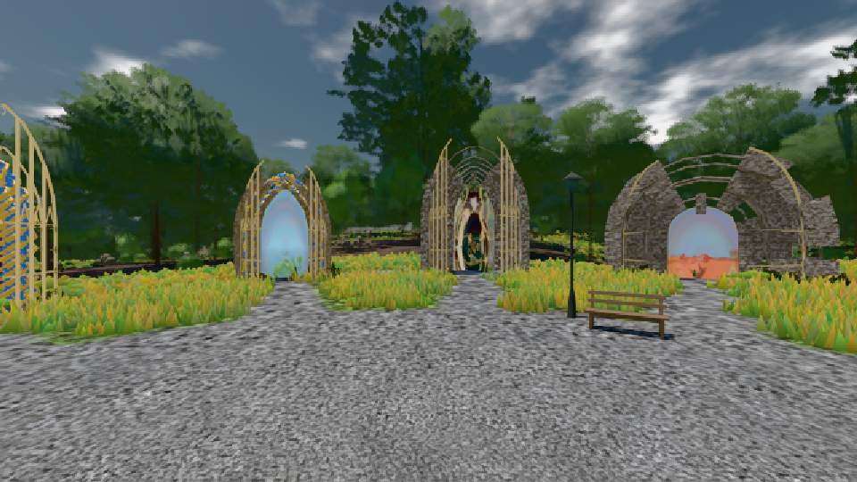

# GPU-PROBE 9c275ca8 — GRÜN

Zweig `w22-ankunft-kalt` · Kopf 9c275ca8bade7ca928d38eec6fd7f64f8ddfdd03 · Läufer radeon-890m · 08.11. 01:17 · Wanduhr ab Push 503 s · Lauf https://github.com/MiguellD/AnazhRealm/actions/runs/42428471215

Ruf: `bild:genesis`

GPU AMD Radeon(TM) 890M Graphics · npm ci 35 s (package-lock ed18c269)
Schloss /c/Users/micha/AppData/Local/Temp/claude/gpu-schloss hält „ci-runner 42428471215/1 probe“
- Hook 2026-11-08 01:15:51 start ci-runner 42428471215/1 probe: Schloss genommen (refs/heads/w22-ankunft-kalt 9c275ca8bade7ca928d38eec6fd7f64f8ddfdd03 ws=C:\actions-runner\_work\AnazhRealm\AnazhRealm)

### bild:genesis — GRÜN · 47 s

Adapter: [linse-gpu] amd/rdna-3

```text
Kamera des Spiels → Blick (10.0 m): 0.00 92.40 0.00 -10.00 92.40 0.00
 "abnahme": "ABNAHME GRÜN · beweis · Sicht 0.0 % · Ziel Blickziel im Bild frei 10 m · Luma 105.8 σ 39.3 schwarz 0.0 % weiß 0.0 % · Stand 18.546.214 · Bühne summer sunny 0.50 · Gerät WebGPU amd rdna-3",
```


