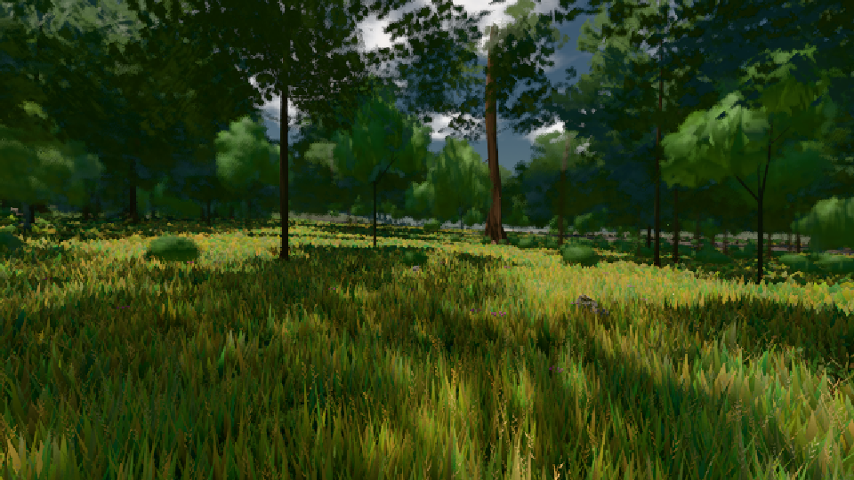

# GPU-PROBE 7c9c3a8e — ROT

Zweig `w22-geh-bild` · Kopf 7c9c3a8ee651dd2859f1d92ec045e8f50fffd7a9 · Läufer radeon-890m · 08.11. 01:57 · Wanduhr ab Push 532 s · Lauf https://github.com/MiguellD/AnazhRealm/actions/runs/42431427347

Ruf: `gate:geh-zerlegung bild:wiese@0.5`

GPU AMD Radeon(TM) 890M Graphics · npm ci 34 s (package-lock 4c7ceb0e)
Schloss /c/Users/micha/AppData/Local/Temp/claude/gpu-schloss hält „ci-runner 42431427347/1 probe“
- Hook 2026-11-08 01:53:21 start ci-runner 42431427347/1 probe: Schloss genommen (refs/heads/w22-geh-bild 7c9c3a8ee651dd2859f1d92ec045e8f50fffd7a9 ws=C:\actions-runner\_work\AnazhRealm\AnazhRealm)

### gate:geh-zerlegung — ROT · 102 s

Adapter: [linse-gpu] amd/rdna-3

```text
GEH ROT leib.K1#1 Latenz p95 ms ego/gehen 58.6 (p50 35.8, fehlt 0) · ego/wechsel 31.3 (p50 19.6, fehlt 0) · third/gehen 43.8 (p50 32.7, fehlt 0) · third/wechsel 27.6 (p50 16.4, fehlt 0) · Bild 14 ms
GEH ROT leib.K1#1 Knoten-Bau: 34 Schlüssel · Σ 1429.5 ms in 599 Schritten · 0 vorher im Cache · 0 gelöscht · Arenen 16 · [Stoff|Glied alt/neu n|Pass|t ms Schritte max]: [["MeshPhysicalNodeMaterial|spieler|haupt|t8270",72.7,30,29.8],["MeshPhysicalNodeMaterial|spieler|haupt|t8270",64.8,27,22.6],["MeshPhysicalNodeMaterial|vorbau:fahrzeug_gt|haupt|t6078",57.4,18,19.5],["MSNM|arena fscatter:blume:L2 neu n1|haupt|t8671",57.2,12,19.8],["MeshPhysicalNodeMaterial|spieler|haupt|t8266",56.1,11,19.8],["MSNM|arena fscatter:geroell:L0 neu n1|haupt|t8344",54.9,8,19.5],["MSNM|vorbau:baum_eiche|haupt
GEH ROT wiese-ego Gang 1: Bild p50/95/99/max 25.2/42/50.3/58.8 · CPU 27.3/42.6/53.6/60.1 · GPU 2.1/10.2/10.7/10.7 · 203 Bilder · Weg 25 m · Phasen {"streaming":8.52,"waterIso":0,"archCulling":0.59,"creatures":1.32,"physics":0.37,"render":16.31,"gpuMs":8.64}
GEH ROT wiese-ego Gang 1 Knoten-Bau: 1 Schlüssel · Σ 61 ms in 8 Schritten · 0 vorher im Cache · 0 gelöscht · Arenen 16 · [Stoff|Glied alt/neu n|Pass|t ms Schritte max]: [["MSNM|streuSatz|haupt|t1250",61,8,22]]
GEH ROT wiese-ego Gang 2: Bild p50/95/99/max 25.1/33.5/41.8/50.2 · CPU 22.3/33.6/38.1/48 · GPU 2.3/8/8.8/8.8 · 253 Bilder · Weg 24 m · Phasen {"streaming":4.21,"waterIso":0,"archCulling":0.21,"creatures":1.31,"physics":0.27,"render":15.15,"gpuMs":1.91}
GEH ROT wiese-ego Gang 2 Knoten-Bau: 0 Schlüssel · Σ 0 ms in 0 Schritten · 0 vorher im Cache · 0 gelöscht · Arenen 12 · [Stoff|Glied alt/neu n|Pass|t ms Schritte max]: []
GEH ROT genesis-third Gang 1: Bild p50/95/99/max 25.1/33.6/50.2/75.5 · CPU 21.3/34.1/48.8/73.2 · GPU 5/8.9/10.6/10.6 · 255 Bilder · Weg 25 m · Phasen {"streaming":2.65,"waterIso":0,"archCulling":0.08,"creatures":0.67,"physics":0.24,"render":12.41,"gpuMs":5.09}
GEH ROT genesis-third Gang 1 Knoten-Bau: 9 Schlüssel · Σ 2.7 ms in 29 Schritten · 0 vorher im Cache · 0 gelöscht · Arenen 15 · [Stoff|Glied alt/neu n|Pass|t ms Schritte max]: [["ShadowMaterial|bauSatz|Point Light Shadow [ licht:wurf ] - Face 1|t2904",2.4,6,2.4],["ShadowMaterial|bauWurf|Point Light Shadow [ licht:wurf ] - Face 1|t2903",0.3,2,0.3],["ShadowMaterial|arena f:tanne:L1 alt n14|Point Light Shadow [ licht:wurf ] - Face",0,3,0],["ShadowMaterial|arena f:sitzbank:L0 alt n2|Point Light Shadow [ licht:wurf ] - Fa",0,2,0],["ShadowMaterial|bodenSatz|Point Light Shadow [ licht:wurf ]
```

### bild:wiese@0.5 — GRÜN · 48 s

Adapter: [linse-gpu] amd/rdna-3

```text
Kamera des Spiels → Blick (10.0 m): -280.40 29.71 -1045.60 -289.61 29.71 -1049.50
 "abnahme": "ABNAHME GRÜN · beweis · Sicht 0.0 % · Ziel Blickziel im Bild frei 10 m · Luma 57.8 σ 34.1 schwarz 0.0 % weiß 0.0 % · Stand 18.546.213 · Bühne summer sunny 0.50 · Gerät WebGPU amd rdna-3",
```


