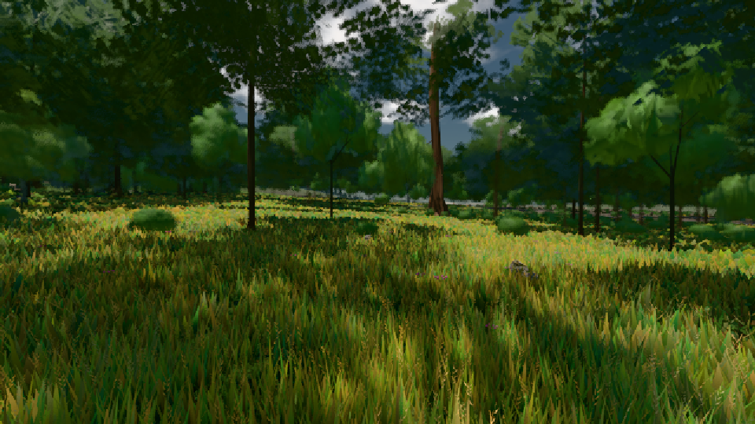

# GPU-PROBE 9a40fdb9 — GRÜN

Zweig `w22-geh-bild` · Kopf 9a40fdb9c358b6c56422784aa6fd3c442d4f8505 · Läufer omen-gtx1060 · 08.11. 01:34 · Wanduhr ab Push 193 s · Lauf https://github.com/MiguellD/AnazhRealm/actions/runs/42430093685

Ruf: `bild:wiese@0.5`

GPU NVIDIA GeForce GTX 1060 · node_modules bleiben (package-lock 4c7ceb0e)
Schloss /c/Users/micha/AppData/Local/Temp/claude/gpu-schloss hält „ci-runner 42430093685/1 probe“
- Hook 2026-11-08 01:32:59 start ci-runner 42430093685/1 probe: Schloss genommen (refs/heads/w22-geh-bild 9a40fdb9c358b6c56422784aa6fd3c442d4f8505 ws=C:\actions-runner\_work\AnazhRealm\AnazhRealm)

### bild:wiese@0.5 — GRÜN · 44 s

Adapter: [linse-gpu] nvidia/pascal

```text
Kamera des Spiels → Blick (10.0 m): -280.40 29.71 -1045.60 -289.61 29.71 -1049.50
 "abnahme": "ABNAHME GRÜN · beweis · Sicht 0.0 % · Ziel Blickziel im Bild frei 10 m · Luma 57.7 σ 33.8 schwarz 0.0 % weiß 0.0 % · Stand 18.546.213 · Bühne summer sunny 0.50 · Gerät WebGPU nvidia pascal",
```


