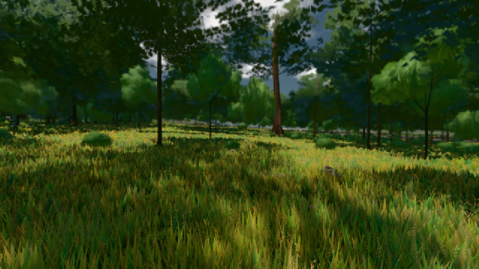

# GPU-PROBE af6f1703 — GRÜN

Zweig `w22-geh-bild` · Kopf af6f1703ed1760d91c17c24f0c5d41f0a15b687b · Läufer omen-gtx1060 · 08.11. 02:04 · Wanduhr ab Push 83 s · Lauf https://github.com/MiguellD/AnazhRealm/actions/runs/42432539892

Ruf: `bild:wiese@0.5`

GPU NVIDIA GeForce GTX 1060 · node_modules bleiben (package-lock ed18c269)
Schloss /c/Users/micha/AppData/Local/Temp/claude/gpu-schloss hält „ci-runner 42432539892/1 probe“
- Hook 2026-11-08 02:03:32 start ci-runner 42432539892/1 probe: Schloss genommen (refs/heads/w22-geh-bild af6f1703ed1760d91c17c24f0c5d41f0a15b687b ws=C:\actions-runner\_work\AnazhRealm\AnazhRealm)

### bild:wiese@0.5 — GRÜN · 43 s

Adapter: [linse-gpu] nvidia/pascal

```text
Kamera des Spiels → Blick (10.0 m): -280.40 29.71 -1045.60 -289.61 29.71 -1049.50
 "abnahme": "ABNAHME GRÜN · beweis · Sicht 0.0 % · Ziel Blickziel im Bild frei 10 m · Luma 57.7 σ 33.8 schwarz 0.0 % weiß 0.0 % · Stand 18.546.214 · Bühne summer sunny 0.50 · Gerät WebGPU nvidia pascal",
```


