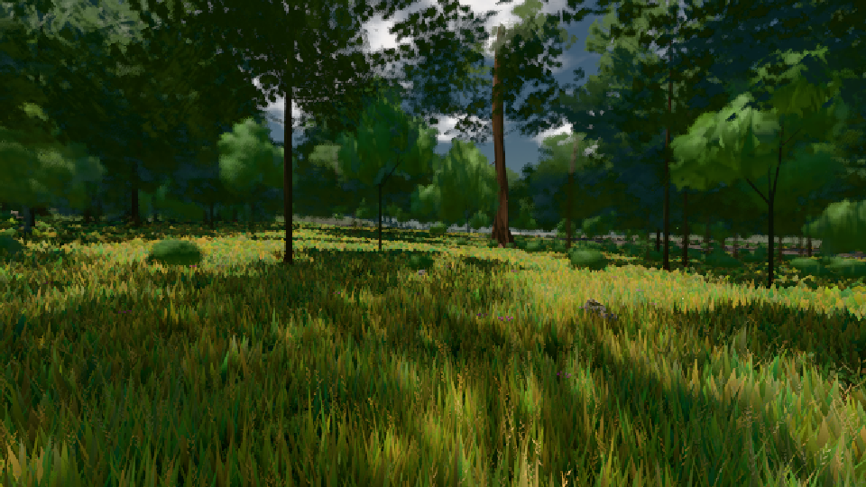

# GPU-PROBE cc607a5b — ROT

Zweig `w22-geh-bild` · Kopf cc607a5bf7615c01d17e00b0921029097f0b0c16 · Läufer radeon-890m · 08.11. 01:47 · Wanduhr ab Push 389 s · Lauf https://github.com/MiguellD/AnazhRealm/actions/runs/42430877144

Ruf: `gate:geh-zerlegung bild:wiese@0.5`

GPU AMD Radeon(TM) 890M Graphics · npm ci 31 s (package-lock 4c7ceb0e)
Schloss /c/Users/micha/AppData/Local/Temp/claude/gpu-schloss hält „ci-runner 42430877144/1 probe“
- Hook 2026-11-08 01:43:49 start ci-runner 42430877144/1 probe: Schloss genommen (refs/heads/w22-geh-bild cc607a5bf7615c01d17e00b0921029097f0b0c16 ws=C:\actions-runner\_work\AnazhRealm\AnazhRealm)

### gate:geh-zerlegung — ROT · 103 s

Adapter: [linse-gpu] amd/rdna-3

```text
GEH ROT leib.K1#1 Latenz p95 ms ego/gehen 53.6 (p50 33, fehlt 0) · ego/wechsel 34.5 (p50 20.4, fehlt 0) · third/gehen 72.7 (p50 33.7, fehlt 0) · third/wechsel 21.8 (p50 16.4, fehlt 0) · Bild 14.6 ms
GEH ROT leib.K1#1 Knoten-Bau: 43 Schlüssel · Σ 1894.7 ms in 755 Schritten · 0 vorher im Cache · 0 gelöscht · Arenen 16 · [Stoff|Glied alt/neu n|Pass|t ms Schritte max]: [["MSNM|tier:?|haupt|t19355",93.6,29,40],["MSNM|tier:?|haupt|t19355",82.3,26,33.3],["MSNM|tier:?|haupt|t19355",77.7,18,26.6],["MSNM|tier:?|haupt|t19355",77.1,21,26.7],["MeshPhysicalNodeMaterial|spieler|haupt|t8606",64.7,30,23.5],["MSNM|tier:?|haupt|t19332",64.1,8,23],["MSNM|spieler|haupt|t8603",62.9,15,26.3]]
GEH ROT wiese-ego Gang 1: Bild p50/95/99/max 25.2/41.9/50.1/58.6 · CPU 26.8/39.8/50/54.1 · GPU 2.1/10.1/10.4/10.4 · 207 Bilder · Weg 24 m · Phasen {"streaming":7.76,"waterIso":0,"archCulling":0.4,"creatures":1.14,"physics":0.28,"render":14.29,"gpuMs":5.82}
GEH ROT wiese-ego Gang 1 Knoten-Bau: 1 Schlüssel · Σ 65.2 ms in 8 Schritten · 0 vorher im Cache · 0 gelöscht · Arenen 16 · [Stoff|Glied alt/neu n|Pass|t ms Schritte max]: [["MSNM|streuSatz|haupt|t1203",65.2,8,25.8]]
GEH ROT wiese-ego Gang 2: Bild p50/95/99/max 25.1/41.8/42/50.2 · CPU 21.7/35.3/45.4/55.5 · GPU 4.8/10.9/12.8/12.8 · 256 Bilder · Weg 24 m · Phasen {"streaming":3.24,"waterIso":0,"archCulling":0.17,"creatures":1.18,"physics":0.25,"render":13.77,"gpuMs":1.67}
GEH ROT wiese-ego Gang 2 Knoten-Bau: 0 Schlüssel · Σ 0 ms in 0 Schritten · 0 vorher im Cache · 0 gelöscht · Arenen 12 · [Stoff|Glied alt/neu n|Pass|t ms Schritte max]: []
GEH ROT genesis-third Gang 1: Bild p50/95/99/max 25.1/33.6/58.5/67.2 · CPU 22.2/36.1/54.9/61.2 · GPU 1.8/9.3/9.5/9.5 · 250 Bilder · Weg 25 m · Phasen {"streaming":3.76,"waterIso":0,"archCulling":0.22,"creatures":0.78,"physics":0.3,"render":14.6,"gpuMs":5.85}
GEH ROT genesis-third Gang 1 Knoten-Bau: 10 Schlüssel · Σ 1.5 ms in 35 Schritten · 0 vorher im Cache · 0 gelöscht · Arenen 15 · [Stoff|Glied alt/neu n|Pass|t ms Schritte max]: [["ShadowMaterial|bauWurf|Point Light Shadow [ licht:wurf ] - Face 1|t2885",0.4,2,0.4],["ShadowMaterial|arena f:tanne:L1 alt n14|Point Light Shadow [ licht:wurf ] - Face",0.3,3,0.3],["ShadowMaterial|tier:?|Point Light Shadow [ licht:wurf ] - Face 1|t2886",0.3,6,0.3],["ShadowMaterial|arena f:sitzbank:L0 alt n2|Point Light Shadow [ licht:wurf ] - Fa",0.2,2,0.2],["ShadowMaterial|bauSatz|Point Light Shadow [ licht:
```

### bild:wiese@0.5 — GRÜN · 49 s

Adapter: [linse-gpu] amd/rdna-3

```text
Kamera des Spiels → Blick (10.0 m): -280.40 29.71 -1045.60 -289.61 29.71 -1049.50
 "abnahme": "ABNAHME GRÜN · beweis · Sicht 0.0 % · Ziel Blickziel im Bild frei 10 m · Luma 57.8 σ 34.1 schwarz 0.0 % weiß 0.0 % · Stand 18.546.213 · Bühne summer sunny 0.50 · Gerät WebGPU amd rdna-3",
```


