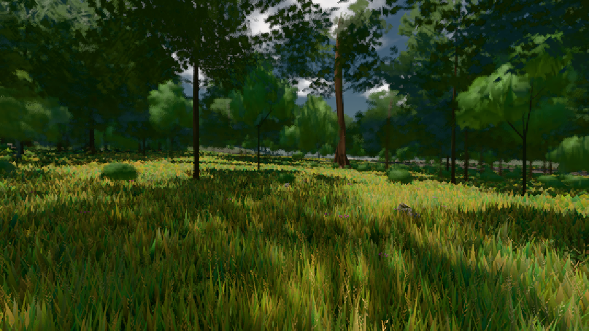

# GPU-PROBE eac0940f — ROT

Zweig `w22-geh-bild` · Kopf eac0940f4bde1c4ee29438d58e6aebc5b9c39d8b · Läufer omen-gtx1060 · 08.11. 01:55 · Wanduhr ab Push 404 s · Lauf https://github.com/MiguellD/AnazhRealm/actions/runs/42431429455

Ruf: `gate:geh-zerlegung bild:wiese@0.5`

GPU NVIDIA GeForce GTX 1060 · node_modules bleiben (package-lock 4c7ceb0e)
Schloss /c/Users/micha/AppData/Local/Temp/claude/gpu-schloss hält „ci-runner 42431429455/1 probe“
- Hook 2026-11-08 01:52:02 start ci-runner 42431429455/1 probe: Schloss genommen (refs/heads/w22-geh-bild eac0940f4bde1c4ee29438d58e6aebc5b9c39d8b ws=C:\actions-runner\_work\AnazhRealm\AnazhRealm)

### gate:geh-zerlegung — ROT · 116 s

Adapter: [linse-gpu] nvidia/pascal

```text
GEH ROT leib.K1#1 Latenz p95 ms ego/gehen 53.9 (p50 45.2, fehlt 0) · ego/wechsel 34.1 (p50 27, fehlt 0) · third/gehen 61.4 (p50 33.2, fehlt 0) · third/wechsel 43.1 (p50 23.3, fehlt 0) · Bild 14.6 ms
GEH ROT leib.K1#1 Knoten-Bau: 42 Schlüssel · Σ 2901.9 ms in 790 Schritten · 0 vorher im Cache · 0 gelöscht · Arenen 16 · [Stoff|Glied alt/neu n|Pass|t ms Schritte max]: [["MSNM|tier:?|haupt|t22255",111.2,31,45.5],["MeshPhysicalNodeMaterial|spieler|haupt|t9248",109,11,39.6],["MeshPhysicalNodeMaterial|spieler|haupt|t9255",108.7,28,42.4],["MSNM|arena fscatter:geroell:L0 neu n1|haupt|t9341",108.1,18,44.1],["MSNM|tier:?|haupt|t22218",104,9,45.9],["MSNM|spieler|haupt|t9248",102.4,14,51.3],["MSNM|tier:?|haupt|t22254",99.6,21,38.6]]
GEH ROT wiese-ego Gang 1: Bild p50/95/99/max 33.4/58.4/74.9/75 · CPU 35.3/58/66.6/74.8 · GPU 0.8/3.5/3.9/3.9 · 155 Bilder · Weg 25 m · Phasen {"streaming":14.29,"waterIso":0.04,"archCulling":0.88,"creatures":1.36,"physics":0.44,"render":19.36,"gpuMs":0.79}
GEH ROT wiese-ego Gang 1 Knoten-Bau: 1 Schlüssel · Σ 82.3 ms in 8 Schritten · 0 vorher im Cache · 0 gelöscht · Arenen 16 · [Stoff|Glied alt/neu n|Pass|t ms Schritte max]: [["MSNM|streuSatz|haupt|t1352",82.3,8,33]]
GEH ROT wiese-ego Gang 2: Bild p50/95/99/max 25/41.7/50/58.3 · CPU 25.3/41.7/44.9/50.2 · GPU 0.8/3.6/3.9/3.9 · 215 Bilder · Weg 25 m · Phasen {"streaming":5.27,"waterIso":0,"archCulling":0.19,"creatures":1.34,"physics":0.35,"render":17.53,"gpuMs":2.45}
GEH ROT wiese-ego Gang 2 Knoten-Bau: 0 Schlüssel · Σ 0 ms in 0 Schritten · 0 vorher im Cache · 0 gelöscht · Arenen 12 · [Stoff|Glied alt/neu n|Pass|t ms Schritte max]: []
GEH ROT genesis-third Gang 1: Bild p50/95/99/max 25.1/50/58.4/66.7 · CPU 28/43.5/56/57.3 · GPU 3.3/4.5/4.6/4.6 · 198 Bilder · Weg 25 m · Phasen {"streaming":4.8,"waterIso":0,"archCulling":0.28,"creatures":0.99,"physics":0.53,"render":15.78,"gpuMs":2.58}
GEH ROT genesis-third Gang 1 Knoten-Bau: 10 Schlüssel · Σ 0.6 ms in 35 Schritten · 0 vorher im Cache · 0 gelöscht · Arenen 15 · [Stoff|Glied alt/neu n|Pass|t ms Schritte max]: [["ShadowMaterial|bauWurf|Point Light Shadow [ licht:wurf ] - Face 1|t3034",0.2,2,0.2],["ShadowMaterial|bauSatz|Point Light Shadow [ licht:wurf ] - Face 1|t3035",0.1,6,0.1],["ShadowMaterial|arena f:fichte:L1 alt n14|Point Light Shadow [ licht:wurf ] - Fac",0.1,3,0.1],["ShadowMaterial|tier:?|Point Light Shadow [ licht:wurf ] - Face 1|t3035",0.1,6,0.1],["ShadowMaterial|bodenSatz|Point Light Shadow [ licht:wurf ] 
```

### bild:wiese@0.5 — GRÜN · 45 s

Adapter: [linse-gpu] nvidia/pascal

```text
Kamera des Spiels → Blick (10.0 m): -280.40 29.71 -1045.60 -289.61 29.71 -1049.50
 "abnahme": "ABNAHME GRÜN · beweis · Sicht 0.0 % · Ziel Blickziel im Bild frei 10 m · Luma 57.6 σ 33.8 schwarz 0.0 % weiß 0.0 % · Stand 18.546.213 · Bühne summer sunny 0.50 · Gerät WebGPU nvidia pascal",
```


