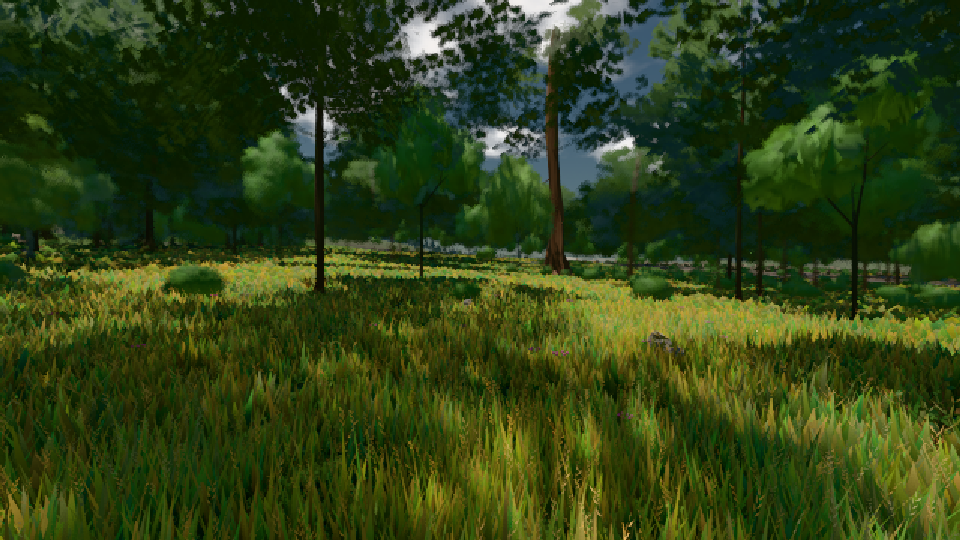

# GPU-PROBE 15d70fc6 — GRÜN

Zweig `w22-wald-geburt` · Kopf 15d70fc6ef570c8e42e1043e7dfdf0b149031cf2 · Läufer radeon-890m · 08.11. 01:43 · Wanduhr ab Push 376 s · Lauf https://github.com/MiguellD/AnazhRealm/actions/runs/42430594512

Ruf: `gate:pop bild:wiese`

GPU AMD Radeon(TM) 890M Graphics · node_modules bleiben (package-lock ed18c269)
Schloss /c/Users/micha/AppData/Local/Temp/claude/gpu-schloss hält „ci-runner 42430594512/1 probe“
- Hook 2026-11-08 01:41:11 start ci-runner 42430594512/1 probe: Schloss genommen (refs/heads/w22-wald-geburt 15d70fc6ef570c8e42e1043e7dfdf0b149031cf2 ws=C:\actions-runner\_work\AnazhRealm\AnazhRealm)

### gate:pop — GRÜN · 60 s

Adapter: [linse-gpu] amd/rdna-3

```text
lod.K2#1 GRÜN 0.0287 % Pop-Pixel/s (595 px) · 11*+3@189/20*+1@187/30*+3@154/353+4@185/33*+1@198/47*+4@186/51+4@155/50*+5@189 · Laub 216 · dc, Dreiecke, ms je Bild 32,351413,662
```

### bild:wiese — GRÜN · 50 s

Adapter: [linse-gpu] amd/rdna-3

```text
Kamera des Spiels → Blick (10.0 m): -280.40 29.71 -1045.60 -289.61 29.71 -1049.50
 "abnahme": "ABNAHME GRÜN · beweis · Sicht 0.0 % · Ziel Blickziel im Bild frei 10 m · Luma 57.8 σ 34.1 schwarz 0.0 % weiß 0.0 % · Stand 18.546.214 · Bühne summer sunny 0.50 · Gerät WebGPU amd rdna-3",
```


