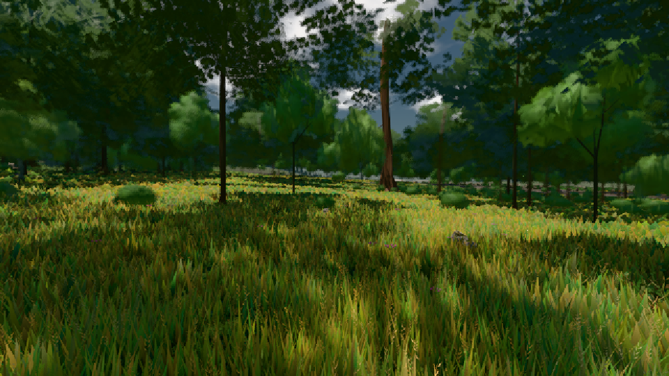

# GPU-PROBE 279f55de — GRÜN

Zweig `w22-wald-geburt` · Kopf 279f55deec46bf002691823d8f465e11e484b2c6 · Läufer radeon-890m · 08.11. 01:12 · Wanduhr ab Push 627 s · Lauf https://github.com/MiguellD/AnazhRealm/actions/runs/42427932070

Ruf: `gate:pop bild:wiese`

GPU AMD Radeon(TM) 890M Graphics · npm ci 71 s (package-lock ed18c269)
Schloss /c/Users/micha/AppData/Local/Temp/claude/gpu-schloss hält „ci-runner 42427932070/1 probe“
- Hook 2026-11-08 01:04:35 start ci-runner 42427932070/1 probe: Schloss genommen (refs/heads/w22-wald-geburt 279f55deec46bf002691823d8f465e11e484b2c6 ws=C:\actions-runner\_work\AnazhRealm\AnazhRealm)

### gate:pop — GRÜN · 72 s

Adapter: [linse-gpu] amd/rdna-3

```text
lod.K2#1 GRÜN 0.0452 % Pop-Pixel/s (937 px) · 22*/15*/210*+1@154/135/77*/65*/327*+17@155/86* · Laub 216,216,216,216,216,216,216,216
```

### bild:wiese — GRÜN · 57 s

Adapter: [linse-gpu] amd/rdna-3

```text
Kamera des Spiels → Blick (10.0 m): -280.40 29.71 -1045.60 -289.61 29.71 -1049.50
 "abnahme": "ABNAHME GRÜN · beweis · Sicht 0.0 % · Ziel Blickziel im Bild frei 10 m · Luma 57.8 σ 34.1 schwarz 0.0 % weiß 0.0 % · Stand 18.546.214 · Bühne summer sunny 0.50 · Gerät WebGPU amd rdna-3",
```


