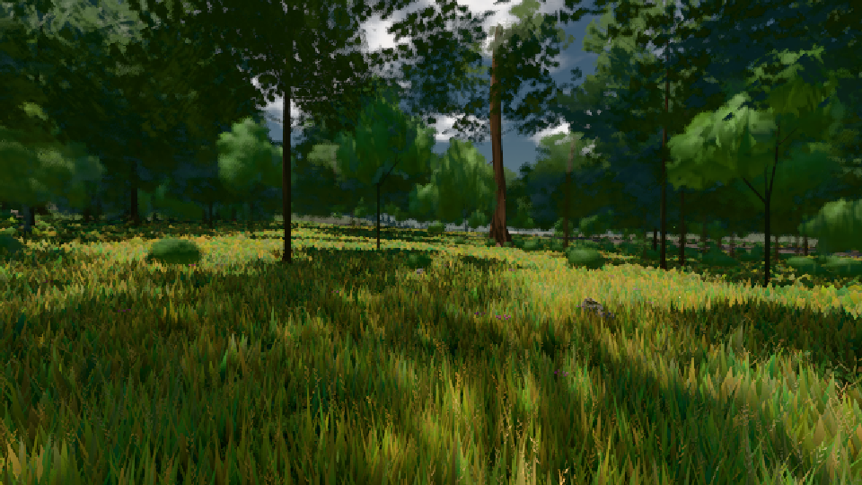

# GPU-PROBE 438ddf4b — GRÜN

Zweig `w22-wald-geburt` · Kopf 438ddf4b2a4dcb62ff1ed9e71d03481f87e02277 · Läufer radeon-890m · 08.11. 01:50 · Wanduhr ab Push 312 s · Lauf https://github.com/MiguellD/AnazhRealm/actions/runs/42431220765

Ruf: `gate:pop bild:wiese`

GPU AMD Radeon(TM) 890M Graphics · npm ci 33 s (package-lock ed18c269)
Schloss /c/Users/micha/AppData/Local/Temp/claude/gpu-schloss hält „ci-runner 42431220765/1 probe“
- Hook 2026-11-08 01:47:36 start ci-runner 42431220765/1 probe: Schloss genommen (refs/heads/w22-wald-geburt 438ddf4b2a4dcb62ff1ed9e71d03481f87e02277 ws=C:\actions-runner\_work\AnazhRealm\AnazhRealm)

### gate:pop — GRÜN · 67 s

Adapter: ungenannt (die Probe nannte keinen Browser-Adapter)

```text
lod.K2#1 GRÜN 0.0288 % Pop-Pixel/s (597 px) · 10*+3@189/19*+1@187/210*+3@154/146+4@185/38*+1@198/52*+4@186/61*+4@155/61*+5@189 · Laub 216 · dc, Dreiecke 32,351509 · GPU 25.88 ms, CPU 2.3 ms je Bild
```

### bild:wiese — GRÜN · 48 s

Adapter: [linse-gpu] amd/rdna-3

```text
Kamera des Spiels → Blick (10.0 m): -280.40 29.71 -1045.60 -289.61 29.71 -1049.50
 "abnahme": "ABNAHME GRÜN · beweis · Sicht 0.0 % · Ziel Blickziel im Bild frei 10 m · Luma 57.8 σ 34.1 schwarz 0.0 % weiß 0.0 % · Stand 18.546.214 · Bühne summer sunny 0.50 · Gerät WebGPU amd rdna-3",
```


