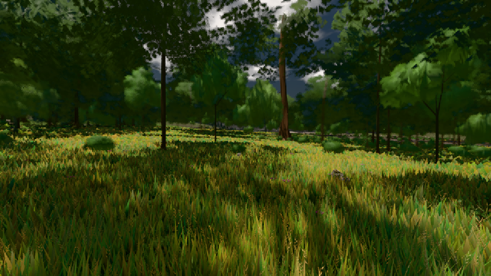

# GPU-PROBE 480dc24a — GRÜN

Zweig `w22-wald-geburt` · Kopf 480dc24a5ad9cd34ea03b591f4a0e7fb139a9986 · Läufer radeon-890m · 08.11. 02:10 · Wanduhr ab Push 349 s · Lauf https://github.com/MiguellD/AnazhRealm/actions/runs/42432626306

Ruf: `gate:pop bild:wiese`

GPU AMD Radeon(TM) 890M Graphics · node_modules bleiben (package-lock ed18c269)
Schloss /c/Users/micha/AppData/Local/Temp/claude/gpu-schloss hält „ci-runner 42432626306/1 probe“
- Hook 2026-11-08 02:04:41 start ci-runner 42432626306/1 probe: wartet auf Schloss von 'punkte-radeon-sitzungpid=46700'
- Hook 2026-11-08 02:07:39 start ci-runner 42432626306/1 probe: Schloss genommen (refs/heads/w22-wald-geburt 480dc24a5ad9cd34ea03b591f4a0e7fb139a9986 ws=C:\actions-runner\_work\AnazhRealm\AnazhRealm)

### gate:pop — GRÜN · 63 s

Adapter: ungenannt (die Probe nannte keinen Browser-Adapter)

```text
lod.K2#1 GRÜN 0.0363 % Pop-Pixel/s (753 px) · 13*+3@189/21*+1@187/219*+3@154/333+4@185/48*+1@198/38*+4@186/34*+4@155/47*+5@189 · Laub 216 · dc, Dreiecke 32,351541 · GPU 26.97 ms, CPU 4.32 ms je Bild
```

### bild:wiese — GRÜN · 39 s

Adapter: [linse-gpu] amd/rdna-3

```text
Kamera des Spiels → Blick (10.0 m): -280.40 29.71 -1045.60 -289.61 29.71 -1049.50
 "abnahme": "ABNAHME GRÜN · beweis · Sicht 0.0 % · Ziel Blickziel im Bild frei 10 m · Luma 54.3 σ 34.2 schwarz 0.0 % weiß 0.0 % · Stand 18.546.214 · Bühne summer sunny 0.50 · Gerät WebGPU amd rdna-3",
```


