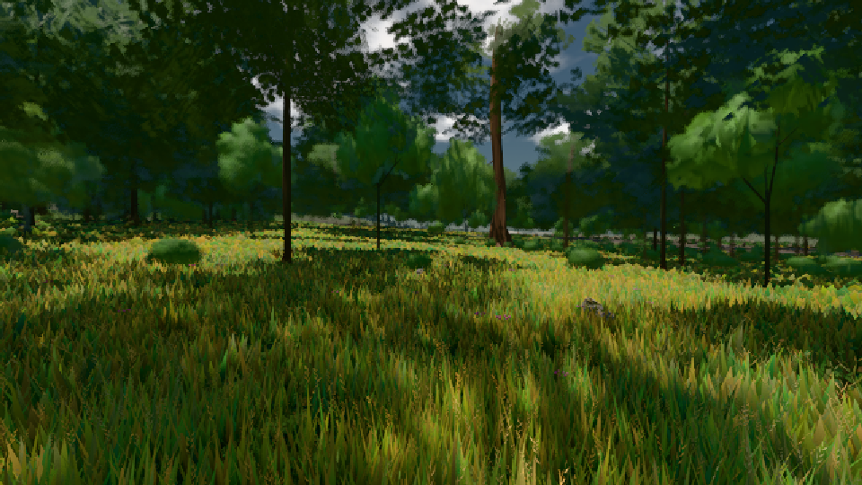

# GPU-PROBE 6ee4408f — GRÜN

Zweig `w22-wald-geburt` · Kopf 6ee4408f03b3d02bd742a54633c06c0f5aa76a94 · Läufer omen-gtx1060 · 08.11. 01:08 · Wanduhr ab Push 319 s · Lauf https://github.com/MiguellD/AnazhRealm/actions/runs/42427947838

Ruf: `gate:pop bild:wiese`

GPU NVIDIA GeForce GTX 1060 · node_modules bleiben (package-lock ed18c269)
Schloss /c/Users/micha/AppData/Local/Temp/claude/gpu-schloss hält „ci-runner 42427947838/1 probe“
- Hook 2026-11-08 01:05:49 start ci-runner 42427947838/1 probe: Schloss genommen (refs/heads/w22-wald-geburt 6ee4408f03b3d02bd742a54633c06c0f5aa76a94 ws=C:\actions-runner\_work\AnazhRealm\AnazhRealm)

### gate:pop — GRÜN · 66 s

Adapter: [linse-gpu] nvidia/pascal

```text
lod.K2#1 ROT 0.0673 % Pop-Pixel/s (1396 px) · 480*+21@186/20*+7@195/44*+2@154/219+2@193/169*/61*+2@190/336*+8@155/67* · Laub 216,216,216,216,216,216,216,216
```

### bild:wiese — GRÜN · 45 s

Adapter: [linse-gpu] nvidia/pascal

```text
Kamera des Spiels → Blick (10.0 m): -280.40 29.71 -1045.60 -289.61 29.71 -1049.50
 "abnahme": "ABNAHME GRÜN · beweis · Sicht 0.0 % · Ziel Blickziel im Bild frei 10 m · Luma 57.7 σ 33.8 schwarz 0.0 % weiß 0.0 % · Stand 18.546.214 · Bühne summer sunny 0.50 · Gerät WebGPU nvidia pascal",
```


