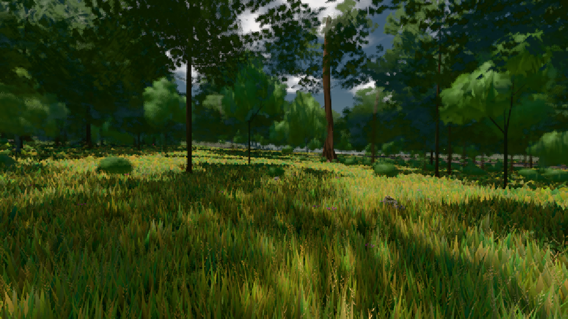

# GPU-PROBE 7a0349b0 — GRÜN

Zweig `w22-wald-geburt` · Kopf 7a0349b048e39e79126f463d1c73d092bfbfaaa6 · Läufer radeon-890m · 08.11. 02:03 · Wanduhr ab Push 257 s · Lauf https://github.com/MiguellD/AnazhRealm/actions/runs/42432234091

Ruf: `gate:pop bild:wiese`

GPU AMD Radeon(TM) 890M Graphics · npm ci 36 s (package-lock ed18c269)
Schloss /c/Users/micha/AppData/Local/Temp/claude/gpu-schloss hält „ci-runner 42432234091/1 probe“
- Hook 2026-11-08 01:59:37 start ci-runner 42432234091/1 probe: wartet auf Schloss von 'punkte-radeon-sitzungpid=43080'
- Hook 2026-11-08 02:00:31 start ci-runner 42432234091/1 probe: Schloss genommen (refs/heads/w22-wald-geburt 7a0349b048e39e79126f463d1c73d092bfbfaaa6 ws=C:\actions-runner\_work\AnazhRealm\AnazhRealm)

### gate:pop — GRÜN · 63 s

Adapter: ungenannt (die Probe nannte keinen Browser-Adapter)

```text
lod.K2#1 GRÜN 0.0393 % Pop-Pixel/s (815 px) · 10*/12*/26*+1@154/226/156*/45*/48*+1@155/292*+16@197 · Laub 216 · dc, Dreiecke 32,351373 · GPU 21.77 ms, CPU 5.23 ms je Bild
```

### bild:wiese — GRÜN · 45 s

Adapter: [linse-gpu] amd/rdna-3

```text
Kamera des Spiels → Blick (10.0 m): -280.40 29.71 -1045.60 -289.61 29.71 -1049.50
 "abnahme": "ABNAHME GRÜN · beweis · Sicht 0.0 % · Ziel Blickziel im Bild frei 10 m · Luma 57.8 σ 34.1 schwarz 0.0 % weiß 0.0 % · Stand 18.546.214 · Bühne summer sunny 0.50 · Gerät WebGPU amd rdna-3",
```


