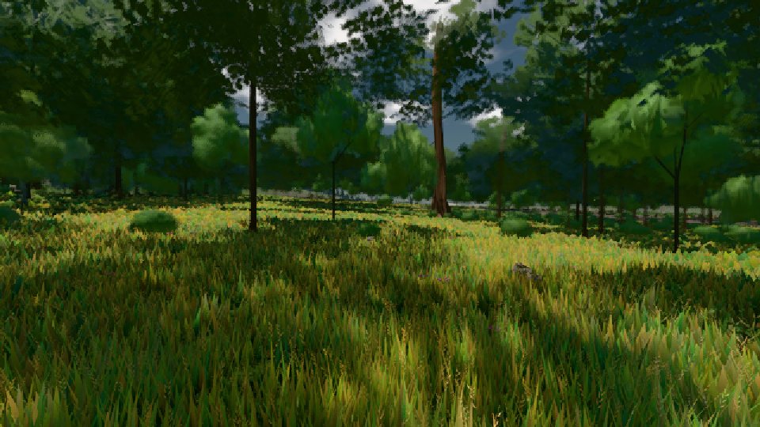

# GPU-PROBE 8774f57e — GRÜN

Zweig `w22-wald-geburt` · Kopf 8774f57ec1edfb7617721b49e300b3f25a77ae85 · Läufer omen-gtx1060 · 08.11. 02:15 · Wanduhr ab Push 239 s · Lauf https://github.com/MiguellD/AnazhRealm/actions/runs/42433177165

Ruf: `gate:pop bild:wiese`

GPU NVIDIA GeForce GTX 1060 · node_modules bleiben (package-lock ed18c269)
Schloss /c/Users/micha/AppData/Local/Temp/claude/gpu-schloss hält „ci-runner 42433177165/1 probe“
- Hook 2026-11-08 02:11:56 start ci-runner 42433177165/1 probe: Schloss genommen (refs/heads/w22-wald-geburt 8774f57ec1edfb7617721b49e300b3f25a77ae85 ws=C:\actions-runner\_work\AnazhRealm\AnazhRealm)

### gate:pop — GRÜN · 68 s

Adapter: ungenannt (die Probe nannte keinen Browser-Adapter)

```text
lod.K2#1 GRÜN 0.0319 % Pop-Pixel/s (661 px) · 23*+3@189/22*+1@187/194*+3@154/155*+4@185/35*+1@198/57*+5@155/99*+5@190/76*+3@189 · Laub 216 · dc, Dreiecke 32,351853 · GPU 32.82 ms, CPU 3.98 ms je Bild
```

### bild:wiese — GRÜN · 43 s

Adapter: [linse-gpu] nvidia/pascal

```text
Kamera des Spiels → Blick (10.0 m): -280.40 29.71 -1045.60 -289.61 29.71 -1049.50
 "abnahme": "ABNAHME GRÜN · beweis · Sicht 0.0 % · Ziel Blickziel im Bild frei 10 m · Luma 57.7 σ 33.8 schwarz 0.0 % weiß 0.0 % · Stand 18.546.214 · Bühne summer sunny 0.50 · Gerät WebGPU nvidia pascal",
```


