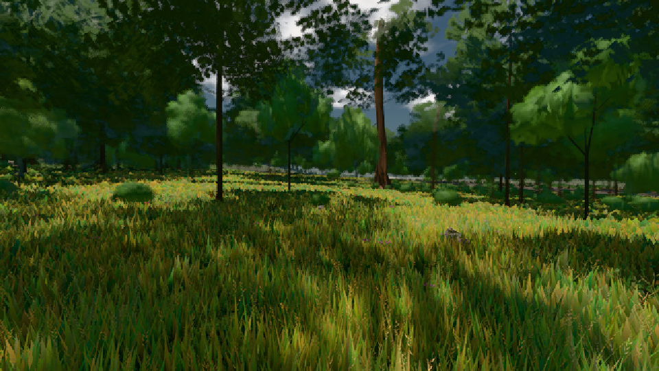

# GPU-PROBE a0201255 — GRÜN

Zweig `w22-wald-geburt` · Kopf a020125528218f1bbf364bf5de8cf1a710dc30be · Läufer radeon-890m · 08.11. 01:41 · Wanduhr ab Push 217 s · Lauf https://github.com/MiguellD/AnazhRealm/actions/runs/42430597226

Ruf: `gate:pop bild:wiese`

GPU AMD Radeon(TM) 890M Graphics · npm ci 33 s (package-lock ed18c269)
Schloss /c/Users/micha/AppData/Local/Temp/claude/gpu-schloss hält „ci-runner 42430597226/1 probe“
- Hook 2026-11-08 01:37:52 start ci-runner 42430597226/1 probe: wartet auf Schloss von 'punkte-radeon-sitzungpid=11448'
- Hook 2026-11-08 01:38:08 start ci-runner 42430597226/1 probe: Schloss genommen (refs/heads/w22-wald-geburt a020125528218f1bbf364bf5de8cf1a710dc30be ws=C:\actions-runner\_work\AnazhRealm\AnazhRealm)

### gate:pop — GRÜN · 58 s

Adapter: [linse-gpu] amd/rdna-3

```text
lod.K2#1 GRÜN 0.0407 % Pop-Pixel/s (844 px) · 11*/14*/13*+1@154/29/232*/170*/65*+1@155/310*+16@197 · Laub 216 · dc, Dreiecke, ms je Bild 32,351453,611
```

### bild:wiese — GRÜN · 48 s

Adapter: [linse-gpu] amd/rdna-3

```text
Kamera des Spiels → Blick (10.0 m): -280.40 29.71 -1045.60 -289.61 29.71 -1049.50
 "abnahme": "ABNAHME GRÜN · beweis · Sicht 0.0 % · Ziel Blickziel im Bild frei 10 m · Luma 57.8 σ 34.1 schwarz 0.0 % weiß 0.0 % · Stand 18.546.214 · Bühne summer sunny 0.50 · Gerät WebGPU amd rdna-3",
```


