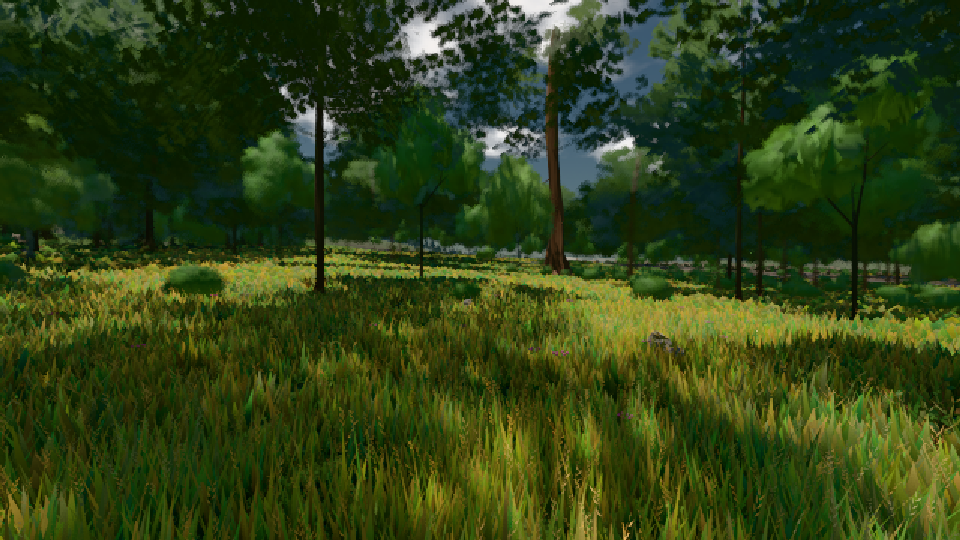

# GPU-PROBE aec208de — GRÜN

Zweig `w22-wald-geburt` · Kopf aec208de225ef5553cf5184ecc9070cddbea9a78 · Läufer radeon-890m · 08.11. 01:23 · Wanduhr ab Push 466 s · Lauf https://github.com/MiguellD/AnazhRealm/actions/runs/42428956951

Ruf: `gate:pop bild:wiese`

GPU AMD Radeon(TM) 890M Graphics · node_modules bleiben (package-lock ed18c269)
Schloss /c/Users/micha/AppData/Local/Temp/claude/gpu-schloss hält „ci-runner 42428956951/1 probe“
- Hook 2026-11-08 01:20:55 start ci-runner 42428956951/1 probe: Schloss genommen (refs/heads/w22-wald-geburt aec208de225ef5553cf5184ecc9070cddbea9a78 ws=C:\actions-runner\_work\AnazhRealm\AnazhRealm)

### gate:pop — GRÜN · 70 s

Adapter: [linse-gpu] amd/rdna-3

```text
lod.K2#1 ROT 0.0663 % Pop-Pixel/s (1374 px) · 35*+3@189/20*+1@187/218*+3@154/157+4@185/63*+1@198/120*+4@186/666*+4@155/95*+5@189 · Laub 216,216,216,216,216,216,216,216
```

### bild:wiese — GRÜN · 44 s

Adapter: [linse-gpu] amd/rdna-3

```text
Kamera des Spiels → Blick (10.0 m): -280.40 29.71 -1045.60 -289.61 29.71 -1049.50
 "abnahme": "ABNAHME GRÜN · beweis · Sicht 0.0 % · Ziel Blickziel im Bild frei 10 m · Luma 57.8 σ 34.1 schwarz 0.0 % weiß 0.0 % · Stand 18.546.214 · Bühne summer sunny 0.50 · Gerät WebGPU amd rdna-3",
```


