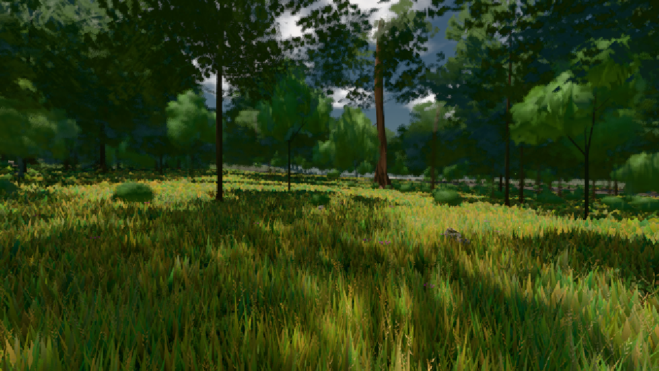

# GPU-PROBE d3ac18c2 — ROT

Zweig `w22-wald-geburt` · Kopf d3ac18c2f17976112634b8e780cf2dda9fd7592a · Läufer radeon-890m · 08.11. 08:37 · Wanduhr ab Push 240 s · Lauf https://github.com/MiguellD/AnazhRealm/actions/runs/42459306489

Ruf: `gate:pop gate:kamera-leib:echt bild:wiese`

GPU AMD Radeon(TM) 890M Graphics · npm ci 54 s (package-lock 69f9d79b)
Schloss /c/Users/micha/AppData/Local/Temp/claude/gpu-schloss hält „ci-runner 42459306489/1 probe“
- Hook 2026-11-08 08:34:05 start ci-runner 42459306489/1 probe: Schloss genommen (refs/heads/w22-wald-geburt d3ac18c2f17976112634b8e780cf2dda9fd7592a ws=C:\actions-runner\_work\AnazhRealm\AnazhRealm)

### gate:pop — GRÜN · 50 s

Adapter: ungenannt (die Probe nannte keinen Browser-Adapter)

```text
lod.K2#1 GRÜN 0.025 % Pop-Pixel/s (519 px) · 12*+1@189/18*/300*+2@154/16/29*/24*+2@192/60*+3@155/60*+1@189 · Laub 216 · dc, Dreiecke 32,351741 · GPU 19.77 ms, CPU 1.9 ms je Bild
```

### gate:kamera-leib:echt — ROT · 44 s

Adapter: [linse-gpu] amd/rdna-3

```text
  ❌ K6 Strafe am Prüfplatz — A0 Kopf 2.0 % Leib 0.8 % (3135 px),A1 Kopf 0.0 % Leib 1.5 % (3218 px),A2 Kopf 0.0 % Leib 0.3 % (3252 px),A3 Kopf 0.0 % Leib 1.0 % (3256 px),D0 Kopf 1.3 % Leib 0.6 % (3111 px),D1 Kopf 2.1 % Leib 1.6 % (3267 px),D2 Kopf 2.0 % Leib 0.6 % (3293 px),D3 Kopf 0.7 % Leib 1.2 % (3334 px) — Strafe: der Rückstrahl springt 1.0 % je Bild, das Raster 6.5 %
❌ ROT — 1 Verletzung(en): K6 Strafe am Prüfplatz — A0 Kopf 2.0 % Leib 0.8 % (3135 px),A1 Kopf 0.0 % Leib 1.5 % (3218 px),A2 Kopf 0.0 % Leib 0.3 % (3252 px),A3 Kopf 0.0 % Leib 1.0 % (3256 px),D0 Kopf 1.3 % Leib 0.6 % (3111 px),D1 Kopf 2.1 % Leib 1.6 % (3267 px),D2 Kopf 2.0 % Leib 0.6 % (3293 px),D3 Kopf 0.7 % Leib 1.2 % (3334 px)
```

### bild:wiese — GRÜN · 33 s

Adapter: [linse-gpu] amd/rdna-3

```text
Kamera des Spiels → Blick (10.0 m): -280.40 29.71 -1045.60 -289.61 29.71 -1049.50
 "abnahme": "ABNAHME GRÜN · beweis · Sicht 0.0 % · Ziel Blickziel im Bild frei 10 m · Luma 57.8 σ 34.1 schwarz 0.0 % weiß 0.0 % · Stand 18.546.217 · Bühne summer sunny 0.50 · Gerät WebGPU amd rdna-3",
```


