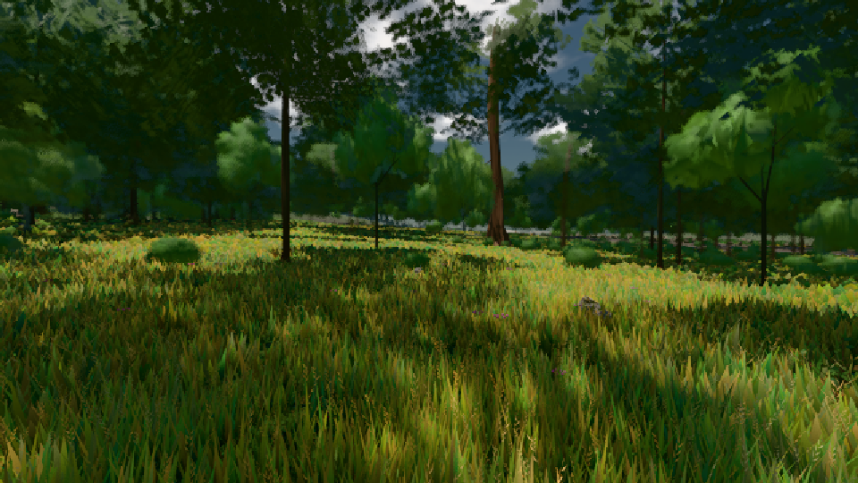

# GPU-PROBE ef7a7cce — GRÜN

Zweig `w22-wald-geburt` · Kopf ef7a7cce569f10aaa7ad33fb6ffb6423f1930c1d · Läufer omen-gtx1060 · 08.11. 02:07 · Wanduhr ab Push 158 s · Lauf https://github.com/MiguellD/AnazhRealm/actions/runs/42432637831

Ruf: `gate:pop bild:wiese`

GPU NVIDIA GeForce GTX 1060 · node_modules bleiben (package-lock ed18c269)
Schloss /c/Users/micha/AppData/Local/Temp/claude/gpu-schloss hält „ci-runner 42432637831/1 probe“
- Hook 2026-11-08 02:04:46 start ci-runner 42432637831/1 probe: Schloss genommen (refs/heads/w22-wald-geburt ef7a7cce569f10aaa7ad33fb6ffb6423f1930c1d ws=C:\actions-runner\_work\AnazhRealm\AnazhRealm)

### gate:pop — GRÜN · 71 s

Adapter: ungenannt (die Probe nannte keinen Browser-Adapter)

```text
lod.K2#1 ROT 0.0616 % Pop-Pixel/s (1278 px) · 18*/27*/306*+1@154/41*/36*/65*+1@155/707+16@197/78* · Laub 216 · dc, Dreiecke 32,351861 · GPU 32.72 ms, CPU 4.02 ms je Bild
```

### bild:wiese — GRÜN · 50 s

Adapter: [linse-gpu] nvidia/pascal

```text
Kamera des Spiels → Blick (10.0 m): -280.40 29.71 -1045.60 -289.61 29.71 -1049.50
 "abnahme": "ABNAHME GRÜN · beweis · Sicht 0.0 % · Ziel Blickziel im Bild frei 10 m · Luma 57.7 σ 33.8 schwarz 0.0 % weiß 0.0 % · Stand 18.546.214 · Bühne summer sunny 0.50 · Gerät WebGPU nvidia pascal",
```


