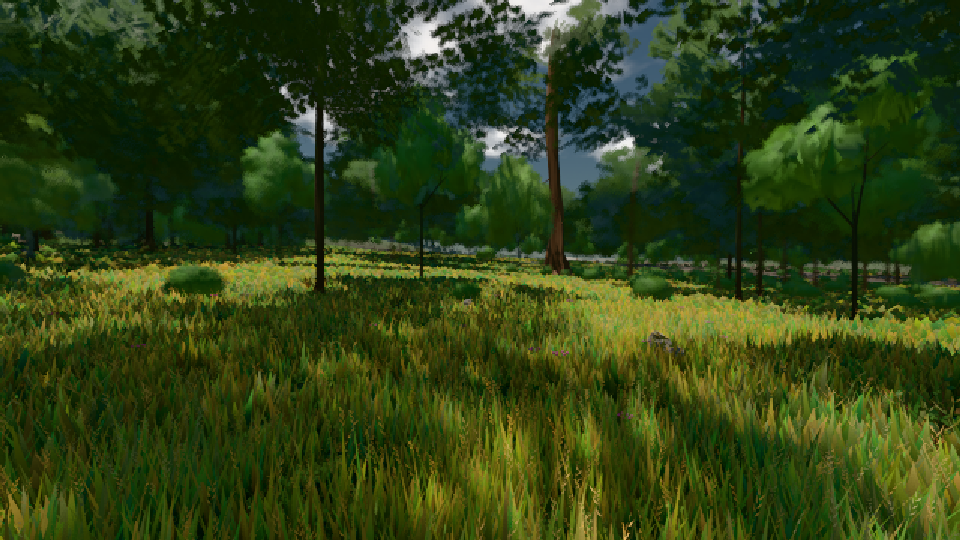

# GPU-PROBE 7e5539db — GRÜN

Zweig `w22-wasser-fix` · Kopf 7e5539db3e37be12bb29a587bd5adafb51d3e5b9 · Läufer omen-gtx1060 · 08.11. 01:14 · Wanduhr ab Push 406 s · Lauf https://github.com/MiguellD/AnazhRealm/actions/runs/42428363006

Ruf: `gate:fenster-wechsel gate:ziel-zensus bild:wiese@0.5`

GPU NVIDIA GeForce GTX 1060 · node_modules bleiben (package-lock ed18c269)
Schloss /c/Users/micha/AppData/Local/Temp/claude/gpu-schloss hält „ci-runner 42428363006/1 probe“
- Hook 2026-11-08 01:11:32 start ci-runner 42428363006/1 probe: Schloss genommen (refs/heads/w22-wasser-fix 7e5539db3e37be12bb29a587bd5adafb51d3e5b9 ws=C:\actions-runner\_work\AnazhRealm\AnazhRealm)

### gate:fenster-wechsel — GRÜN · 30 s

Adapter: [linse-gpu] nvidia/pascal

```text
  ✅ K der resize-Handler baut keinen Leser der Szenen-Tiefe neu (die Diät trägt jeden Größenwechsel)
  ✅ E1 keine WebGPU-Validierung (704×396 DPR 1, laufender Loop)
  ✅ E2 keine WebGPU-Validierung (704×396 DPR 2, laufender Loop)
  ✅ E3 keine WebGPU-Validierung (640×360 DPR 1, laufender Loop)
  ✅ E4a keine WebGPU-Validierung (setPixelRatio(1.25), laufender Loop)
  ✅ E4b keine WebGPU-Validierung (setPixelRatio(1), laufender Loop)
  ✅ E5 nicht vakuös: das Wasser zeichnet, das Abbild wurde je Größe neu angelegt, die Pixel-Ratio folgte DPR und Kappe — Wasser 2 (Fern-Wasser 279 Quads), Abbild-Stände 5, Pixel-Ratio E2 1.25 · E3 1 · E4 1.25/1, Frames 6/7/6/7/6
  ✅ ES Selbsttest: ohne den Wächter fällt „Destroyed texture …“ an einem Größen-Ziel beim Pixel-Ratio-Schritt — 1× Destroyed texture [Texture "kontakt:verdeckung"] used in a submit.
  [21 s] GRÜN
GRÜN fenster-wechsel
```

### gate:ziel-zensus — GRÜN · 31 s

Adapter: [linse-gpu] nvidia/pascal

```text
  ✅ Selbsttest „Schmuggel bleibt" → rot: SELBSTTEST: nach dem Abbau noch im Zensus: zensus-selbsttest:bloom
  ✅ Selbsttest „Sonde lief nicht" → rot: RUNDUNG: die Sonde lief nicht — das Gerät schreibt 11/11/10, und keiner weiß, wie es rundet
  ✅ Selbsttest „halber Versatz beim Runden gegen null" → rot: RUNDUNG: die Ditherung trägt den Versatz 0.5, das Gerät rundet „gegen null“
  ✅ Selbsttest „kein Versatz beim Runden zum nächsten" → rot: RUNDUNG: die Ditherung trägt den Versatz 0, das Gerät rundet „zum nächsten“
  ✅ Selbsttest „Ditherung erreicht das Ziel nicht" → rot: RUNDUNG: zwei Phasen der Ditherung ändern 0 der Pixel (Soll ≥ 0.05) — das Ziel trägt sie nicht
  ✅ Selbsttest „Ditherung hebt das Mittel" → rot: RUNDUNG: die Ditherung verschiebt das Mittel um 1.5 Stufen
  ✅ Selbsttest „die Welt steht nicht" → rot: RUNDUNG: dieselbe Phase ändert 0.000013 der Pixel — die Welt steht nicht, der Vergleich misst sie statt der Ditherung
  ✅ Selbsttest „Rundungs-Probe blind" → rot: RUNDUNG: die Probe lief nicht (die Wand ist blind für die Ditherung)
✅ SELBSTTEST GRÜN — das Urteil nennt jeden gebauten Täter beim Namen, der saubere Lauf bleibt grün.
✅ GRÜN — kein Ziel ohne Leser, keine Klasse fällt; die Schatten-Karte zeichnet ohne Farbe (1 Pässe, 0 Farb-Anhänge, Schatten 128 dunkler); 6 eingeschmuggelte Täter beim Namen und restlos fort; die Ausgabe rg11b10ufloat rundet gegen null, die Ditherung (Versatz 0) ändert 0.789 der Pixel bei Mittel -0.016 Stufen.
```

### bild:wiese@0.5 — GRÜN · 48 s

Adapter: [linse-gpu] nvidia/pascal

```text
Kamera des Spiels → Blick (10.0 m): -280.40 29.71 -1045.60 -289.61 29.71 -1049.50
 "abnahme": "ABNAHME GRÜN · beweis · Sicht 0.0 % · Ziel Blickziel im Bild frei 10 m · Luma 57.7 σ 33.8 schwarz 0.0 % weiß 0.0 % · Stand 18.546.214 · Bühne summer sunny 0.50 · Gerät WebGPU nvidia pascal",
```


