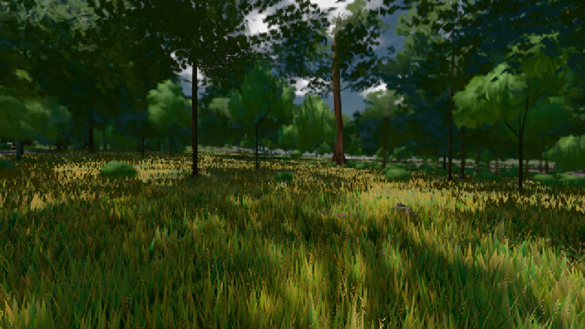

# GPU-PROBE 19190c25 — GRÜN

Zweig `w23-ankunft-faden` · Kopf 19190c258b879f80c5cea6ec8492c5f725f24a4d · Läufer omen-gtx1060 · 08.11. 13:45 · Wanduhr ab Push 135 s · Lauf https://github.com/MiguellD/AnazhRealm/actions/runs/42481540970

Ruf: `bild:wiese`

GPU NVIDIA GeForce GTX 1060 · npm ci 38 s (package-lock 49331b5e)
Schloss /c/Users/micha/AppData/Local/Temp/claude/gpu-schloss hält „ci-runner 42481540970/1 probe“
- Hook 2026-11-08 13:43:16 start ci-runner 42481540970/1 probe: Schloss genommen (refs/heads/w23-ankunft-faden 19190c258b879f80c5cea6ec8492c5f725f24a4d ws=C:\actions-runner\_work\AnazhRealm\AnazhRealm)

### bild:wiese — GRÜN · 57 s

Adapter: [linse-gpu] nvidia/pascal

```text
Kamera des Spiels → Blick (10.0 m): -280.40 29.71 -1045.60 -289.61 29.71 -1049.50
 "abnahme": "ABNAHME GRÜN · beweis · Sicht 0.0 % · Ziel Blickziel im Bild frei 10 m · Luma 55.6 σ 31.6 schwarz 0.0 % weiß 0.0 % · Stand 18.546.222 · Bühne summer sunny 0.50 · Gerät WebGPU nvidia pascal",
```


