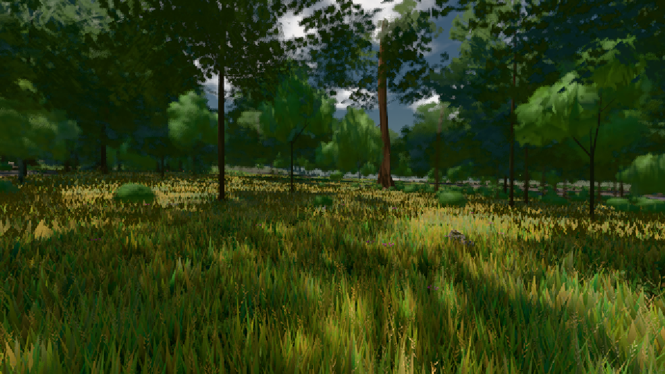

# GPU-PROBE 0286b621 — ROT

Zweig `w23-geh-takt` · Kopf 0286b62170244bad68f29a025a76f93c9804f12d · Läufer radeon-890m · 08.11. 12:55 · Wanduhr ab Push 380 s · Lauf https://github.com/MiguellD/AnazhRealm/actions/runs/42477422333

Ruf: `gate:geh-ab gate:geh-zerlegung bild:wiese@0.5`

GPU AMD Radeon(TM) 890M Graphics · node_modules bleiben (package-lock d2004163)
Schloss /c/Users/micha/AppData/Local/Temp/claude/gpu-schloss hält „ci-runner 42477422333/1 probe“
- Hook 2026-11-08 12:49:43 start ci-runner 42477422333/1 probe: Schloss genommen (refs/heads/w23-geh-takt 0286b62170244bad68f29a025a76f93c9804f12d ws=C:\actions-runner\_work\AnazhRealm\AnazhRealm)

### gate:geh-ab — ROT · 198 s

Adapter: [linse-gpu] amd/rdna-3

```text
GEH-AB ROT wiese erster Gang, Median der Besuche: Bild-p95 A 41.8 → B 33.5 ms · A: Bild p50/p95 25.2,25.2 / 41.8,41.8 · CPU p50/p95 26.7,25 / 38.5,37.1 · GPU p95 11.73,10.53 · Bilder 142,145 · Weg 16,16 ‖ B: Bild p50/p95 25,25 / 33.5,33.5 · CPU p50/p95 20.8,21.4 / 31.5,32.3 · GPU p95 7.12,8 · Bilder 182,175 · Weg 16,16
GEH-AB GRÜN genesis erster Gang, Median der Besuche: Bild-p95 A 25.3 → B 25.2 ms · A: Bild p50/p95 25.1,16.9 / 33.5,25.3 · CPU p50/p95 23,20.2 / 32.2,27.8 · GPU p95 9.1,7.4 · Bilder 166,194 · Weg 17,17 ‖ B: Bild p50/p95 16.8,16.8 / 33.5,25.2 · CPU p50/p95 18.1,18.1 / 30.1,27.3 · GPU p95 7.55,5.87 · Bilder 201,204 · Weg 16,16
```

### gate:geh-zerlegung — ROT · 83 s

Adapter: [linse-gpu] amd/rdna-3

```text
GEH ROT wiese-ego Gang 1: Stand Bild 8.4/17/25.2/42.2 GPU 1.26/3.68/3.68/3.68 Phasen {"streaming":0.6,"waterIso":0,"archCulling":0.01,"creatures":0.87,"physics":0.15,"render":5.29,"gpuMs":1.04} · Bild p50/95/99/max 25.1/41.9/58.6/67 · Takt 23.7/39.6/60.4/63.9 · 155 Bilder · > 33 ms 28 (TAKT 28 NEBEN 0 GC 0 GPU 0) · Bau 4 Σ 48.8 ms [["haupt streuSatz",48.8]] · Pipe sync 0 · Ursachen 10× 385/59 TAKT: renderer._renderScene › _renderScene [three.webgpu.min.js] | 10× 360/42 TAKT: verteilt | 4× 201/67 TAKT: _loopVoxelStreaming › _runFrameScheduler | 2× 67/34 TAKT: _knotenRate › bui
GEH ROT wiese-ego Gang 1 Sicht ab p95 7/155 Takte: 0 12.7/5.9 · 1_instanzWahlPass 4.7/1.4 · 2_instanzBehalten 2.4/0.5 · 3_passTrifft 1.6/0.2 · 2_archGroupTausch 0.6/0.1 · 3_instanzTausch 0.5/0.1 · 2_arenaTakt 0.5/0.3 · 3_takt 0.5/0.3 · 2_instanzWahlWeg 0.4/0.2 · 1_nahWieseSicht 4.0/1.6 · 2_nahWieseFernSatz 3.6/1.4 · 3_wieseFernWahl 2.2/0.5 · 3_wieseFernSchreib 0.8/0.8 · 1_chunkSatzPass 3.2/2.1 · 2_hoehlenSicht 2.0/1.4 · 3_hoehlenSichtLicht 1.9/1.0 · 1_kaskadenPassen 0.5/0.4 · 2_kaskadenHuellen 0.3/0.2
GEH ROT wiese-ego Gang 1 Planer ab p95 7/155 Takte: 0 19.6/8.0 · 1_dispatchFrameJobs 14.6/6.0 · 2run 14.5/6.0 · 3_tickScatterStreaming 4.2/0.1 · 3_tickVoxelChunkStreaming 4.0/0.2 · 3_tickNahWiese 2.8/4.9 · 3_tickSaat 2.7/0.0 · 3_tickNahStreu 0.4/0.7 · 1_tickPendingVegSpawns 2.2/0.0 · 2_pflanzGang 2.0/0.0 · 3_naturSetzen 2.0/0.0 · 1_tickArchitectureLOD 1.8/1.8 · 2_zusagenVon 1.5/1.5 · 3(anonym) 1.5/1.5 · 1_tickScatterLod 0.3/0.1
GEH GRÜN wiese-ego Gang 2: Bild p50/95/99/max 16.8/25.2/25.2/33.4 · Takt 17.1/25.2/27.9/28.3 · 223 Bilder · > 33 ms 1 (TAKT 1 NEBEN 0 GC 0 GPU 0) · Bau 0 Σ 0 ms [] · Pipe sync 0 · Ursachen 1× 33/33 TAKT: renderer._renderScene › _renderScene [three.webgpu.min.js]
GEH GRÜN wiese-ego Gang 2 Sicht ab p95 12/223 Takte: 0 8.3/5.3 · 1_chunkSatzPass 3.1/1.9 · 2_hoehlenSicht 2.1/1.3 · 3_hoehlenSichtLicht 2.0/1.2 · 2_chunkSatzAbschnitt 1.0/0.6 · 3_passTrifftBox 0.3/0.2 · 1_instanzWahlPass 2.9/1.3 · 2_instanzBehalten 1.9/0.6 · 3_passTrifft 1.1/0.3 · 1_nahWieseSicht 1.9/1.5 · 2_nahWieseFernSatz 1.7/1.3 · 3_wieseFernWahl 1.0/0.4 · 3_wieseFernSchreib 0.7/0.7 · 1_kaskadenPassen 0.3/0.4
GEH GRÜN wiese-ego Gang 2 Planer ab p95 12/223 Takte: 0 8.3/4.1 · 1_dispatchFrameJobs 6.6/3.1 · 2run 6.6/3.1 · 3_tickNahWiese 4.2/2.2 · 3_tickVoxelChunkStreaming 1.4/0.1 · 3_tickNahStreu 0.4/0.7 · 3_tickPendingWaterIso 0.4/0.0 · 1_tickArchitectureLOD 1.6/0.8 · 2_zusagenVon 1.2/0.7 · 3(anonym) 1.2/0.7
GEH ROT genesis-third Gang 1: Stand Bild 8.4/25.2/33.6/58.6 GPU 1.67/6.29/6.29/6.29 Phasen {"streaming":0.31,"waterIso":0.01,"archCulling":0.01,"creatures":0.52,"physics":0.24,"render":5.54,"gpuMs":1.54} · Bild p50/95/99/max 25/33.5/41.9/41.9 · Takt 21.2/29.3/37.3/38 · 181 Bilder · > 33 ms 16 (TAKT 16 NEBEN 0 GC 0 GPU 0) · Bau 31 Σ 4.2 ms [["Point Light Shadow [ licht:wurf ] - Face 1 bauWurf",4.1],["Point Light Shadow [ licht:wurf ] - Face 5 arena f:sitzbank:L0",0.1],["Point Light Shadow [ licht:wurf ] - Face 1 arena f:tanne:L1",0]] · Pipe sync 0 · Ursachen 10× 344/42 TAKT: renderer.
GEH ROT genesis-third Gang 1 Sicht ab p95 10/181 Takte: 0 8.0/4.3 · 1_chunkSatzPass 3.2/1.3 · 2_chunkSatzBereit 2.3/0.5 · 3_hoehlenSicht 1.5/0.3 · 3_chunkSatzAbschnitt 0.7/0.2 · 2_hoehlenSicht 0.4/0.3 · 2_chunkSatzAbschnitt 0.4/0.5 · 1_instanzWahlPass 2.1/0.9 · 2_instanzFensterGilt 1.6/0.6 · 3_instanzBehalten 1.0/0.5 · 2_arenaTakt 0.4/0.3 · 3_takt 0.3/0.3 · 1_nahWieseSicht 1.7/1.5 · 2_nahWieseFernSatz 1.5/1.4 · 3_wieseFernWahl 1.1/0.6 · 3_wieseFernSchreib 0.4/0.6 · 1_kaskadenPassen 0.7/0.4 · 2_kaskadeHaelt 0.3/0.1 · 3_kaskadenWerferOben 0.3/0.1
GEH ROT genesis-third Gang 1 Planer ab p95 10/181 Takte: 0 9.9/7.1 · 1_dispatchFrameJobs 7.6/5.8 · 2run 7.6/5.7 · 3_tickNahWiese 6.9/5.0 · 3_tickNahStreu 0.3/0.3 · 1_tickArchitectureLOD 1.6/1.0 · 2_archStufeUrteil 1.1/0.4
```

### bild:wiese@0.5 — GRÜN · 45 s

Adapter: [linse-gpu] amd/rdna-3

```text
Kamera des Spiels → Blick (10.0 m): -280.40 29.71 -1045.60 -289.61 29.71 -1049.50
 "abnahme": "ABNAHME GRÜN · beweis · Sicht 0.0 % · Ziel Blickziel im Bild frei 10 m · Luma 56.3 σ 31.4 schwarz 0.0 % weiß 0.0 % · Stand 18.546.220 · Bühne summer sunny 0.50 · Gerät WebGPU amd rdna-3",
```


