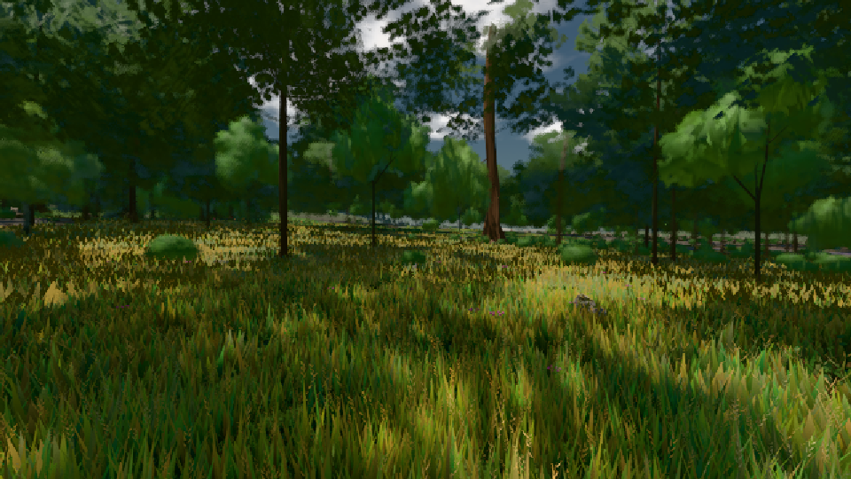

# GPU-PROBE 343d7ddb — ROT

Zweig `w23-geh-takt` · Kopf 343d7ddb21724fe2e2d259f1f51e2fce4c1f49d7 · Läufer radeon-890m · 08.11. 12:08 · Wanduhr ab Push 172 s · Lauf https://github.com/MiguellD/AnazhRealm/actions/runs/42474184633

Ruf: `gate:geh-zerlegung bild:wiese@0.5`

GPU AMD Radeon(TM) 890M Graphics · node_modules bleiben (package-lock d2004163)
Schloss /c/Users/micha/AppData/Local/Temp/claude/gpu-schloss hält „ci-runner 42474184633/1 probe“
- Hook 2026-11-08 12:05:39 start ci-runner 42474184633/1 probe: Schloss genommen (refs/heads/w23-geh-takt 343d7ddb21724fe2e2d259f1f51e2fce4c1f49d7 ws=C:\actions-runner\_work\AnazhRealm\AnazhRealm)

### gate:geh-zerlegung — ROT · 76 s

Adapter: [linse-gpu] amd/rdna-3

```text
GEH ROT wiese-ego Gang 1: Stand Bild 8.5/16.9/25.2/41.9 GPU 1.13/3.37/3.37/3.37 Phasen {"streaming":0.4,"waterIso":0.01,"archCulling":0,"creatures":0.85,"physics":0.14,"render":6.27,"gpuMs":0.82} · Bild p50/95/99/max 25.1/33.5/41.9/58.8 · Takt 21.2/34.1/45.2/59.8 · 174 Bilder · > 33 ms 24 (TAKT 24 NEBEN 0 GC 0 GPU 0) · Bau 4 Σ 43 ms [["haupt streuSatz",43]] · Pipe sync 0 · Ursachen 10× 377/59 TAKT: verteilt | 8× 268/34 TAKT: renderer._renderScene › _renderScene [three.webgpu.min.js] | 3× 100/33 TAKT: _loopVoxelStreaming › _runFrameScheduler | 1× 42/42 TAKT: _dispatchFrameJobs â
GEH ROT wiese-ego Gang 1 Sicht ab p95 8/174 Takte: 0 8.7/5.6 · 1_instanzWahlPass 3.2/1.5 · 2_instanzBehalten 1.5/0.7 · 3_passTrifft 0.9/0.3 · 2_arenaTakt 0.5/0.2 · 3_takt 0.5/0.2 · 2_archGroupTausch 0.5/0.1 · 1_chunkSatzPass 2.6/1.9 · 2_hoehlenSicht 1.5/1.3 · 3_hoehlenSichtLicht 1.3/1.0 · 2_chunkSatzAbschnitt 0.7/0.6 · 1_nahWieseSicht 2.3/1.6 · 2_nahWieseFernSatz 2.1/1.2 · 3_wieseFernWahl 1.1/0.4 · 3_wieseFernSchreib 0.6/0.7 · 1_kaskadenPassen 0.4/0.4
GEH ROT wiese-ego Gang 1 Planer ab p95 8/174 Takte: 0 16.2/6.8 · 1_dispatchFrameJobs 11.4/4.9 · 2run 11.4/4.9 · 3_tickNahWiese 4.1/4.0 · 3_tickVoxelChunkStreaming 2.8/0.1 · 3_tickScatterStreaming 2.2/0.1 · 3_tickSaat 1.4/0.0 · 3_tickNahStreu 0.5/0.6 · 1_tickPendingVegSpawns 2.0/0.0 · 2_pflanzGang 2.0/0.0 · 3_naturSetzen 2.0/0.0 · 1_tickArchitectureLOD 1.9/1.7 · 2_zusagenVon 1.7/1.5 · 3(anonym) 1.6/1.4
GEH ROT wiese-ego Gang 2: Bild p50/95/99/max 16.9/33.5/33.7/41.8 · Takt 19.9/29.8/33.3/43.1 · 187 Bilder · > 33 ms 21 (TAKT 21 NEBEN 0 GC 0 GPU 0) · Bau 0 Σ 0 ms [] · Pipe sync 0 · Ursachen 15× 511/42 TAKT: renderer._renderScene › _renderScene [three.webgpu.min.js] | 5× 167/34 TAKT: verteilt | 1× 34/34 TAKT: _dispatchFrameJobs › run
GEH ROT wiese-ego Gang 2 Sicht ab p95 11/189 Takte: 0 10.2/5.8 · 1_chunkSatzPass 3.7/2.1 · 2_hoehlenSicht 2.6/1.3 · 3_hoehlenSichtLicht 2.3/1.0 · 2_chunkSatzAbschnitt 0.9/0.7 · 3isEmpty 0.3/0.2 · 3_passTrifftBox 0.3/0.2 · 1_instanzWahlPass 3.6/1.6 · 2_instanzBehalten 2.0/0.7 · 3_passTrifft 1.0/0.3 · 2_instanzWahlWeg 0.5/0.4 · 2_arenaTakt 0.3/0.3 · 1_nahWieseSicht 2.0/1.5 · 2_nahWieseFernSatz 1.6/1.3 · 3_wieseFernSchreib 0.8/0.7 · 3_wieseFernWahl 0.5/0.4 · 1_kaskadenPassen 0.5/0.4
GEH ROT wiese-ego Gang 2 Planer ab p95 11/189 Takte: 0 10.0/4.9 · 1_dispatchFrameJobs 8.0/3.5 · 2run 8.0/3.5 · 3_tickNahWiese 6.0/2.4 · 3_tickVoxelChunkStreaming 1.3/0.1 · 3_tickNahStreu 0.3/0.8 · 1_tickArchitectureLOD 1.8/1.3 · 2_zusagenVon 1.6/1.1 · 3(anonym) 1.5/1.1
GEH ROT genesis-third Gang 1: Stand Bild 8.5/25.2/33.9/41.8 GPU 1.39/3.57/3.57/3.57 Phasen {"streaming":0.39,"waterIso":0,"archCulling":0,"creatures":0.66,"physics":0.39,"render":7.18,"gpuMs":1.36} · Bild p50/95/99/max 25.1/33.5/41.9/50.3 · Takt 21.9/29.3/36.5/42.9 · 175 Bilder · > 33 ms 15 (TAKT 15 NEBEN 0 GC 0 GPU 0) · Bau 30 Σ 3.7 ms [["Point Light Shadow [ licht:wurf ] - Face 1 bauWurf",3.7],["Point Light Shadow [ licht:wurf ] - Face 1 arena f:tanne:L1",0],["Point Light Shadow [ licht:wurf ] - Face 1 bauSatz",0]] · Pipe sync 0 · Ursachen 13× 452/50 TAKT: renderer._renderScene › 
GEH ROT genesis-third Gang 1 Sicht ab p95 8/175 Takte: 0 9.2/5.8 · 1_nahWieseSicht 3.1/2.9 · 2_nahWieseFernSatz 2.8/2.8 · 3_wieseFernWahl 2.1/2.0 · 3_wieseFernSchreib 0.5/0.5 · 1_chunkSatzPass 2.7/1.4 · 2_chunkSatzBereit 1.0/0.8 · 3_hoehlenSicht 0.7/0.4 · 3_chunkSatzAbschnitt 0.3/0.3 · 2_hoehlenSicht 0.9/0.3 · 3_hoehlenSichtLicht 0.8/0.2 · 2_chunkSatzAbschnitt 0.7/0.3 · 3_passTrifftBox 0.4/0.1 · 1_instanzWahlPass 2.5/1.1 · 2_instanzFensterGilt 2.1/0.7 · 3_instanzBehalten 1.6/0.4 · 2_arenaTakt 0.3/0.2 · 1_kaskadenPassen 0.7/0.3 · 2_kaskadeHaelt 0.3/0.1
GEH ROT genesis-third Gang 1 Planer ab p95 8/175 Takte: 0 7.8/6.7 · 1_dispatchFrameJobs 4.8/5.3 · 2run 4.8/5.3 · 3_tickNahWiese 4.3/4.7 · 1_tickArchitectureLOD 1.4/0.9 · 2_archStufeUrteil 0.7/0.5 · 2_zusagenVon 0.6/0.3 · 3(anonym) 0.6/0.3 · 1_tickPendingVegSpawns 0.7/0.0 · 2_pflanzGang 0.7/0.0 · 3_naturSetzen 0.7/0.0
```

### bild:wiese@0.5 — GRÜN · 42 s

Adapter: [linse-gpu] amd/rdna-3

```text
Kamera des Spiels → Blick (10.0 m): -280.40 29.71 -1045.60 -289.61 29.71 -1049.50
 "abnahme": "ABNAHME GRÜN · beweis · Sicht 0.0 % · Ziel Blickziel im Bild frei 10 m · Luma 56.3 σ 31.4 schwarz 0.0 % weiß 0.0 % · Stand 18.546.220 · Bühne summer sunny 0.50 · Gerät WebGPU amd rdna-3",
```


