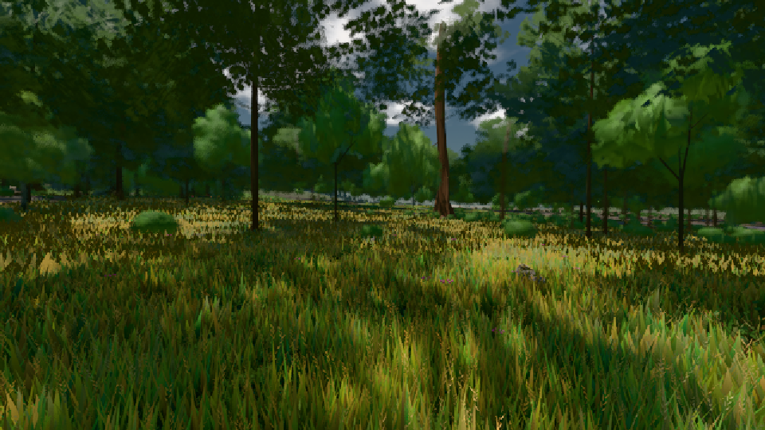

# GPU-PROBE cf51c30c — GRÜN

Zweig `w23-geh-takt` · Kopf cf51c30c5b2d352e3fc7badccab09c861b66907b · Läufer radeon-890m · 08.11. 13:42 · Wanduhr ab Push 459 s · Lauf https://github.com/MiguellD/AnazhRealm/actions/runs/42480912099

Ruf: `bild:wiese@0.5`

GPU AMD Radeon(TM) 890M Graphics · npm ci 30 s (package-lock ae8c8b42)
Schloss /c/Users/micha/AppData/Local/Temp/claude/gpu-schloss hält „ci-runner 42480912099/1 probe“
- Hook 2026-11-08 13:40:22 start ci-runner 42480912099/1 probe: Schloss genommen (refs/heads/w23-geh-takt cf51c30c5b2d352e3fc7badccab09c861b66907b ws=C:\actions-runner\_work\AnazhRealm\AnazhRealm)

### bild:wiese@0.5 — GRÜN · 53 s

Adapter: [linse-gpu] amd/rdna-3

```text
Kamera des Spiels → Blick (10.0 m): -280.40 29.71 -1045.60 -289.61 29.71 -1049.50
 "abnahme": "ABNAHME GRÜN · beweis · Sicht 0.0 % · Ziel Blickziel im Bild frei 10 m · Luma 56.3 σ 31.4 schwarz 0.0 % weiß 0.0 % · Stand 18.546.221 · Bühne summer sunny 0.50 · Gerät WebGPU amd rdna-3",
```


