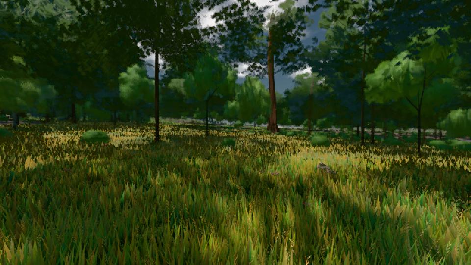

# GPU-PROBE 322a86b9 — GRÜN

Zweig `w23-karte-l2` · Kopf 322a86b9a6a9eaeb3473d5d479a6c57ec6e86a2d · Läufer omen-gtx1060 · 08.11. 13:05 · Wanduhr ab Push 3860 s · Lauf https://github.com/MiguellD/AnazhRealm/actions/runs/42473851857

Ruf: `gate:laub-kante bild:wiese@0.5`

GPU NVIDIA GeForce GTX 1060 · node_modules bleiben (package-lock d2004163)
Schloss /c/Users/micha/AppData/Local/Temp/claude/gpu-schloss hält „ci-runner 42473851857/3 probe“
- Hook 2026-11-08 13:02:10 start ci-runner 42473851857/3 probe: Schloss genommen (refs/heads/w23-karte-l2 322a86b9a6a9eaeb3473d5d479a6c57ec6e86a2d ws=C:\actions-runner\_work\AnazhRealm\AnazhRealm)

### gate:laub-kante — GRÜN · 112 s

Adapter: ungenannt (die Probe nannte keinen Browser-Adapter)

```text
lod.K1#1 ROT f:fichte:L1 0.1879 (353240 px, zweiton 0) · f:tanne:L0 0.1775 (119931 px, zweiton 0) · f:tanne:L1 0.1763 (284040 px, zweiton 0) · fimp:birke:L2 0.3324 (31418 px, zweiton 0) · fimp:eiche:L2 0.2373 (80280 px, zweiton 0) · fimp:fichte:L2 0.2122 (39734 px, zweiton 0) · fimp:strauch:L2 0.4076 (22509 px, zweiton 0.0019) · fimp:tanne:L2 0.2226 (119882 px, zweiton 0)
ABNAHME GRÜN · beweis · Sicht 0.0 % · Ziel tanne im Bild frei 16.81 m · Luma 55 σ 38.4 schwarz 0.0 % weiß 0.0 % · Stand 18.546.220 · Bühne summer sunny 0.50 · Gerät WebGPU nvidia pascal · Blick-Wahl 1 Posen
```

### bild:wiese@0.5 — GRÜN · 53 s

Adapter: [linse-gpu] nvidia/pascal

```text
Kamera des Spiels → Blick (10.0 m): -280.40 29.71 -1045.60 -289.61 29.71 -1049.50
 "abnahme": "ABNAHME GRÜN · beweis · Sicht 0.0 % · Ziel Blickziel im Bild frei 10 m · Luma 55.5 σ 31.6 schwarz 0.0 % weiß 0.0 % · Stand 18.546.220 · Bühne summer sunny 0.50 · Gerät WebGPU nvidia pascal",
```


