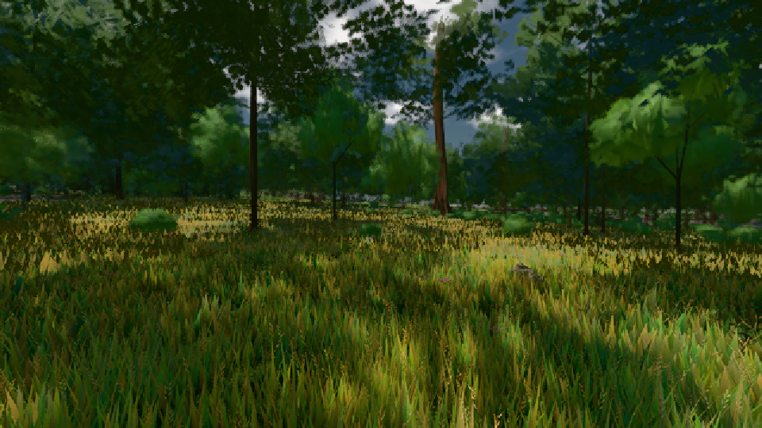

# GPU-PROBE 97e9da92 — GRÜN

Zweig `w23-karte-l2` · Kopf 97e9da9298c525472badecfec359dd5286322c5c · Läufer omen-gtx1060 · 08.11. 13:42 · Wanduhr ab Push 387 s · Lauf https://github.com/MiguellD/AnazhRealm/actions/runs/42481043093

Ruf: `bild:wiese@0.5`

GPU NVIDIA GeForce GTX 1060 · node_modules bleiben (package-lock ae8c8b42)
Schloss /c/Users/micha/AppData/Local/Temp/claude/gpu-schloss hält „ci-runner 42481043093/1 probe“
- Hook 2026-11-08 13:41:10 start ci-runner 42481043093/1 probe: Schloss genommen (refs/heads/w23-karte-l2 97e9da9298c525472badecfec359dd5286322c5c ws=C:\actions-runner\_work\AnazhRealm\AnazhRealm)

### bild:wiese@0.5 — GRÜN · 72 s

Adapter: [linse-gpu] nvidia/pascal

```text
Kamera des Spiels → Blick (10.0 m): -280.40 29.71 -1045.60 -289.61 29.71 -1049.50
 "abnahme": "ABNAHME GRÜN · beweis · Sicht 0.0 % · Ziel Blickziel im Bild frei 10 m · Luma 55.2 σ 31.3 schwarz 0.0 % weiß 0.0 % · Stand 18.546.221 · Bühne summer sunny 0.50 · Gerät WebGPU nvidia pascal",
```


