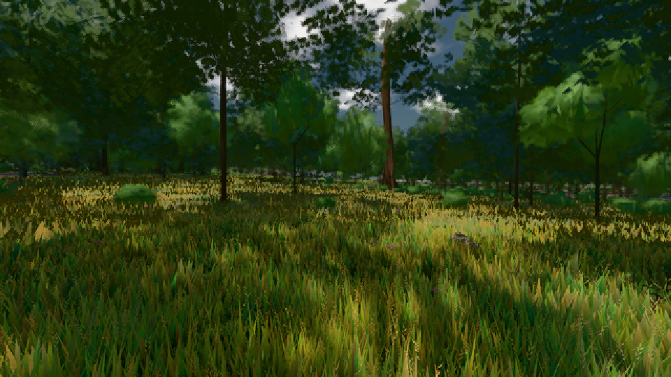

# GPU-PROBE c61e3a9b — GRÜN

Zweig `w23-karte-l2` · Kopf c61e3a9ba63c9c613c5769e84b21fa0de46ebfc9 · Läufer radeon-890m · 08.11. 12:45 · Wanduhr ab Push 171 s · Lauf https://github.com/MiguellD/AnazhRealm/actions/runs/42476948909

Ruf: `gate:laub-kante bild:wiese@0.5`

GPU AMD Radeon(TM) 890M Graphics · node_modules bleiben (package-lock d2004163)
Schloss /c/Users/micha/AppData/Local/Temp/claude/gpu-schloss hält „ci-runner 42476948909/1 probe“
- Hook 2026-11-08 12:43:05 start ci-runner 42476948909/1 probe: Schloss genommen (refs/heads/w23-karte-l2 c61e3a9ba63c9c613c5769e84b21fa0de46ebfc9 ws=C:\actions-runner\_work\AnazhRealm\AnazhRealm)

### gate:laub-kante — GRÜN · 72 s

Adapter: ungenannt (die Probe nannte keinen Browser-Adapter)

```text
lod.K1#1 ROT [["f:fichte:L1",0.1815,342980,0],["f:tanne:L0",0.1698,119181,0],["f:tanne:L1",0.1757,275044,0],["fimp:birke:L2",0.1889,27676,0],["fimp:eiche:L2",0.1553,65169,0],["fimp:fichte:L2",0.1575,32185,0],["fimp:strauch:L2",0.3536,24561,0],["fimp:tanne:L2",0.177,113063,0]]
ABNAHME GRÜN · beweis · Sicht 0.0 % · Ziel tanne im Bild frei 16.81 m · Luma 48.2 σ 36.5 schwarz 0.0 % weiß 0.0 % · Stand 18.546.220 · Bühne summer sunny 0.50 · Gerät WebGPU amd rdna-3 · Blick-Wahl 1 Posen
```

### bild:wiese@0.5 — GRÜN · 47 s

Adapter: [linse-gpu] amd/rdna-3

```text
Kamera des Spiels → Blick (10.0 m): -280.40 29.71 -1045.60 -289.61 29.71 -1049.50
 "abnahme": "ABNAHME GRÜN · beweis · Sicht 0.0 % · Ziel Blickziel im Bild frei 10 m · Luma 55.9 σ 31.1 schwarz 0.0 % weiß 0.0 % · Stand 18.546.220 · Bühne summer sunny 0.50 · Gerät WebGPU amd rdna-3",
```


