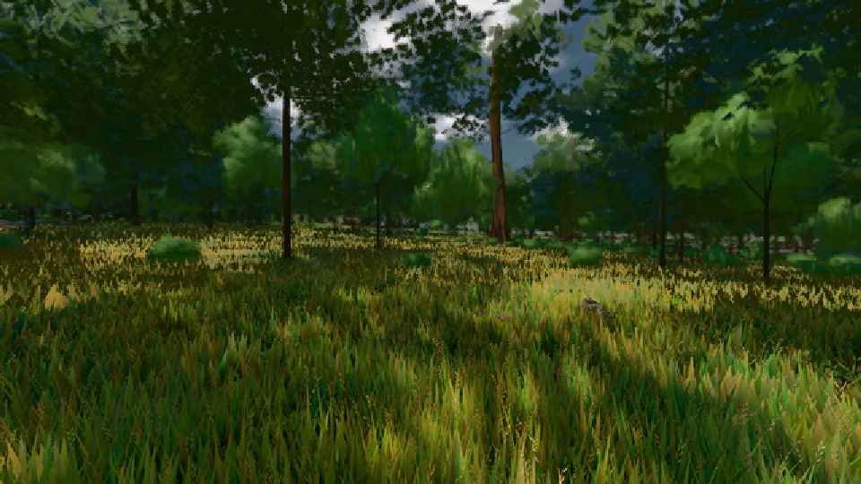

# GPU-PROBE f5140fb2 — GRÜN

Zweig `w23-karte-l2` · Kopf f5140fb290bfa5a7d23e2f631afdd8eee3a9ff87 · Läufer radeon-890m · 08.11. 12:28 · Wanduhr ab Push 180 s · Lauf https://github.com/MiguellD/AnazhRealm/actions/runs/42475693561

Ruf: `gate:laub-kante bild:wiese@0.5`

GPU AMD Radeon(TM) 890M Graphics · node_modules bleiben (package-lock d2004163)
Schloss /c/Users/micha/AppData/Local/Temp/claude/gpu-schloss hält „ci-runner 42475693561/1 probe“
- Hook 2026-11-08 12:25:59 start ci-runner 42475693561/1 probe: Schloss genommen (refs/heads/w23-karte-l2 f5140fb290bfa5a7d23e2f631afdd8eee3a9ff87 ws=C:\actions-runner\_work\AnazhRealm\AnazhRealm)

### gate:laub-kante — GRÜN · 69 s

Adapter: [linse-gpu] amd/rdna-3

```text
lod.K1#1 ROT f:fichte:L1 0.1821 (343930 px, zweiton 0) · f:tanne:L0 0.1695 (119073 px, zweiton 0) · f:tanne:L1 0.1761 (275487 px, zweiton 0) · fimp:birke:L2 0.2236 (27661 px, zweiton 0) · fimp:eiche:L2 0.1718 (66713 px, zweiton 0) · fimp:fichte:L2 0.1659 (33277 px, zweiton 0) · fimp:strauch:L2 0.3314 (24065 px, zweiton 0) · fimp:tanne:L2 0.1809 (110094 px, zweiton 0)
ABNAHME GRÜN · beweis · Sicht 0.0 % · Ziel tanne im Bild frei 16.81 m · Luma 48.2 σ 36.5 schwarz 0.0 % weiß 0.0 % · Stand 18.546.220 · Bühne summer sunny 0.50 · Gerät WebGPU amd rdna-3 · Blick-Wahl 1 Posen
```

### bild:wiese@0.5 — GRÜN · 47 s

Adapter: [linse-gpu] amd/rdna-3

```text
Kamera des Spiels → Blick (10.0 m): -280.40 29.71 -1045.60 -289.61 29.71 -1049.50
 "abnahme": "ABNAHME GRÜN · beweis · Sicht 0.0 % · Ziel Blickziel im Bild frei 10 m · Luma 55.9 σ 31.1 schwarz 0.0 % weiß 0.0 % · Stand 18.546.220 · Bühne summer sunny 0.50 · Gerät WebGPU amd rdna-3",
```


