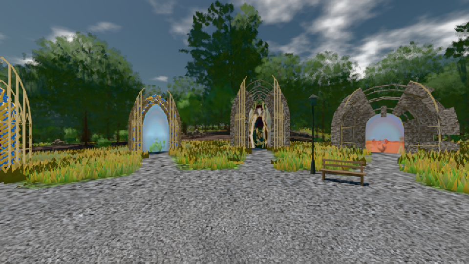

# GPU-PROBE ef68685e — GRÜN

Zweig `w24-fahrt-takt` · Kopf ef68685ed8ecf67cbac026d656c30b8e41caa0c6 · Läufer radeon-890m · 08.11. 17:44 · Wanduhr ab Push 1164 s · Lauf https://github.com/MiguellD/AnazhRealm/actions/runs/42499815149

Ruf: `bild:genesis@0.5`

GPU AMD Radeon(TM) 890M Graphics · node_modules bleiben (package-lock 74fc4120)
Schloss /c/Users/micha/AppData/Local/Temp/claude/gpu-schloss hält „ci-runner 42499815149/1 probe“
- Hook 2026-11-08 17:42:56 start ci-runner 42499815149/1 probe: Schloss genommen (refs/heads/w24-fahrt-takt ef68685ed8ecf67cbac026d656c30b8e41caa0c6 ws=C:\actions-runner\_work\AnazhRealm\AnazhRealm)

### bild:genesis@0.5 — GRÜN · 51 s

Adapter: [linse-gpu] amd/rdna-3

```text
Kamera des Spiels → Blick (10.0 m): 0.00 92.40 0.00 -10.00 92.40 0.00
 "abnahme": "ABNAHME GRÜN · beweis · Sicht 0.0 % · Ziel Blickziel im Bild frei 10 m · Luma 101.9 σ 38.2 schwarz 0.0 % weiß 0.0 % · Stand 18.546.224 · Bühne summer sunny 0.50 · Gerät WebGPU amd rdna-3",
```


