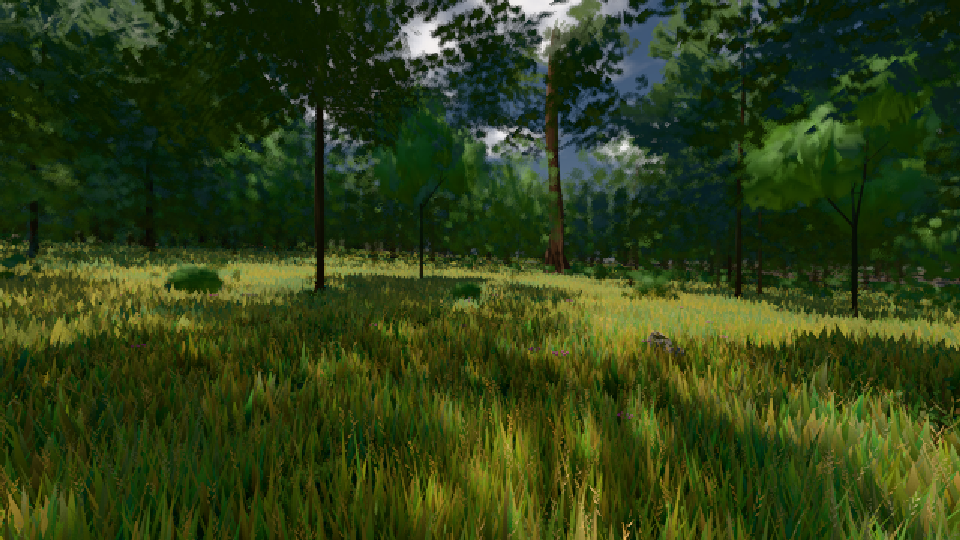

# GPU-PROBE 105bcf8c — GRÜN

Zweig `w24-laub-kante` · Kopf 105bcf8cfca16ffc3179763ce2b1bc2bd03c5ec6 · Läufer omen-gtx1060 · 09.11. 01:56 · Wanduhr ab Push 3556 s · Lauf https://github.com/MiguellD/AnazhRealm/actions/runs/42537596516

Ruf: `gate:laub-kante bild:wiese@0.5`

GPU NVIDIA GeForce GTX 1060 · node_modules bleiben (package-lock bcc5174f)
Schloss /c/Users/micha/AppData/Local/Temp/claude/gpu-schloss hält „ci-runner 42537596516/2 probe“
- Hook 2026-11-09 01:53:37 start ci-runner 42537596516/2 probe: Schloss genommen (refs/heads/w24-laub-kante 105bcf8cfca16ffc3179763ce2b1bc2bd03c5ec6 ws=C:\actions-runner\_work\AnazhRealm\AnazhRealm)

### gate:laub-kante — GRÜN · 86 s

Adapter: ungenannt (die Probe nannte keinen Browser-Adapter)

```text
lod.K1#1 GRÜN [["f:fichte:L1",0.1832,366563,0],["f:tanne:L0",0.1762,122118,0],["f:tanne:L1",0.1675,286028,0],["fimp:birke:L2",0.1604,29562,0],["fimp:eiche:L2",0.1414,66395,0],["fimp:fichte:L2",0.1427,49245,0],["fimp:strauch:L2",0.2111,22940,0],["fimp:tanne:L2",0.1562,130531,0]]
ABNAHME GRÜN · beweis · Sicht 0.0 % · Ziel tanne im Bild frei 16.81 m · Luma 56.1 σ 39.2 schwarz 0.0 % weiß 0.0 % · Stand 18.546.229 · Bühne summer sunny 0.50 · Gerät WebGPU nvidia pascal · Blick-Wahl 1 Posen
```

### bild:wiese@0.5 — GRÜN · 44 s

Adapter: [linse-gpu] nvidia/pascal

```text
Kamera des Spiels → Blick (10.0 m): -280.40 29.71 -1045.60 -289.61 29.71 -1049.50
 "abnahme": "ABNAHME GRÜN · beweis · Sicht 0.0 % · Ziel Blickziel im Bild frei 10 m · Luma 57.2 σ 33.7 schwarz 0.0 % weiß 0.0 % · Stand 18.546.229 · Bühne summer sunny 0.50 · Gerät WebGPU nvidia pascal",
```


