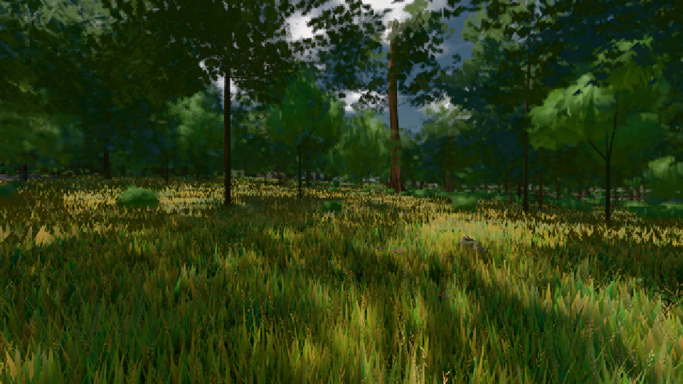

# GPU-PROBE 02611cdf — GRÜN

Zweig `w24-strauch-saum` · Kopf 02611cdf3c71fbb851604ad429dd2144baafc884 · Läufer radeon-890m · 08.11. 14:33 · Wanduhr ab Push 295 s · Lauf https://github.com/MiguellD/AnazhRealm/actions/runs/42485136574

Ruf: `gate:laub-kante bild:wiese@0.5`

GPU AMD Radeon(TM) 890M Graphics · node_modules bleiben (package-lock 49331b5e)
Schloss /c/Users/micha/AppData/Local/Temp/claude/gpu-schloss hält „ci-runner 42485136574/1 probe“
- Hook 2026-11-08 14:28:58 start ci-runner 42485136574/1 probe: Schloss genommen (refs/heads/w24-strauch-saum 02611cdf3c71fbb851604ad429dd2144baafc884 ws=C:\actions-runner\_work\AnazhRealm\AnazhRealm)

### gate:laub-kante — GRÜN · 194 s

Adapter: ungenannt (die Probe nannte keinen Browser-Adapter)

```text
lod.K1#1 ROT [["f:fichte:L1",0.1853,343644,0],["f:tanne:L0",0.1697,118870,0],["f:tanne:L1",0.1738,274165,0],["fimp:birke:L2",0.1867,27786,0],["fimp:eiche:L2",0.1559,62949,0],["fimp:fichte:L2",0.1476,34352,0],["fimp:strauch:L2",0.3091,25271,0],["fimp:tanne:L2",0.1731,111922,0]]
lod.K1#1 ROT [["f:fichte:L1",0.181,342932,0],["f:tanne:L0",0.1699,119194,0],["f:tanne:L1",0.1757,275050,0],["fimp:birke:L2",0.1888,27685,0],["fimp:eiche:L2",0.1555,65194,0],["fimp:fichte:L2",0.1572,32171,0],["fimp:strauch:L2",0.3529,24563,0],["fimp:tanne:L2",0.1775,113042,0]]
lod.K1#1 ROT [["f:fichte:L1",0.1838,343627,0],["f:tanne:L0",0.1677,118487,0],["f:tanne:L1",0.174,271978,0],["fimp:birke:L2",0.1907,27263,0],["fimp:eiche:L2",0.1525,61867,0],["fimp:fichte:L2",0.1536,34800,0],["fimp:strauch:L2",0.2843,25570,0],["fimp:tanne:L2",0.1641,113159,0]]
lod.K1#1 ROT [["f:fichte:L1",0.1804,342410,0],["f:tanne:L0",0.1689,119188,0],["f:tanne:L1",0.1728,273107,0],["fimp:birke:L2",0.1512,27292,0],["fimp:eiche:L2",0.1519,62947,0],["fimp:fichte:L2",0.1511,32558,0],["fimp:strauch:L2",0.3284,25198,0],["fimp:tanne:L2",0.1612,114966,0]]
lod.K1#1 ROT [["f:fichte:L1",0.1846,342596,0],["f:tanne:L0",0.1682,118342,0],["f:tanne:L1",0.1736,271182,0],["fimp:birke:L2",0.1764,26145,0],["fimp:eiche:L2",0.1537,60877,0],["fimp:fichte:L2",0.1619,36205,0],["fimp:strauch:L2",0.277,25402,0.0019],["fimp:tanne:L2",0.1641,117488,0]]
ABNAHME GRÜN · beweis · Sicht 0.0 % · Ziel tanne im Bild frei 16.81 m · Luma 47.9 σ 36.4 schwarz 0.0 % weiß 0.0 % · Stand 18.546.222 · Bühne summer sunny 0.50 · Gerät WebGPU amd rdna-3 · Blick-Wahl 1 Posen
```

### bild:wiese@0.5 — GRÜN · 46 s

Adapter: [linse-gpu] amd/rdna-3

```text
Kamera des Spiels → Blick (10.0 m): -280.40 29.71 -1045.60 -289.61 29.71 -1049.50
 "abnahme": "ABNAHME GRÜN · beweis · Sicht 0.0 % · Ziel Blickziel im Bild frei 10 m · Luma 55.6 σ 30.9 schwarz 0.0 % weiß 0.0 % · Stand 18.546.222 · Bühne summer sunny 0.50 · Gerät WebGPU amd rdna-3",
```


