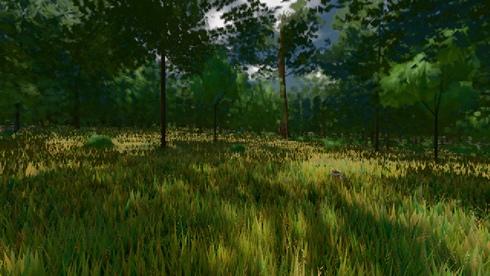

# GPU-PROBE 02c89d91 — ROT

Zweig `w24-strauch-saum` · Kopf 02c89d9150ee225eaf8ee6949b0ce347bd3c9931 · Läufer omen-gtx1060 · 08.11. 19:16 · Wanduhr ab Push 345 s · Lauf https://github.com/MiguellD/AnazhRealm/actions/runs/42508701356

Ruf: `gate:laub-kante bild:wiese@0.5`

GPU NVIDIA GeForce GTX 1060 · node_modules bleiben (package-lock 6ebaf53e)
Schloss /c/Users/micha/AppData/Local/Temp/claude/gpu-schloss hält „ci-runner 42508701356/1 probe“
- Hook 2026-11-08 19:14:04 start ci-runner 42508701356/1 probe: Schloss genommen (refs/heads/w24-strauch-saum 02c89d9150ee225eaf8ee6949b0ce347bd3c9931 ws=C:\actions-runner\_work\AnazhRealm\AnazhRealm)

### gate:laub-kante — ROT · 82 s

Adapter: ungenannt (die Probe nannte keinen Browser-Adapter)

```text
werkbank.cjs ABSTURZ: TypeError: Cannot read properties of undefined (reading 'klassen')
```

### bild:wiese@0.5 — GRÜN · 57 s

Adapter: [linse-gpu] nvidia/pascal

```text
Kamera des Spiels → Blick (10.0 m): -280.40 29.71 -1045.60 -289.61 29.71 -1049.50
 "abnahme": "ABNAHME GRÜN · beweis · Sicht 0.0 % · Ziel Blickziel im Bild frei 10 m · Luma 54.7 σ 30.7 schwarz 0.0 % weiß 0.0 % · Stand 18.546.225 · Bühne summer sunny 0.50 · Gerät WebGPU nvidia pascal",
```


