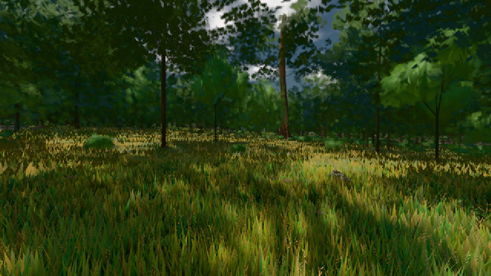

# GPU-PROBE 1e61b27e — GRÜN

Zweig `w24-strauch-saum` · Kopf 1e61b27ed73a51441b9e458762545d1b780815b4 · Läufer radeon-890m · 08.11. 17:28 · Wanduhr ab Push 1288 s · Lauf https://github.com/MiguellD/AnazhRealm/actions/runs/42498246662

Ruf: `gate:laub-kante bild:wiese@0.5`

GPU AMD Radeon(TM) 890M Graphics · npm ci 39 s (package-lock 74fc4120)
Schloss /c/Users/micha/AppData/Local/Temp/claude/gpu-schloss hält „ci-runner 42498246662/1 probe“
- Hook 2026-11-08 17:19:07 start ci-runner 42498246662/1 probe: wartet auf Schloss von 'punkte-radeon-sitzungpid=47584'
- Hook 2026-11-08 17:22:31 start ci-runner 42498246662/1 probe: Schloss genommen (refs/heads/w24-strauch-saum 1e61b27ed73a51441b9e458762545d1b780815b4 ws=C:\actions-runner\_work\AnazhRealm\AnazhRealm)

### gate:laub-kante — GRÜN · 205 s

Adapter: ungenannt (die Probe nannte keinen Browser-Adapter)

```text
lod.K1#1 ROT [["f:fichte:L1",0.1835,343326,0],["f:tanne:L0",0.1689,118070,0],["f:tanne:L1",0.1732,269308,0],["fimp:birke:L2",0.1704,25656,0],["fimp:eiche:L2",0.1449,58046,0],["fimp:fichte:L2",0.1546,39426,0],["fimp:strauch:L2",0.2243,23051,0],["fimp:tanne:L2",0.1603,115884,0]]
✅ Strauch-Karten [m, φ°, Höhe, Boden über Strahl, Fuß über Boden] "29.1 2.9 1.85 -0.06 -0.01,43.2 0.9 1.8 -0.1 0.01,43.8 2.4 1.48 -0.06 -0.02,54 2.2 1.96 -0.04 -0.04,59.3 0.8 1.96 -0.06 0.01,62.1 1.1 1.98 -0.07 0,62.5 2.2 1.55 -0.07 0.01,66 2.2 1.77 -0.03 0,66.7 0.6 2.06 -0.04 0,67.1 2.3 1.47 -0.04 0,69.9 2.3 1.54 -0.05 0,70 2.2 1.43 -0.07 0.02,73.1 1.6 1.49 -0.06 0,73.9 2 1.91 -0.06 0.01,74.4 2.1 1.66 -0.05 -0.01,75.1 2.3 1.38 -0.04 0"
lod.K1#1 ROT [["f:fichte:L1",0.1848,343073,0],["f:tanne:L0",0.168,118255,0],["f:tanne:L1",0.1784,268551,0],["fimp:birke:L2",0.1708,24878,0],["fimp:eiche:L2",0.1399,57825,0],["fimp:fichte:L2",0.1528,39853,0],["fimp:strauch:L2",0.2208,22972,0],["fimp:tanne:L2",0.1593,120392,0]]
lod.K1#1 GRÜN [["f:fichte:L1",0.1826,343793,0],["f:tanne:L0",0.1693,118043,0],["f:tanne:L1",0.1748,269452,0],["fimp:birke:L2",0.1709,25902,0],["fimp:eiche:L2",0.1445,57986,0],["fimp:fichte:L2",0.1505,40277,0],["fimp:strauch:L2",0.2165,22970,0],["fimp:tanne:L2",0.1622,115832,0]]
lod.K1#1 ROT [["f:fichte:L1",0.1804,342568,0],["f:tanne:L0",0.1689,117904,0],["f:tanne:L1",0.1728,268679,0],["fimp:birke:L2",0.1688,25075,0],["fimp:eiche:L2",0.1376,57903,0],["fimp:fichte:L2",0.1494,39613,0],["fimp:strauch:L2",0.2187,22815,0.0011],["fimp:tanne:L2",0.153,115753,0]]
lod.K1#1 GRÜN [["f:fichte:L1",0.1828,342688,0],["f:tanne:L0",0.1687,117876,0],["f:tanne:L1",0.1735,268702,0],["fimp:birke:L2",0.1674,25270,0],["fimp:eiche:L2",0.1367,57391,0],["fimp:fichte:L2",0.148,40744,0],["fimp:strauch:L2",0.2181,22774,0],["fimp:tanne:L2",0.1542,115793,0]]
ABNAHME GRÜN · beweis · Sicht 0.0 % · Ziel tanne im Bild frei 16.81 m · Luma 47.7 σ 36.3 schwarz 0.0 % weiß 0.0 % · Stand 18.546.224 · Bühne summer sunny 0.50 · Gerät WebGPU amd rdna-3 · Blick-Wahl 1 Posen
```

### bild:wiese@0.5 — GRÜN · 51 s

Adapter: [linse-gpu] amd/rdna-3

```text
Kamera des Spiels → Blick (10.0 m): -280.40 29.71 -1045.60 -289.61 29.71 -1049.50
 "abnahme": "ABNAHME GRÜN · beweis · Sicht 0.0 % · Ziel Blickziel im Bild frei 10 m · Luma 55.1 σ 30.5 schwarz 0.0 % weiß 0.0 % · Stand 18.546.224 · Bühne summer sunny 0.50 · Gerät WebGPU amd rdna-3",
```


