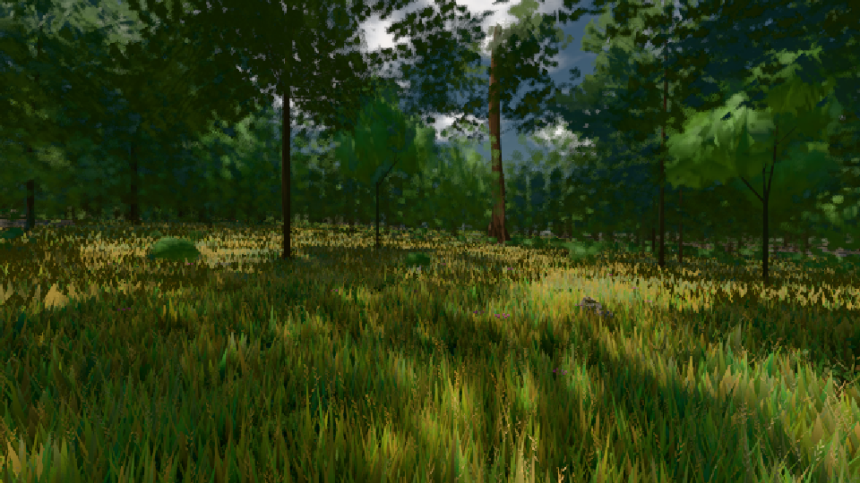

# GPU-PROBE 26c586c8 — GRÜN

Zweig `w24-strauch-saum` · Kopf 26c586c8370c69f6db7b3831e6de07beab520ffc · Läufer radeon-890m · 08.11. 19:48 · Wanduhr ab Push 467 s · Lauf https://github.com/MiguellD/AnazhRealm/actions/runs/42511149247

Ruf: `gate:laub-kante bild:wiese@0.5`

GPU AMD Radeon(TM) 890M Graphics · npm ci 33 s (package-lock 14bd2eb7)
Schloss /c/Users/micha/AppData/Local/Temp/claude/gpu-schloss hält „ci-runner 42511149247/1 probe“
- Hook 2026-11-08 19:44:03 start ci-runner 42511149247/1 probe: Schloss genommen (refs/heads/w24-strauch-saum 26c586c8370c69f6db7b3831e6de07beab520ffc ws=C:\actions-runner\_work\AnazhRealm\AnazhRealm)

### gate:laub-kante — GRÜN · 77 s

Adapter: ungenannt (die Probe nannte keinen Browser-Adapter)

```text
lod.K1#1 GRÜN [["f:fichte:L1",0.1825,353491,0],["f:tanne:L0",0.1685,118440,0],["f:tanne:L1",0.1768,278005,0],["fimp:birke:L2",0.1526,25404,0],["fimp:eiche:L2",0.1403,55644,0],["fimp:fichte:L2",0.1347,43285,0],["fimp:strauch:L2",0.2105,22169,0],["fimp:tanne:L2",0.1475,114833,0]]
✅ Strauch-Karten [m, φ°, Höhe, Boden über Strahl, Fuß über Boden] "29.1 2.9 1.85 -0.06 -0.01,43.2 0.9 1.8 -0.1 0.01,43.8 2.4 1.48 -0.06 -0.02,54 2.2 1.96 -0.04 -0.04,59.3 0.8 1.96 -0.06 0.01,62.1 1.1 1.98 -0.07 0,62.5 2.2 1.55 -0.07 0.01,66 2.2 1.77 -0.03 0,66.7 0.6 2.06 -0.04 0,67.1 2.3 1.47 -0.04 0,69.9 2.3 1.54 -0.05 0,70 2.2 1.43 -0.07 0.02,73.1 1.6 1.49 -0.06 0,73.9 2 1.91 -0.06 0.01,74.4 2.1 1.66 -0.05 -0.01,75.1 2.3 1.38 -0.04 0"
ABNAHME GRÜN · beweis · Sicht 0.0 % · Ziel tanne im Bild frei 16.81 m · Luma 48.7 σ 36.3 schwarz 0.0 % weiß 0.0 % · Stand 18.546.226 · Bühne summer sunny 0.50 · Gerät WebGPU amd rdna-3 · Blick-Wahl 1 Posen
```

### bild:wiese@0.5 — GRÜN · 59 s

Adapter: [linse-gpu] amd/rdna-3

```text
Kamera des Spiels → Blick (10.0 m): -280.40 29.71 -1045.60 -289.61 29.71 -1049.50
 "abnahme": "ABNAHME GRÜN · beweis · Sicht 0.0 % · Ziel Blickziel im Bild frei 10 m · Luma 55.9 σ 30.7 schwarz 0.0 % weiß 0.0 % · Stand 18.546.226 · Bühne summer sunny 0.50 · Gerät WebGPU amd rdna-3",
```


