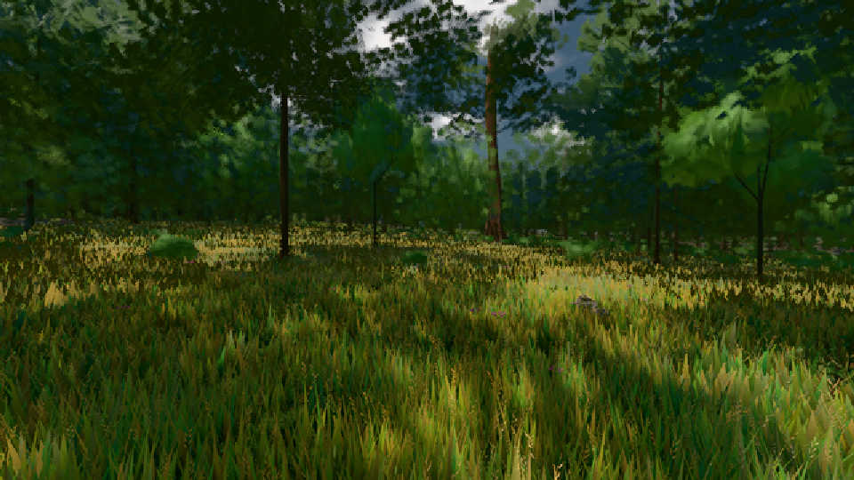

# GPU-PROBE 33c73b16 — ROT

Zweig `w24-strauch-saum` · Kopf 33c73b1618751f836bf405becfbbb847a5983396 · Läufer omen-gtx1060 · 08.11. 19:43 · Wanduhr ab Push 771 s · Lauf https://github.com/MiguellD/AnazhRealm/actions/runs/42510336975

Ruf: `gate:laub-kante bild:wiese@0.5`

GPU NVIDIA GeForce GTX 1060 · npm ci 42 s (package-lock 14bd2eb7)
Schloss /c/Users/micha/AppData/Local/Temp/claude/gpu-schloss hält „ci-runner 42510336975/1 probe“
- Hook 2026-11-08 19:39:40 start ci-runner 42510336975/1 probe: Schloss genommen (refs/heads/w24-strauch-saum 33c73b1618751f836bf405becfbbb847a5983396 ws=C:\actions-runner\_work\AnazhRealm\AnazhRealm)

### gate:laub-kante — ROT · 81 s

Adapter: ungenannt (die Probe nannte keinen Browser-Adapter)

```text
werkbank.cjs ABSTURZ: Error: /bild ohne Klasse: DIE WELT STEHT NICHT nach 2099 Takten: Ruhe 0, zuletzt brach sie: Fege-Takt nahStreu wartet (DER BAU STEHT NICHT: die Welt nach 2099 Takten — die Welt hat nichts mehr offen) weltStehtNach (pptr:evaluate;lade%20(C%3A%5Cactions-runner%5C_work%5CAnazhRealm%5Cgpu-probe%5Cscripts%5Cwerkbank.cjs%3A938%3A24):1051:15) | at weltStehtNach (evaluate at lade (C:\actions-runner\_work\AnazhRealm\gpu-probe\scripts\werkbank.cjs:938:24), <anonymous>:1050:14) | at #evaluate (C:\actions-runner\_work\AnazhRealm\gpu-probe\node_modules\puppeteer-core\lib\cjs\puppete
```

### bild:wiese@0.5 — GRÜN · 62 s

Adapter: [linse-gpu] nvidia/pascal

```text
Kamera des Spiels → Blick (10.0 m): -280.40 29.71 -1045.60 -289.61 29.71 -1049.50
 "abnahme": "ABNAHME GRÜN · beweis · Sicht 0.0 % · Ziel Blickziel im Bild frei 10 m · Luma 54.7 σ 30.7 schwarz 0.0 % weiß 0.0 % · Stand 18.546.226 · Bühne summer sunny 0.50 · Gerät WebGPU nvidia pascal",
```


