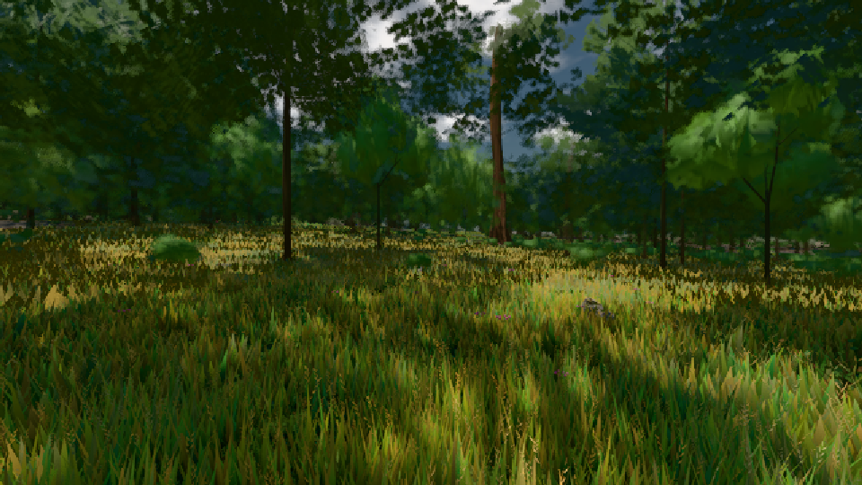

# GPU-PROBE 3405cbd8 — GRÜN

Zweig `w24-strauch-saum` · Kopf 3405cbd8516fe4c744008df6c212db716191f477 · Läufer radeon-890m · 08.11. 16:51 · Wanduhr ab Push 3527 s · Lauf https://github.com/MiguellD/AnazhRealm/actions/runs/42491946925

Ruf: `gate:laub-kante bild:wiese@0.5`

GPU AMD Radeon(TM) 890M Graphics · node_modules bleiben (package-lock 8355392c)
Schloss /c/Users/micha/AppData/Local/Temp/claude/gpu-schloss hält „ci-runner 42491946925/1 probe“
- Hook 2026-11-08 16:45:58 start ci-runner 42491946925/1 probe: Schloss genommen (refs/heads/w24-strauch-saum 3405cbd8516fe4c744008df6c212db716191f477 ws=C:\actions-runner\_work\AnazhRealm\AnazhRealm)

### gate:laub-kante — GRÜN · 207 s

Adapter: ungenannt (die Probe nannte keinen Browser-Adapter)

```text
lod.K1#1 ROT [["f:fichte:L1",0.1859,342640,0],["f:tanne:L0",0.1689,118348,0],["f:tanne:L1",0.1749,271227,0],["fimp:birke:L2",0.1775,26186,0],["fimp:eiche:L2",0.153,61049,0],["fimp:fichte:L2",0.1631,36321,0],["fimp:strauch:L2",0.2491,23499,0],["fimp:tanne:L2",0.1633,117798,0]]
lod.K1#1 ROT [["f:fichte:L1",0.1837,343185,0],["f:tanne:L0",0.1696,118321,0],["f:tanne:L1",0.1743,270780,0],["fimp:birke:L2",0.1873,27167,0],["fimp:eiche:L2",0.1504,60884,0],["fimp:fichte:L2",0.1503,35599,0],["fimp:strauch:L2",0.2405,23623,0],["fimp:tanne:L2",0.1625,113767,0]]
lod.K1#1 ROT [["f:fichte:L1",0.1765,343237,0],["f:tanne:L0",0.1682,118458,0],["f:tanne:L1",0.181,270022,0],["fimp:birke:L2",0.1594,26047,0],["fimp:eiche:L2",0.1443,59394,0],["fimp:fichte:L2",0.1635,37767,0],["fimp:strauch:L2",0.2417,23279,0],["fimp:tanne:L2",0.1607,117839,0]]
lod.K1#1 ROT [["f:fichte:L1",0.1809,343578,0],["f:tanne:L0",0.1695,118615,0],["f:tanne:L1",0.1789,272061,0],["fimp:birke:L2",0.1692,26459,0],["fimp:eiche:L2",0.1464,61467,0],["fimp:fichte:L2",0.1662,35652,0],["fimp:strauch:L2",0.2591,23320,0],["fimp:tanne:L2",0.1611,116782,0]]
lod.K1#1 ROT [["f:fichte:L1",0.1861,342831,0],["f:tanne:L0",0.1686,118331,0],["f:tanne:L1",0.1751,270676,0],["fimp:birke:L2",0.1701,25974,0],["fimp:eiche:L2",0.149,59768,0],["fimp:fichte:L2",0.1608,37078,0],["fimp:strauch:L2",0.2377,23315,0],["fimp:tanne:L2",0.1579,118993,0]]
ABNAHME GRÜN · beweis · Sicht 0.0 % · Ziel tanne im Bild frei 16.81 m · Luma 47.9 σ 36.4 schwarz 0.0 % weiß 0.0 % · Stand 18.546.223 · Bühne summer sunny 0.50 · Gerät WebGPU amd rdna-3 · Blick-Wahl 1 Posen
```

### bild:wiese@0.5 — GRÜN · 56 s

Adapter: [linse-gpu] amd/rdna-3

```text
Kamera des Spiels → Blick (10.0 m): -280.40 29.71 -1045.60 -289.61 29.71 -1049.50
 "abnahme": "ABNAHME GRÜN · beweis · Sicht 0.0 % · Ziel Blickziel im Bild frei 10 m · Luma 55.5 σ 30.7 schwarz 0.0 % weiß 0.0 % · Stand 18.546.223 · Bühne summer sunny 0.50 · Gerät WebGPU amd rdna-3",
```


