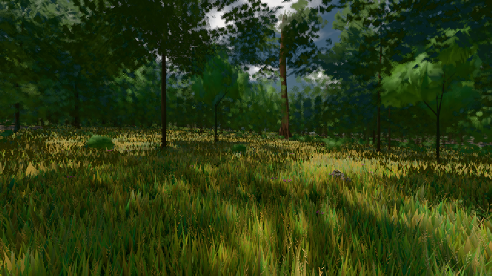

# GPU-PROBE 3f35067a — GRÜN

Zweig `w24-strauch-saum` · Kopf 3f35067a09f9a9eb99943b88a55aa4fc24fdd2dd · Läufer omen-gtx1060 · 08.11. 20:53 · Wanduhr ab Push 93 s · Lauf https://github.com/MiguellD/AnazhRealm/actions/runs/42517127608

Ruf: `bild:wiese@0.5`

GPU NVIDIA GeForce GTX 1060 · node_modules bleiben (package-lock 14bd2eb7)
Schloss /c/Users/micha/AppData/Local/Temp/claude/gpu-schloss hält „ci-runner 42517127608/1 probe“
- Hook 2026-11-08 20:51:45 start ci-runner 42517127608/1 probe: Schloss genommen (refs/heads/w24-strauch-saum 3f35067a09f9a9eb99943b88a55aa4fc24fdd2dd ws=C:\actions-runner\_work\AnazhRealm\AnazhRealm)

### bild:wiese@0.5 — GRÜN · 54 s

Adapter: [linse-gpu] nvidia/pascal

```text
Kamera des Spiels → Blick (10.0 m): -280.40 29.71 -1045.60 -289.61 29.71 -1049.50
 "abnahme": "ABNAHME GRÜN · beweis · Sicht 0.0 % · Ziel Blickziel im Bild frei 10 m · Luma 54.9 σ 30.8 schwarz 0.0 % weiß 0.0 % · Stand 18.546.226 · Bühne summer sunny 0.50 · Gerät WebGPU nvidia pascal",
```


