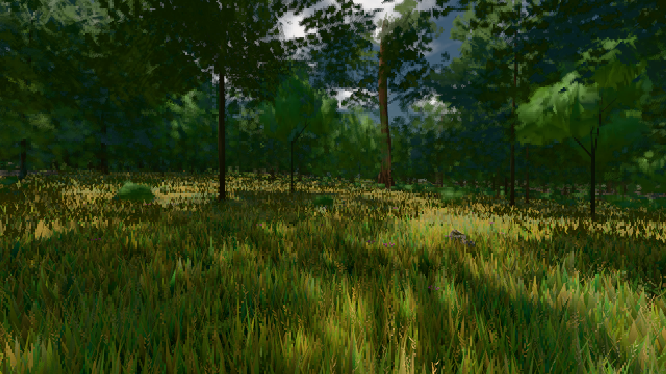

# GPU-PROBE 41d69a4f — GRÜN

Zweig `w24-strauch-saum` · Kopf 41d69a4f1a5165af06fa2e0ba85594715baff709 · Läufer omen-gtx1060 · 08.11. 18:30 · Wanduhr ab Push 502 s · Lauf https://github.com/MiguellD/AnazhRealm/actions/runs/42504614756

Ruf: `gate:laub-kante bild:wiese@0.5`

GPU NVIDIA GeForce GTX 1060 · node_modules bleiben (package-lock 74fc4120)
Schloss /c/Users/micha/AppData/Local/Temp/claude/gpu-schloss hält „ci-runner 42504614756/1 probe“
- Hook 2026-11-08 18:25:02 start ci-runner 42504614756/1 probe: Schloss genommen (refs/heads/w24-strauch-saum 41d69a4f1a5165af06fa2e0ba85594715baff709 ws=C:\actions-runner\_work\AnazhRealm\AnazhRealm)

### gate:laub-kante — GRÜN · 231 s

Adapter: ungenannt (die Probe nannte keinen Browser-Adapter)

```text
lod.K1#1 ROT [["f:fichte:L1",0.1823,364156,0],["f:tanne:L0",0.177,119084,0],["f:tanne:L1",0.1693,286985,0.0001],["fimp:birke:L2",0.1728,30607,0],["fimp:eiche:L2",0.1431,68488,0],["fimp:fichte:L2",0.1433,52496,0],["fimp:strauch:L2",0.2141,23555,0],["fimp:tanne:L2",0.1635,141904,0]]
✅ Strauch-Karten [m, φ°, Höhe, Boden über Strahl, Fuß über Boden] "29.1 2.9 1.85 -0.06 -0.01,43.2 0.9 1.8 -0.1 0.01,43.8 2.4 1.48 -0.06 -0.02,54 2.2 1.96 -0.04 -0.04,59.3 0.8 1.96 -0.06 0.01,62.1 1.1 1.98 -0.07 0,62.5 2.2 1.55 -0.07 0.01,66 2.2 1.77 -0.03 0,66.7 0.6 2.06 -0.04 0,67.1 2.3 1.47 -0.04 0,69.9 2.3 1.54 -0.05 0,70 2.2 1.43 -0.07 0.02,73.1 1.6 1.49 -0.06 0,73.9 2 1.91 -0.06 0.01,74.4 2.1 1.66 -0.05 -0.01,75.1 2.3 1.38 -0.04 0"
lod.K1#1 ROT [["f:fichte:L1",0.1796,361624,0],["f:tanne:L0",0.1815,119765,0],["f:tanne:L1",0.1685,290475,0.0001],["fimp:birke:L2",0.2056,31299,0],["fimp:eiche:L2",0.1788,79051,0],["fimp:fichte:L2",0.1474,41866,0],["fimp:strauch:L2",0.3242,23015,0],["fimp:tanne:L2",0.1691,133075,0]]
lod.K1#1 ROT [["f:fichte:L1",0.1825,364334,0],["f:tanne:L0",0.1769,118891,0],["f:tanne:L1",0.1694,287223,0.0001],["fimp:birke:L2",0.1753,30648,0],["fimp:eiche:L2",0.1417,68636,0],["fimp:fichte:L2",0.147,52784,0],["fimp:strauch:L2",0.2083,23557,0],["fimp:tanne:L2",0.1636,141832,0]]
lod.K1#1 ROT [["f:fichte:L1",0.1818,363961,0],["f:tanne:L0",0.1768,119067,0],["f:tanne:L1",0.1698,286908,0.0001],["fimp:birke:L2",0.1728,30483,0],["fimp:eiche:L2",0.1432,68259,0],["fimp:fichte:L2",0.1446,52528,0],["fimp:strauch:L2",0.2115,23560,0.0025],["fimp:tanne:L2",0.1624,141893,0]]
ABNAHME GRÜN · beweis · Sicht 0.0 % · Ziel tanne im Bild frei 16.81 m · Luma 62.2 σ 42.2 schwarz 0.0 % weiß 0.0 % · Stand 18.546.224 · Bühne summer sunny 0.50 · Gerät WebGPU nvidia pascal · Blick-Wahl 1 Posen
```

### bild:wiese@0.5 — GRÜN · 58 s

Adapter: [linse-gpu] nvidia/pascal

```text
Kamera des Spiels → Blick (10.0 m): -280.40 29.71 -1045.60 -289.61 29.71 -1049.50
 "abnahme": "ABNAHME GRÜN · beweis · Sicht 0.0 % · Ziel Blickziel im Bild frei 10 m · Luma 54.2 σ 30.6 schwarz 0.0 % weiß 0.0 % · Stand 18.546.224 · Bühne summer sunny 0.50 · Gerät WebGPU nvidia pascal",
```


