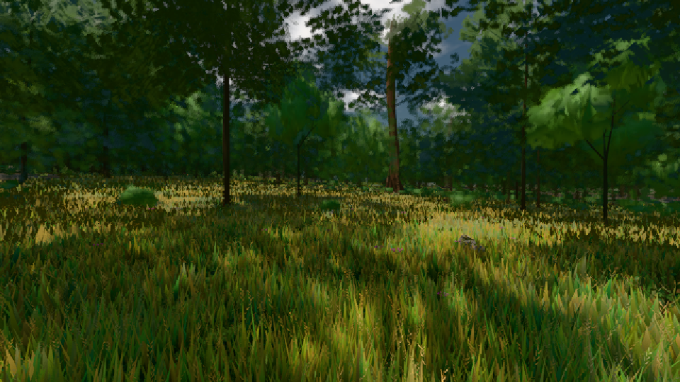

# GPU-PROBE 688408ab — GRÜN

Zweig `w24-strauch-saum` · Kopf 688408ab651b67ffbd8e4831b0b3d6d00231b9e0 · Läufer omen-gtx1060 · 08.11. 18:48 · Wanduhr ab Push 259 s · Lauf https://github.com/MiguellD/AnazhRealm/actions/runs/42506419629

Ruf: `bild:wiese@0.5`

GPU NVIDIA GeForce GTX 1060 · npm ci 39 s (package-lock 6ebaf53e)
Schloss /c/Users/micha/AppData/Local/Temp/claude/gpu-schloss hält „ci-runner 42506419629/1 probe“
- Hook 2026-11-08 18:44:19 start ci-runner 42506419629/1 probe: Schloss genommen (refs/heads/w24-strauch-saum 688408ab651b67ffbd8e4831b0b3d6d00231b9e0 ws=C:\actions-runner\_work\AnazhRealm\AnazhRealm)

### bild:wiese@0.5 — GRÜN · 50 s

Adapter: [linse-gpu] nvidia/pascal

```text
Kamera des Spiels → Blick (10.0 m): -280.40 29.71 -1045.60 -289.61 29.71 -1049.50
 "abnahme": "ABNAHME GRÜN · beweis · Sicht 0.0 % · Ziel Blickziel im Bild frei 10 m · Luma 54.2 σ 30.6 schwarz 0.0 % weiß 0.0 % · Stand 18.546.225 · Bühne summer sunny 0.50 · Gerät WebGPU nvidia pascal",
```


