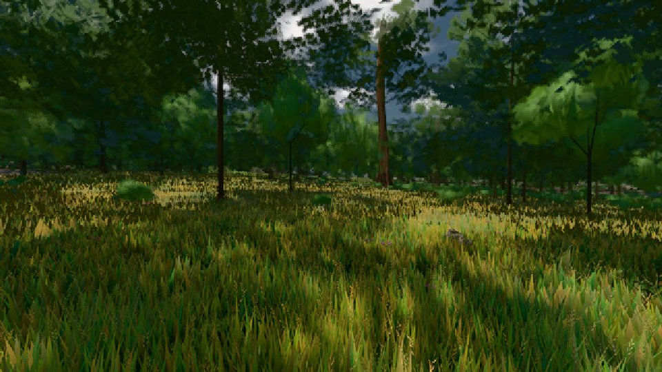

# GPU-PROBE 8505ae41 — GRÜN

Zweig `w24-strauch-saum` · Kopf 8505ae4188f6ee3bc1d1678f5cf1ef675bd76695 · Läufer omen-gtx1060 · 08.11. 15:31 · Wanduhr ab Push 1999 s · Lauf https://github.com/MiguellD/AnazhRealm/actions/runs/42487460426

Ruf: `gate:laub-kante bild:wiese@0.5`

GPU NVIDIA GeForce GTX 1060 · npm ci 38 s (package-lock 8355392c)
Schloss /c/Users/micha/AppData/Local/Temp/claude/gpu-schloss hält „ci-runner 42487460426/1 probe“
- Hook 2026-11-08 15:24:24 start ci-runner 42487460426/1 probe: Schloss genommen (refs/heads/w24-strauch-saum 8505ae4188f6ee3bc1d1678f5cf1ef675bd76695 ws=C:\actions-runner\_work\AnazhRealm\AnazhRealm)

### gate:laub-kante — GRÜN · 306 s

Adapter: ungenannt (die Probe nannte keinen Browser-Adapter)

```text
lod.K1#1 ROT [["f:fichte:L1",0.1768,355366,0],["f:tanne:L0",0.1768,119364,0],["f:tanne:L1",0.1712,281453,0],["fimp:birke:L2",0.1843,28962,0],["fimp:eiche:L2",0.171,70363,0],["fimp:fichte:L2",0.168,44057,0],["fimp:strauch:L2",0.2516,23332,0],["fimp:tanne:L2",0.1633,135190,0]]
lod.K1#1 ROT [["f:fichte:L1",0.1812,354665,0],["f:tanne:L0",0.1772,120043,0],["f:tanne:L1",0.1746,284734,0],["fimp:birke:L2",0.202,30502,0],["fimp:eiche:L2",0.173,75874,0],["fimp:fichte:L2",0.1486,39076,0],["fimp:strauch:L2",0.3222,22675,0],["fimp:tanne:L2",0.1724,129000,0]]
lod.K1#1 ROT [["f:fichte:L1",0.1771,355743,0],["f:tanne:L0",0.1765,119731,0],["f:tanne:L1",0.1693,283919,0],["fimp:birke:L2",0.1843,30328,0],["fimp:eiche:L2",0.1659,73831,0],["fimp:fichte:L2",0.1467,41957,0],["fimp:strauch:L2",0.2787,23344,0],["fimp:tanne:L2",0.1697,129866,0]]
lod.K1#1 ROT [["f:fichte:L1",0.1788,356241,0],["f:tanne:L0",0.1764,119510,0],["f:tanne:L1",0.1713,282262,0],["fimp:birke:L2",0.185,30515,0],["fimp:eiche:L2",0.1561,70943,0],["fimp:fichte:L2",0.15,42431,0],["fimp:strauch:L2",0.2599,23644,0],["fimp:tanne:L2",0.1647,131464,0]]
lod.K1#1 ROT [["f:fichte:L1",0.1861,356561,0],["f:tanne:L0",0.177,118955,0],["f:tanne:L1",0.174,279854,0],["fimp:birke:L2",0.1814,29130,0],["fimp:eiche:L2",0.1623,65322,0],["fimp:fichte:L2",0.1636,48567,0],["fimp:strauch:L2",0.3063,21361,0],["fimp:tanne:L2",0.1812,140630,0]]
lod.K1#1 ROT [["f:fichte:L1",0.189,356328,0],["f:tanne:L0",0.1771,119448,0],["f:tanne:L1",0.174,280584,0],["fimp:birke:L2",0.2038,29312,0],["fimp:eiche:L2",0.1795,68943,0],["fimp:fichte:L2",0.168,46008,0],["fimp:strauch:L2",0.2911,21721,0],["fimp:tanne:L2",0.1939,139216,0]]
ABNAHME GRÜN · beweis · Sicht 0.0 % · Ziel tanne im Bild frei 16.81 m · Luma 54.7 σ 38.2 schwarz 0.0 % weiß 0.0 % · Stand 18.546.223 · Bühne summer sunny 0.50 · Gerät WebGPU nvidia pascal · Blick-Wahl 1 Posen
```

### bild:wiese@0.5 — GRÜN · 58 s

Adapter: [linse-gpu] nvidia/pascal

```text
Kamera des Spiels → Blick (10.0 m): -280.40 29.71 -1045.60 -289.61 29.71 -1049.50
 "abnahme": "ABNAHME GRÜN · beweis · Sicht 0.0 % · Ziel Blickziel im Bild frei 10 m · Luma 54.7 σ 30.9 schwarz 0.0 % weiß 0.0 % · Stand 18.546.223 · Bühne summer sunny 0.50 · Gerät WebGPU nvidia pascal",
```


