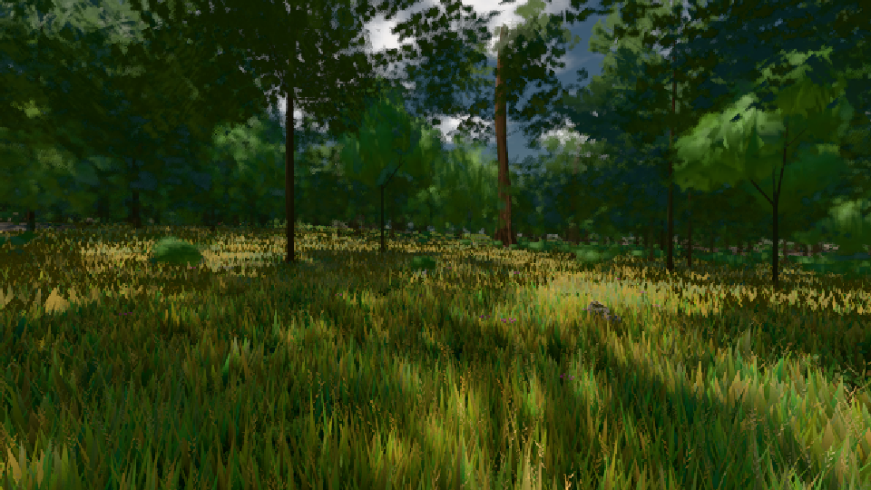

# GPU-PROBE 95ee3097 — GRÜN

Zweig `w24-strauch-saum` · Kopf 95ee3097abaa55cdd1b4aee27d066caf6c002a0b · Läufer radeon-890m · 08.11. 17:05 · Wanduhr ab Push 742 s · Lauf https://github.com/MiguellD/AnazhRealm/actions/runs/42497085674

Ruf: `gate:laub-kante bild:wiese@0.5`

GPU AMD Radeon(TM) 890M Graphics · node_modules bleiben (package-lock 8355392c)
Schloss /c/Users/micha/AppData/Local/Temp/claude/gpu-schloss hält „ci-runner 42497085674/1 probe“
- Hook 2026-11-08 17:00:35 start ci-runner 42497085674/1 probe: Schloss genommen (refs/heads/w24-strauch-saum 95ee3097abaa55cdd1b4aee27d066caf6c002a0b ws=C:\actions-runner\_work\AnazhRealm\AnazhRealm)

### gate:laub-kante — GRÜN · 204 s

Adapter: ungenannt (die Probe nannte keinen Browser-Adapter)

```text
lod.K1#1 ROT [["f:fichte:L1",0.1859,342823,0],["f:tanne:L0",0.1689,118323,0],["f:tanne:L1",0.1746,270668,0],["fimp:birke:L2",0.1707,25962,0],["fimp:eiche:L2",0.1492,59724,0],["fimp:fichte:L2",0.1607,37079,0],["fimp:strauch:L2",0.2384,23322,0],["fimp:tanne:L2",0.1576,118999,0]]
✅ Strauch-Karten [m, φ°, Höhe, Boden über Strahl, Fuß über Boden] "29.1 2.9 1.85 -0.06 -0.01,43.2 0.9 1.8 -0.1 0.01,43.8 2.4 1.48 -0.06 -0.02,54 2.2 1.96 -0.04 -0.04,59.3 0.8 1.96 -0.06 0.01,62.1 1.1 1.98 -0.07 0,62.5 2.2 1.55 -0.07 0.01,66 2.2 1.77 -0.03 0,66.7 0.6 2.06 -0.04 0,67.1 2.3 1.47 -0.04 0,69.9 2.3 1.54 -0.05 0,70 2.2 1.43 -0.07 0.02,73.1 1.6 1.49 -0.06 0,73.9 2 1.91 -0.06 0.01,74.4 2.1 1.66 -0.05 -0.01,75.1 2.3 1.38 -0.04 0"
lod.K1#1 ROT [["f:fichte:L1",0.1858,343520,0],["f:tanne:L0",0.1682,118409,0],["f:tanne:L1",0.1741,270269,0],["fimp:birke:L2",0.1758,26013,0],["fimp:eiche:L2",0.1471,59357,0],["fimp:fichte:L2",0.1637,38316,0],["fimp:strauch:L2",0.2342,23269,0],["fimp:tanne:L2",0.1599,119271,0]]
lod.K1#1 ROT [["f:fichte:L1",0.1836,344522,0],["f:tanne:L0",0.1687,118399,0],["f:tanne:L1",0.1748,270388,0],["fimp:birke:L2",0.1735,26182,0],["fimp:eiche:L2",0.1501,59620,0],["fimp:fichte:L2",0.1603,39306,0],["fimp:strauch:L2",0.2293,23166,0],["fimp:tanne:L2",0.1586,119361,0]]
lod.K1#1 ROT [["f:fichte:L1",0.184,344022,0],["f:tanne:L0",0.1695,118351,0],["f:tanne:L1",0.1725,270323,0],["fimp:birke:L2",0.1855,26849,0],["fimp:eiche:L2",0.1478,59616,0],["fimp:fichte:L2",0.1455,37792,0],["fimp:strauch:L2",0.2306,23413,0],["fimp:tanne:L2",0.1564,115037,0]]
lod.K1#1 ROT [["f:fichte:L1",0.1855,342567,0],["f:tanne:L0",0.1681,118168,0],["f:tanne:L1",0.1764,269389,0],["fimp:birke:L2",0.1694,25093,0],["fimp:eiche:L2",0.1455,58899,0],["fimp:fichte:L2",0.1577,38555,0],["fimp:strauch:L2",0.2317,23207,0],["fimp:tanne:L2",0.1614,119405,0]]
ABNAHME GRÜN · beweis · Sicht 0.0 % · Ziel tanne im Bild frei 16.81 m · Luma 47.8 σ 36.4 schwarz 0.0 % weiß 0.0 % · Stand 18.546.223 · Bühne summer sunny 0.50 · Gerät WebGPU amd rdna-3 · Blick-Wahl 1 Posen
```

### bild:wiese@0.5 — GRÜN · 49 s

Adapter: [linse-gpu] amd/rdna-3

```text
Kamera des Spiels → Blick (10.0 m): -280.40 29.71 -1045.60 -289.61 29.71 -1049.50
 "abnahme": "ABNAHME GRÜN · beweis · Sicht 0.0 % · Ziel Blickziel im Bild frei 10 m · Luma 55.3 σ 30.7 schwarz 0.0 % weiß 0.0 % · Stand 18.546.223 · Bühne summer sunny 0.50 · Gerät WebGPU amd rdna-3",
```


