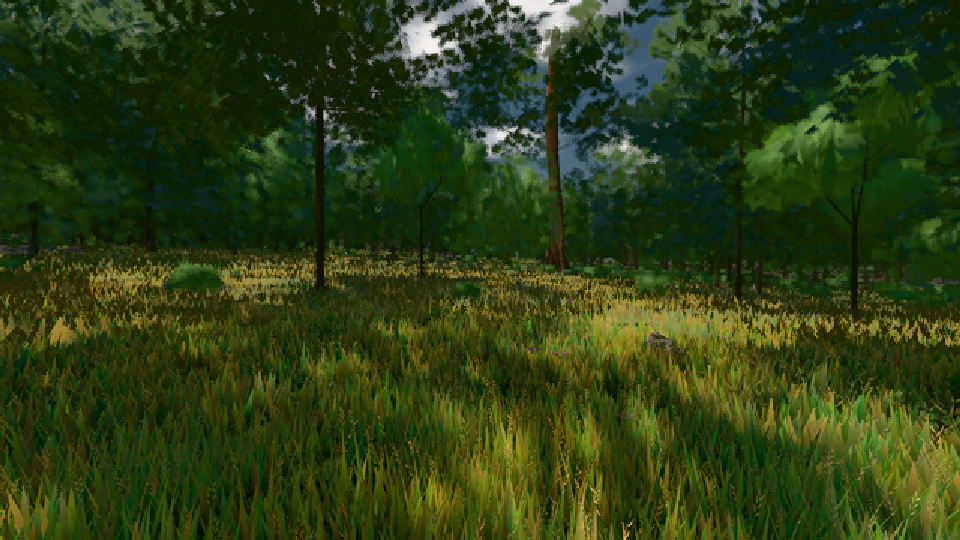

# GPU-PROBE 9adc557b — GRÜN

Zweig `w24-strauch-saum` · Kopf 9adc557b69f0491824e728f74d569165a326ed06 · Läufer radeon-890m · 08.11. 18:21 · Wanduhr ab Push 1489 s · Lauf https://github.com/MiguellD/AnazhRealm/actions/runs/42502419449

Ruf: `gate:laub-kante bild:wiese@0.5`

GPU AMD Radeon(TM) 890M Graphics · node_modules bleiben (package-lock 74fc4120)
Schloss /c/Users/micha/AppData/Local/Temp/claude/gpu-schloss hält „ci-runner 42502419449/1 probe“
- Hook 2026-11-08 18:13:27 start ci-runner 42502419449/1 probe: Schloss genommen (refs/heads/w24-strauch-saum 9adc557b69f0491824e728f74d569165a326ed06 ws=C:\actions-runner\_work\AnazhRealm\AnazhRealm)

### gate:laub-kante — GRÜN · 197 s

Adapter: ungenannt (die Probe nannte keinen Browser-Adapter)

```text
lod.K1#1 GRÜN [["f:fichte:L1",0.1822,344103,0],["f:tanne:L0",0.1691,118029,0],["f:tanne:L1",0.1755,269601,0],["fimp:birke:L2",0.1699,25929,0],["fimp:eiche:L2",0.1438,58097,0],["fimp:fichte:L2",0.149,40596,0],["fimp:strauch:L2",0.2124,22928,0],["fimp:tanne:L2",0.1608,116065,0]]
✅ Strauch-Karten [m, φ°, Höhe, Boden über Strahl, Fuß über Boden] "29.1 2.9 1.85 -0.06 -0.01,43.2 0.9 1.8 -0.1 0.01,43.8 2.4 1.48 -0.06 -0.02,54 2.2 1.96 -0.04 -0.04,59.3 0.8 1.96 -0.06 0.01,62.1 1.1 1.98 -0.07 0,62.5 2.2 1.55 -0.07 0.01,66 2.2 1.77 -0.03 0,66.7 0.6 2.06 -0.04 0,67.1 2.3 1.47 -0.04 0,69.9 2.3 1.54 -0.05 0,70 2.2 1.43 -0.07 0.02,73.1 1.6 1.49 -0.06 0,73.9 2 1.91 -0.06 0.01,74.4 2.1 1.66 -0.05 -0.01,75.1 2.3 1.38 -0.04 0"
lod.K1#1 GRÜN [["f:fichte:L1",0.1825,343783,0],["f:tanne:L0",0.1692,118040,0],["f:tanne:L1",0.1746,269500,0],["fimp:birke:L2",0.1707,25920,0],["fimp:eiche:L2",0.1439,57988,0],["fimp:fichte:L2",0.1495,40299,0],["fimp:strauch:L2",0.2168,22978,0],["fimp:tanne:L2",0.1621,115881,0]]
lod.K1#1 GRÜN [["f:fichte:L1",0.1813,344305,0],["f:tanne:L0",0.1699,117877,0],["f:tanne:L1",0.1751,269825,0],["fimp:birke:L2",0.1688,25965,0],["fimp:eiche:L2",0.1438,58227,0],["fimp:fichte:L2",0.15,40935,0],["fimp:strauch:L2",0.2109,22891,0],["fimp:tanne:L2",0.1612,116099,0]]
lod.K1#1 GRÜN [["f:fichte:L1",0.1824,344355,0],["f:tanne:L0",0.1695,117868,0],["f:tanne:L1",0.1755,269684,0],["fimp:birke:L2",0.1703,26013,0],["fimp:eiche:L2",0.1427,58251,0],["fimp:fichte:L2",0.1505,41261,0],["fimp:strauch:L2",0.2124,22868,0],["fimp:tanne:L2",0.1595,116077,0]]
lod.K1#1 GRÜN [["f:fichte:L1",0.1833,344756,0],["f:tanne:L0",0.1677,118126,0],["f:tanne:L1",0.1751,268962,0],["fimp:birke:L2",0.1731,25112,0],["fimp:eiche:L2",0.1424,58212,0],["fimp:fichte:L2",0.1526,41647,0],["fimp:strauch:L2",0.2177,22800,0],["fimp:tanne:L2",0.1606,120282,0]]
ABNAHME GRÜN · beweis · Sicht 0.0 % · Ziel tanne im Bild frei 16.81 m · Luma 47.7 σ 36.4 schwarz 0.0 % weiß 0.0 % · Stand 18.546.224 · Bühne summer sunny 0.50 · Gerät WebGPU amd rdna-3 · Blick-Wahl 1 Posen
```

### bild:wiese@0.5 — GRÜN · 54 s

Adapter: [linse-gpu] amd/rdna-3

```text
Kamera des Spiels → Blick (10.0 m): -280.40 29.71 -1045.60 -289.61 29.71 -1049.50
 "abnahme": "ABNAHME GRÜN · beweis · Sicht 0.0 % · Ziel Blickziel im Bild frei 10 m · Luma 55 σ 30.4 schwarz 0.0 % weiß 0.0 % · Stand 18.546.224 · Bühne summer sunny 0.50 · Gerät WebGPU amd rdna-3",
```


