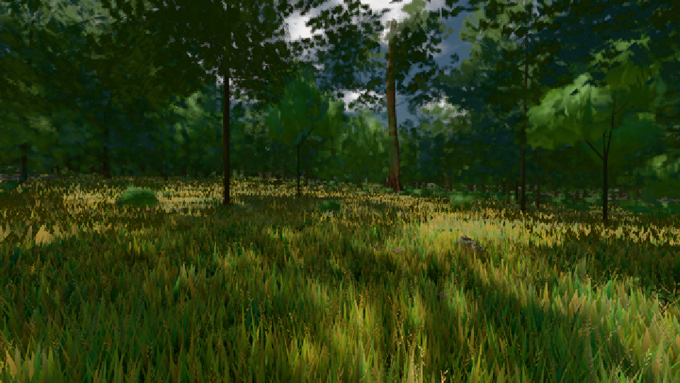

# GPU-PROBE bd17b634 — GRÜN

Zweig `w24-strauch-saum` · Kopf bd17b634414fe7857ef50d2137ba25c45e733883 · Läufer radeon-890m · 08.11. 17:40 · Wanduhr ab Push 646 s · Lauf https://github.com/MiguellD/AnazhRealm/actions/runs/42500177251

Ruf: `gate:laub-kante bild:wiese@0.5`

GPU AMD Radeon(TM) 890M Graphics · npm ci 38 s (package-lock 74fc4120)
Schloss /c/Users/micha/AppData/Local/Temp/claude/gpu-schloss hält „ci-runner 42500177251/1 probe“
- Hook 2026-11-08 17:34:28 start ci-runner 42500177251/1 probe: Schloss genommen (refs/heads/w24-strauch-saum bd17b634414fe7857ef50d2137ba25c45e733883 ws=C:\actions-runner\_work\AnazhRealm\AnazhRealm)

### gate:laub-kante — GRÜN · 200 s

Adapter: ungenannt (die Probe nannte keinen Browser-Adapter)

```text
lod.K1#1 GRÜN [["f:fichte:L1",0.183,343823,0],["f:tanne:L0",0.169,118053,0],["f:tanne:L1",0.1747,269464,0],["fimp:birke:L2",0.1708,25892,0],["fimp:eiche:L2",0.1437,57967,0],["fimp:fichte:L2",0.1502,40293,0],["fimp:strauch:L2",0.2164,22971,0],["fimp:tanne:L2",0.1618,115856,0]]
✅ Strauch-Karten [m, φ°, Höhe, Boden über Strahl, Fuß über Boden] "29.1 2.9 1.85 -0.06 -0.01,43.2 0.9 1.8 -0.1 0.01,43.8 2.4 1.48 -0.06 -0.02,54 2.2 1.96 -0.04 -0.04,59.3 0.8 1.96 -0.06 0.01,62.1 1.1 1.98 -0.07 0,62.5 2.2 1.55 -0.07 0.01,66 2.2 1.77 -0.03 0,66.7 0.6 2.06 -0.04 0,67.1 2.3 1.47 -0.04 0,69.9 2.3 1.54 -0.05 0,70 2.2 1.43 -0.07 0.02,73.1 1.6 1.49 -0.06 0,73.9 2 1.91 -0.06 0.01,74.4 2.1 1.66 -0.05 -0.01,75.1 2.3 1.38 -0.04 0"
lod.K1#1 GRÜN [["f:fichte:L1",0.1832,343959,0],["f:tanne:L0",0.1686,118197,0],["f:tanne:L1",0.1778,268717,0],["fimp:birke:L2",0.1725,24907,0],["fimp:eiche:L2",0.1434,57753,0],["fimp:fichte:L2",0.1527,40863,0],["fimp:strauch:L2",0.2185,22879,0],["fimp:tanne:L2",0.1588,120822,0]]
lod.K1#1 GRÜN [["f:fichte:L1",0.1838,344518,0],["f:tanne:L0",0.1682,118175,0],["f:tanne:L1",0.1766,268790,0],["fimp:birke:L2",0.1709,25034,0],["fimp:eiche:L2",0.1428,58078,0],["fimp:fichte:L2",0.1507,41286,0],["fimp:strauch:L2",0.2157,22824,0],["fimp:tanne:L2",0.1594,120691,0]]
lod.K1#1 GRÜN [["f:fichte:L1",0.1783,343269,0],["f:tanne:L0",0.1672,118454,0],["f:tanne:L1",0.1778,267606,0],["fimp:birke:L2",0.1492,25059,0],["fimp:eiche:L2",0.1471,55662,0],["fimp:fichte:L2",0.1581,42796,0],["fimp:strauch:L2",0.2187,22707,0],["fimp:tanne:L2",0.1573,119497,0]]
lod.K1#1 GRÜN [["f:fichte:L1",0.1824,344127,0],["f:tanne:L0",0.1688,118038,0],["f:tanne:L1",0.1758,269568,0],["fimp:birke:L2",0.1705,25926,0],["fimp:eiche:L2",0.1438,58103,0],["fimp:fichte:L2",0.1497,40596,0],["fimp:strauch:L2",0.2126,22920,0],["fimp:tanne:L2",0.1599,116025,0]]
ABNAHME GRÜN · beweis · Sicht 0.0 % · Ziel tanne im Bild frei 16.81 m · Luma 47.8 σ 36.3 schwarz 0.0 % weiß 0.0 % · Stand 18.546.224 · Bühne summer sunny 0.50 · Gerät WebGPU amd rdna-3 · Blick-Wahl 1 Posen
```

### bild:wiese@0.5 — GRÜN · 51 s

Adapter: [linse-gpu] amd/rdna-3

```text
Kamera des Spiels → Blick (10.0 m): -280.40 29.71 -1045.60 -289.61 29.71 -1049.50
 "abnahme": "ABNAHME GRÜN · beweis · Sicht 0.0 % · Ziel Blickziel im Bild frei 10 m · Luma 55 σ 30.5 schwarz 0.0 % weiß 0.0 % · Stand 18.546.224 · Bühne summer sunny 0.50 · Gerät WebGPU amd rdna-3",
```


