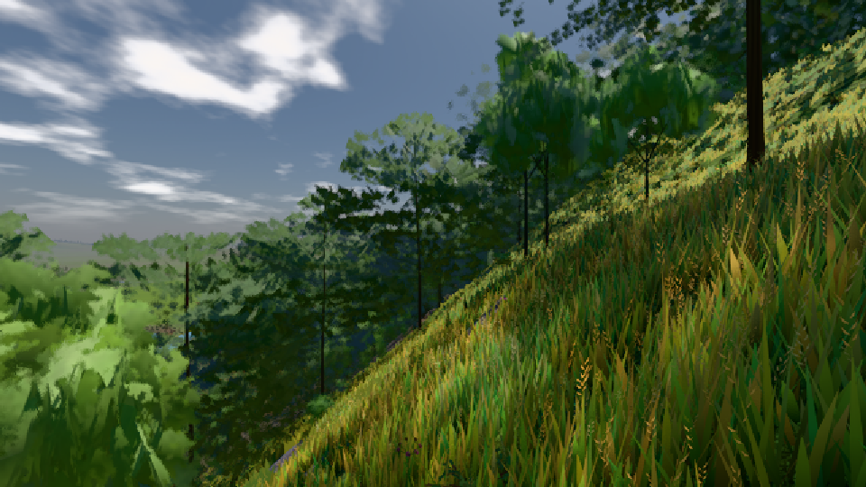
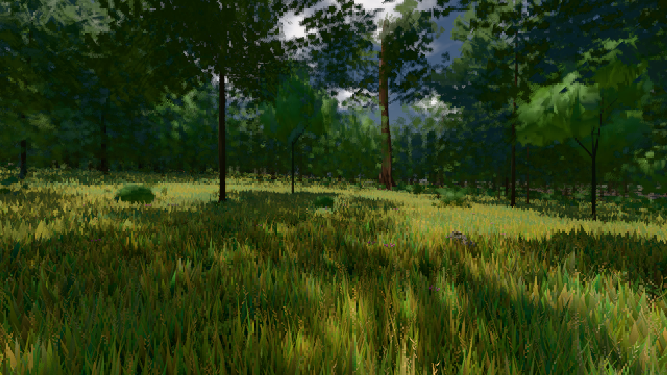

# GPU-PROBE 9e53ecc7 — GRÜN

Zweig `w24-wiese-ferne-y` · Kopf 9e53ecc7568ece2aa5085fc5ceb26fa857092755 · Läufer omen-gtx1060 · 09.11. 05:34 · Wanduhr ab Push 1060 s · Lauf https://github.com/MiguellD/AnazhRealm/actions/runs/42560975268

Ruf: `bild:dorf@0.5 bild:wiese@0.5`

GPU NVIDIA GeForce GTX 1060 · node_modules bleiben (package-lock 315de89a)
Schloss /c/Users/micha/AppData/Local/Temp/claude/gpu-schloss hält „ci-runner 42560975268/1 probe“
- Hook 2026-11-09 05:32:24 start ci-runner 42560975268/1 probe: Schloss genommen (refs/heads/w24-wiese-ferne-y 9e53ecc7568ece2aa5085fc5ceb26fa857092755 ws=C:\actions-runner\_work\AnazhRealm\AnazhRealm)

### bild:dorf@0.5 — GRÜN · 66 s

Adapter: [linse-gpu] nvidia/pascal

```text
Kamera des Spiels → Blick (10.0 m): -841.00 86.89 -861.00 -834.08 86.89 -853.78
 "abnahme": "ABNAHME GRÜN · beweis · Sicht 0.0 % · Ziel Blickziel im Bild frei 10 m · Luma 85.7 σ 48.1 schwarz 0.0 % weiß 0.0 % · Stand 18.546.233 · Bühne summer sunny 0.50 · Gerät WebGPU nvidia pascal",
```



### bild:wiese@0.5 — GRÜN · 51 s

Adapter: [linse-gpu] nvidia/pascal

```text
Kamera des Spiels → Blick (10.0 m): -280.40 29.71 -1045.60 -289.61 29.71 -1049.50
 "abnahme": "ABNAHME GRÜN · beweis · Sicht 0.0 % · Ziel Blickziel im Bild frei 10 m · Luma 56.9 σ 33.2 schwarz 0.0 % weiß 0.0 % · Stand 18.546.233 · Bühne summer sunny 0.50 · Gerät WebGPU nvidia pascal",
```


