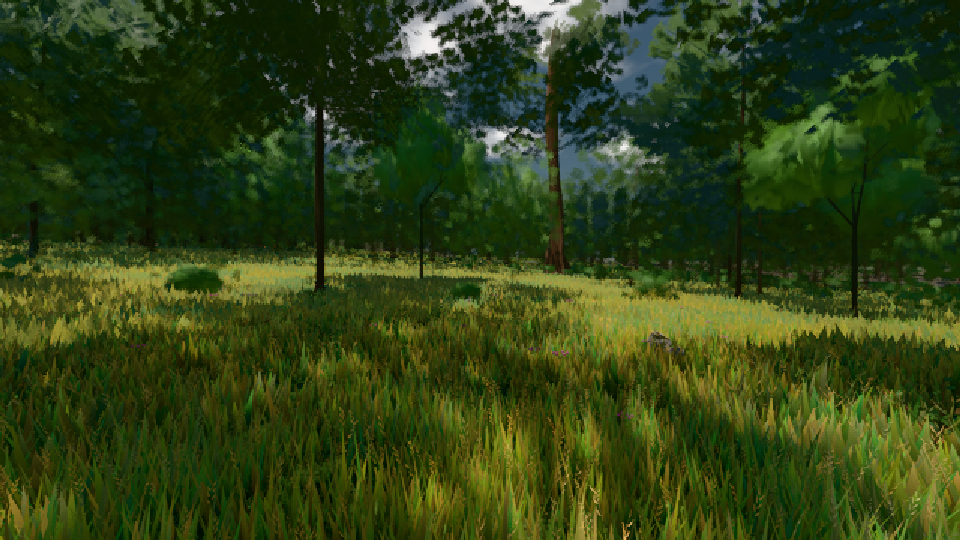
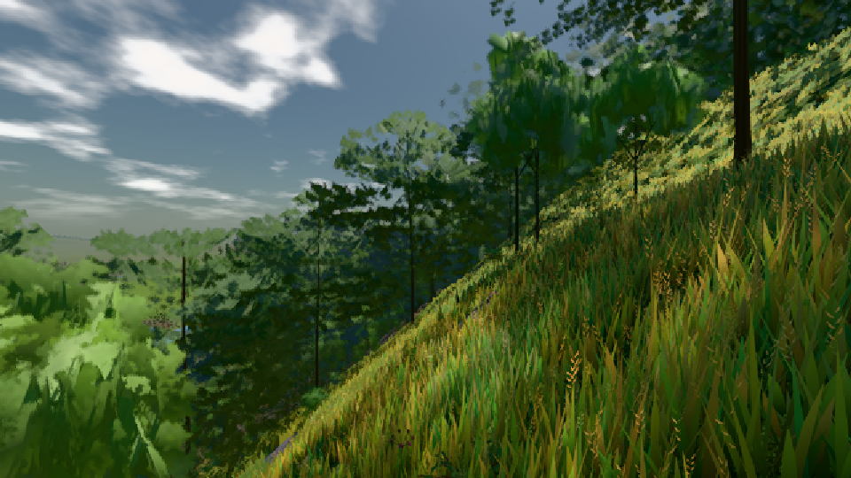
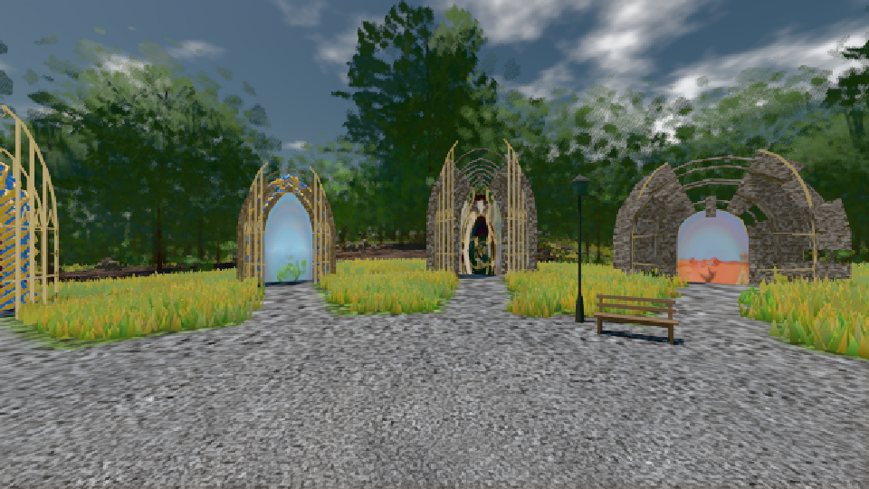

# GPU-PROBE 3a2fe909 — GRÜN

Zweig `w24-wiese-ferne` · Kopf 3a2fe909c11eae8de7787d92a864d843341906f4 · Läufer omen-gtx1060 · 08.11. 23:22 · Wanduhr ab Push 549 s · Lauf https://github.com/MiguellD/AnazhRealm/actions/runs/42529135869

Ruf: `bild:wiese@0.5 bild:dorf@0.5 bild:genesis@0.5`

GPU NVIDIA GeForce GTX 1060 · npm ci 45 s (package-lock 3d113e1d)
Schloss /c/Users/micha/AppData/Local/Temp/claude/gpu-schloss hält „ci-runner 42529135869/1 probe“
- Hook 2026-11-08 23:18:09 start ci-runner 42529135869/1 probe: Schloss genommen (refs/heads/w24-wiese-ferne 3a2fe909c11eae8de7787d92a864d843341906f4 ws=C:\actions-runner\_work\AnazhRealm\AnazhRealm)

### bild:wiese@0.5 — GRÜN · 48 s

Adapter: [linse-gpu] nvidia/pascal

```text
Kamera des Spiels → Blick (10.0 m): -280.40 29.71 -1045.60 -289.61 29.71 -1049.50
 "abnahme": "ABNAHME GRÜN · beweis · Sicht 0.0 % · Ziel Blickziel im Bild frei 10 m · Luma 57.9 σ 33.4 schwarz 0.0 % weiß 0.0 % · Stand 18.546.227 · Bühne summer sunny 0.50 · Gerät WebGPU nvidia pascal",
```



### bild:dorf@0.5 — GRÜN · 63 s

Adapter: [linse-gpu] nvidia/pascal

```text
Kamera des Spiels → Blick (10.0 m): -841.00 86.89 -861.00 -834.08 86.89 -853.78
 "abnahme": "ABNAHME GRÜN · beweis · Sicht 0.0 % · Ziel Blickziel im Bild frei 10 m · Luma 86.4 σ 47.9 schwarz 0.0 % weiß 0.0 % · Stand 18.546.227 · Bühne summer sunny 0.50 · Gerät WebGPU nvidia pascal",
```



### bild:genesis@0.5 — GRÜN · 43 s

Adapter: [linse-gpu] nvidia/pascal

```text
Kamera des Spiels → Blick (10.0 m): 0.00 92.40 0.00 -10.00 92.40 0.00
 "abnahme": "ABNAHME GRÜN · beweis · Sicht 0.0 % · Ziel Blickziel im Bild frei 10 m · Luma 105.6 σ 37.6 schwarz 0.0 % weiß 0.0 % · Stand 18.546.227 · Bühne summer sunny 0.50 · Gerät WebGPU nvidia pascal",
```


