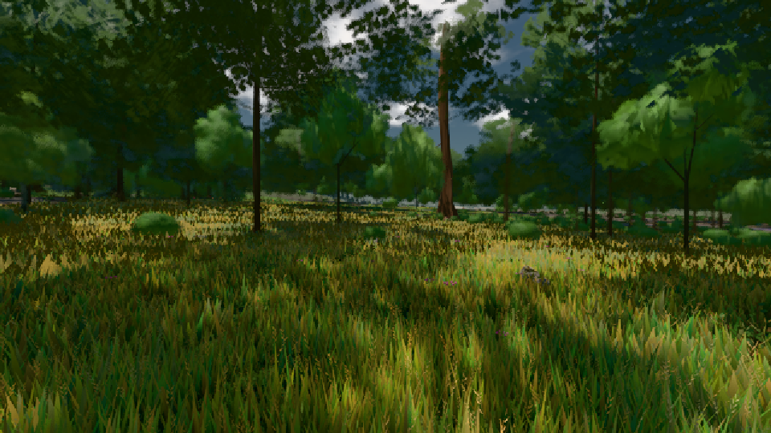
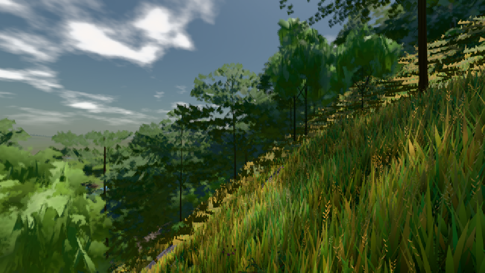
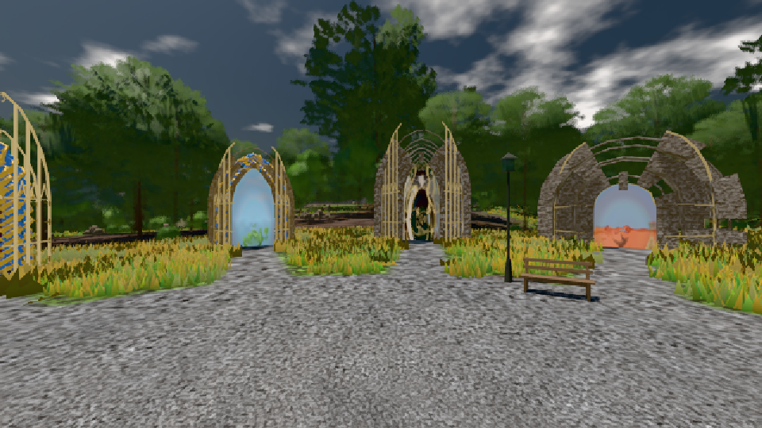

# GPU-PROBE 54977dd9 — GRÜN

Zweig `w24-wiese-ferne` · Kopf 54977dd986c5aea3cc3c78c1a4538d890bc94117 · Läufer radeon-890m · 08.11. 14:09 · Wanduhr ab Push 412 s · Lauf https://github.com/MiguellD/AnazhRealm/actions/runs/42483010692

Ruf: `bild:wiese@0.5 bild:dorf@0.5 bild:genesis@0.5`

GPU AMD Radeon(TM) 890M Graphics · npm ci 29 s (package-lock 49331b5e)
Schloss /c/Users/micha/AppData/Local/Temp/claude/gpu-schloss hält „ci-runner 42483010692/1 probe“
- Hook 2026-11-08 14:05:51 start ci-runner 42483010692/1 probe: Schloss genommen (refs/heads/w24-wiese-ferne 54977dd986c5aea3cc3c78c1a4538d890bc94117 ws=C:\actions-runner\_work\AnazhRealm\AnazhRealm)

### bild:wiese@0.5 — GRÜN · 41 s

Adapter: [linse-gpu] amd/rdna-3

```text
Kamera des Spiels → Blick (10.0 m): -280.40 29.71 -1045.60 -289.61 29.71 -1049.50
 "abnahme": "ABNAHME GRÜN · beweis · Sicht 0.0 % · Ziel Blickziel im Bild frei 10 m · Luma 56.3 σ 31.4 schwarz 0.0 % weiß 0.0 % · Stand 18.546.222 · Bühne summer sunny 0.50 · Gerät WebGPU amd rdna-3",
```



### bild:dorf@0.5 — GRÜN · 46 s

Adapter: [linse-gpu] amd/rdna-3

```text
Kamera des Spiels → Blick (10.0 m): -841.00 86.89 -861.00 -834.08 86.89 -853.78
 "abnahme": "ABNAHME GRÜN · beweis · Sicht 0.0 % · Ziel Blickziel im Bild frei 10 m · Luma 84.3 σ 48.2 schwarz 0.0 % weiß 0.0 % · Stand 18.546.222 · Bühne summer sunny 0.50 · Gerät WebGPU amd rdna-3",
```



### bild:genesis@0.5 — GRÜN · 39 s

Adapter: [linse-gpu] amd/rdna-3

```text
Kamera des Spiels → Blick (10.0 m): 0.00 92.40 0.00 -10.00 92.40 0.00
 "abnahme": "ABNAHME GRÜN · beweis · Sicht 0.0 % · Ziel Blickziel im Bild frei 10 m · Luma 98.5 σ 40.6 schwarz 0.0 % weiß 0.0 % · Stand 18.546.222 · Bühne summer sunny 0.50 · Gerät WebGPU amd rdna-3",
```


