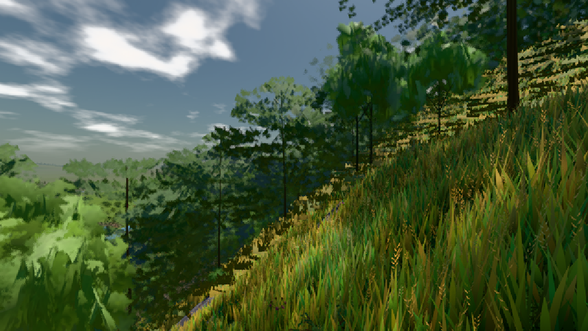
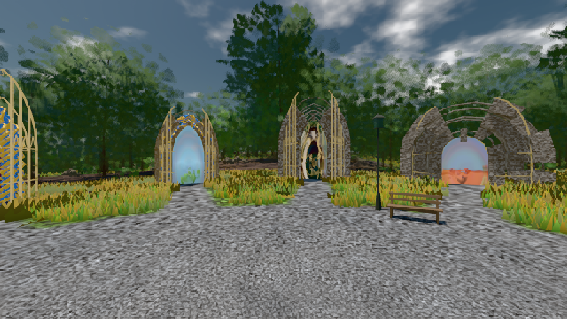

# GPU-PROBE 668f2694 — NACHGEGEBEN

Zweig `w24-wiese-ferne` · Kopf 668f2694e8ccb022040b2f0a5c24f9433eca591c · Läufer radeon-890m · 08.11. 22:56 · Wanduhr ab Push 669 s · Lauf https://github.com/MiguellD/AnazhRealm/actions/runs/42526776693

Ruf: `bild:wiese@0.5 bild:dorf@0.5 bild:genesis@0.5`

GPU AMD Radeon(TM) 890M Graphics · npm ci 74 s (package-lock 3d113e1d)
Schloss /c/Users/micha/AppData/Local/Temp/claude/gpu-schloss hält „ci-runner 42526776693/1 probe“
- Hook 2026-11-08 22:51:09 start ci-runner 42526776693/1 probe: Schloss genommen (refs/heads/w24-wiese-ferne 668f2694e8ccb022040b2f0a5c24f9433eca591c ws=C:\actions-runner\_work\AnazhRealm\AnazhRealm)

### bild:wiese@0.5 — NACHGEGEBEN · 5 s

Adapter: ungenannt (die Probe nannte keinen Browser-Adapter) · NACHGEGEBEN: echt-Job „echt (GPU-Wände auf der Karte)“ (Lauf 42527205420) wartet

```text
NACHGEGEBEN: echt-Job „echt (GPU-Wände auf der Karte)“ (Lauf 42527205420) wartet
```

### bild:dorf@0.5 — GRÜN · 66 s

Adapter: [linse-gpu] amd/rdna-3

```text
Kamera des Spiels → Blick (10.0 m): -841.00 86.89 -861.00 -834.08 86.89 -853.78
 "abnahme": "ABNAHME GRÜN · beweis · Sicht 0.0 % · Ziel Blickziel im Bild frei 10 m · Luma 84.7 σ 47.9 schwarz 0.0 % weiß 0.0 % · Stand 18.546.227 · Bühne summer sunny 0.50 · Gerät WebGPU amd rdna-3",
```



### bild:genesis@0.5 — GRÜN · 53 s

Adapter: [linse-gpu] amd/rdna-3

```text
Kamera des Spiels → Blick (10.0 m): 0.00 92.40 0.00 -10.00 92.40 0.00
 "abnahme": "ABNAHME GRÜN · beweis · Sicht 0.0 % · Ziel Blickziel im Bild frei 10 m · Luma 104.2 σ 37.4 schwarz 0.0 % weiß 0.0 % · Stand 18.546.227 · Bühne summer sunny 0.50 · Gerät WebGPU amd rdna-3",
```


