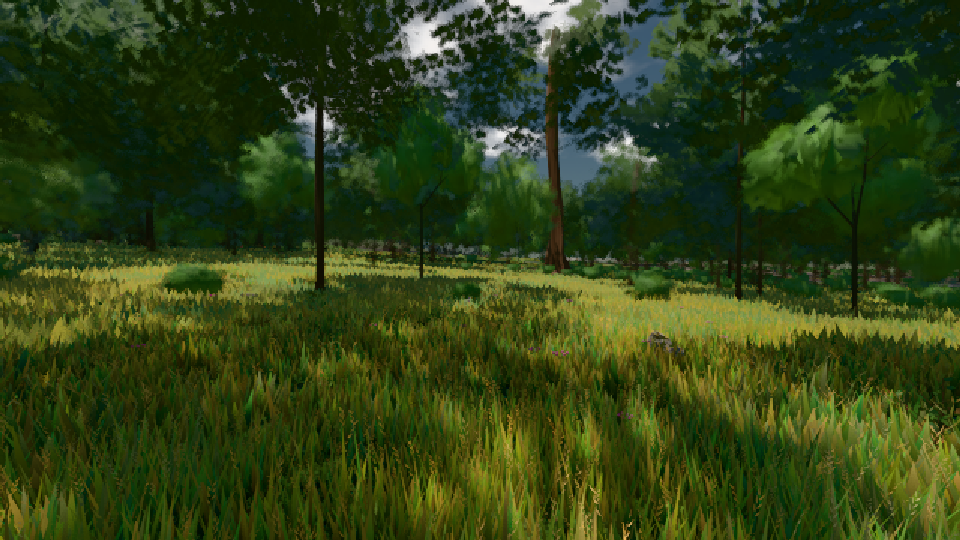
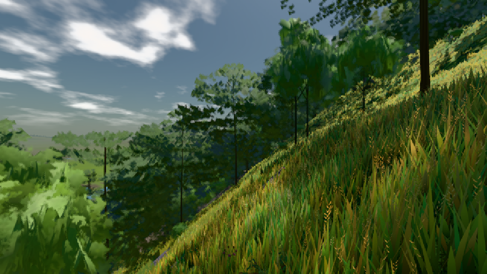
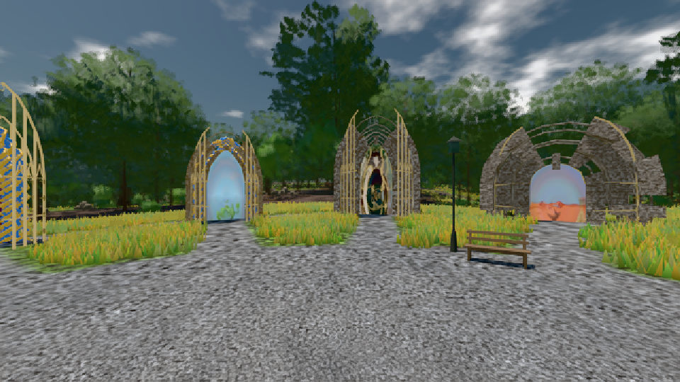

# GPU-PROBE c7f70e6a — NACHGEGEBEN

Zweig `w24-wiese-ferne` · Kopf c7f70e6a6403de023479d74984586221721adf0b · Läufer radeon-890m · 08.11. 16:27 · Wanduhr ab Push 1549 s · Lauf https://github.com/MiguellD/AnazhRealm/actions/runs/42492672287

Ruf: `bild:wiese@0.5 bild:dorf@0.5 bild:genesis@0.5`

GPU AMD Radeon(TM) 890M Graphics · node_modules bleiben (package-lock 8355392c)
Schloss /c/Users/micha/AppData/Local/Temp/claude/gpu-schloss hält „ci-runner 42492672287/1 probe“
- Hook 2026-11-08 16:23:11 start ci-runner 42492672287/1 probe: Schloss genommen (refs/heads/w24-wiese-ferne c7f70e6a6403de023479d74984586221721adf0b ws=C:\actions-runner\_work\AnazhRealm\AnazhRealm)

### bild:wiese@0.5 — GRÜN · 53 s

Adapter: [linse-gpu] amd/rdna-3

```text
Kamera des Spiels → Blick (10.0 m): -280.40 29.71 -1045.60 -289.61 29.71 -1049.50
 "abnahme": "ABNAHME GRÜN · beweis · Sicht 0.0 % · Ziel Blickziel im Bild frei 10 m · Luma 58.5 σ 33.7 schwarz 0.0 % weiß 0.0 % · Stand 18.546.223 · Bühne summer sunny 0.50 · Gerät WebGPU amd rdna-3",
```



### bild:dorf@0.5 — GRÜN · 62 s

Adapter: [linse-gpu] amd/rdna-3

```text
Kamera des Spiels → Blick (10.0 m): -841.00 86.89 -861.00 -834.08 86.89 -853.78
 "abnahme": "ABNAHME GRÜN · beweis · Sicht 0.0 % · Ziel Blickziel im Bild frei 10 m · Luma 86.2 σ 48 schwarz 0.0 % weiß 0.0 % · Stand 18.546.223 · Bühne summer sunny 0.50 · Gerät WebGPU amd rdna-3",
```



### bild:genesis@0.5 — NACHGEGEBEN · 54 s

Adapter: [linse-gpu] amd/rdna-3 · NACHGEGEBEN: echt-Job „echt (GPU-Wände auf der Karte)“ (Lauf 42493135430) wartet

```text
Kamera des Spiels → Blick (10.0 m): 0.00 92.40 0.00 -10.00 92.40 0.00
 "abnahme": "ABNAHME GRÜN · beweis · Sicht 0.0 % · Ziel Blickziel im Bild frei 10 m · Luma 105.5 σ 38.8 schwarz 0.0 % weiß 0.0 % · Stand 18.546.223 · Bühne summer sunny 0.50 · Gerät WebGPU amd rdna-3",
```


