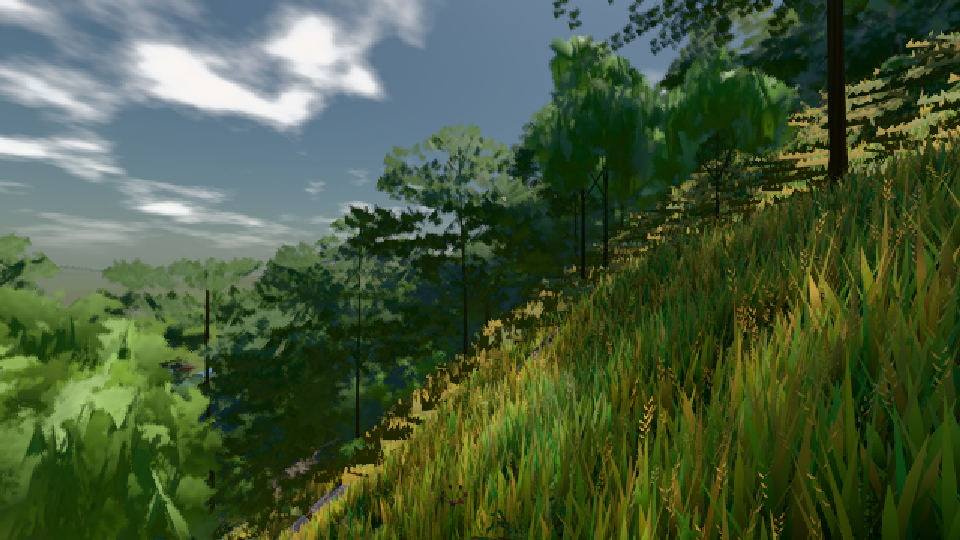

# GPU-PROBE 9f48fbc8 — GRÜN

Zweig `w24-wiese-main` · Kopf 9f48fbc8b1e6d7076de41b098818e5b29c879939 · Läufer radeon-890m · 08.11. 14:46 · Wanduhr ab Push 123 s · Lauf https://github.com/MiguellD/AnazhRealm/actions/runs/42486408202

Ruf: `bild:dorf@0.5`

GPU AMD Radeon(TM) 890M Graphics · node_modules bleiben (package-lock 49331b5e)
Schloss /c/Users/micha/AppData/Local/Temp/claude/gpu-schloss hält „ci-runner 42486408202/1 probe“
- Hook 2026-11-08 14:45:06 start ci-runner 42486408202/1 probe: Schloss genommen (refs/heads/w24-wiese-main 9f48fbc8b1e6d7076de41b098818e5b29c879939 ws=C:\actions-runner\_work\AnazhRealm\AnazhRealm)

### bild:dorf@0.5 — GRÜN · 66 s

Adapter: [linse-gpu] amd/rdna-3

```text
Kamera des Spiels → Blick (10.0 m): -841.00 86.89 -861.00 -834.08 86.89 -853.78
 "abnahme": "ABNAHME GRÜN · beweis · Sicht 0.0 % · Ziel Blickziel im Bild frei 10 m · Luma 84.3 σ 48.2 schwarz 0.0 % weiß 0.0 % · Stand 18.546.222 · Bühne summer sunny 0.50 · Gerät WebGPU amd rdna-3",
```


