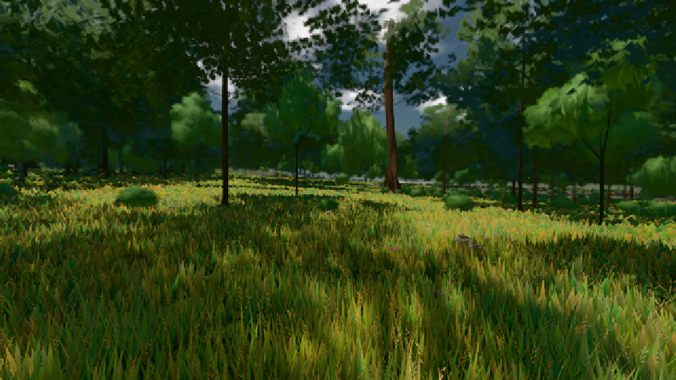
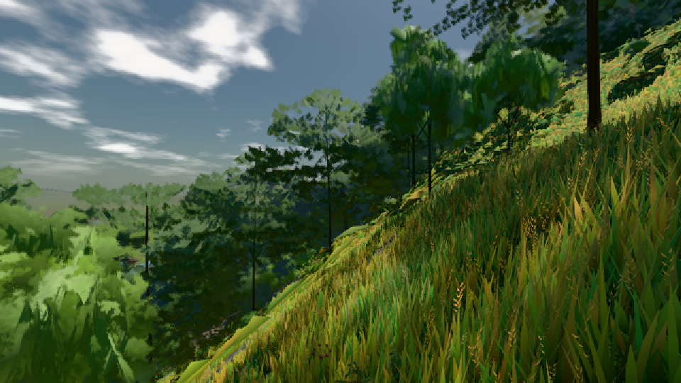
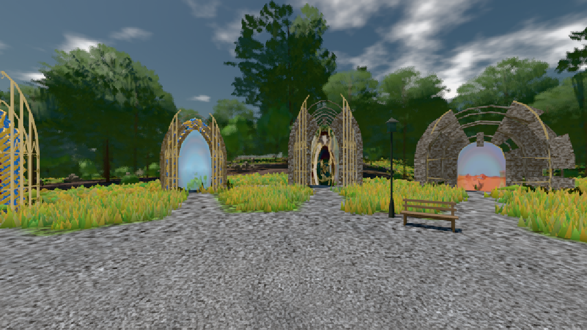

# GPU-PROBE 921818a2 — GRÜN

Zweig `w24-wiese-vorher` · Kopf 921818a2448433780015ce7100ef46c074f1d2b4 · Läufer radeon-890m · 08.11. 14:05 · Wanduhr ab Push 219 s · Lauf https://github.com/MiguellD/AnazhRealm/actions/runs/42483007936

Ruf: `bild:wiese@0.5 bild:dorf@0.5 bild:genesis@0.5`

GPU AMD Radeon(TM) 890M Graphics · npm ci 35 s (package-lock 69f9d79b)
Schloss /c/Users/micha/AppData/Local/Temp/claude/gpu-schloss hält „ci-runner 42483007936/1 probe“
- Hook 2026-11-08 14:02:28 start ci-runner 42483007936/1 probe: Schloss genommen (refs/heads/w24-wiese-vorher 921818a2448433780015ce7100ef46c074f1d2b4 ws=C:\actions-runner\_work\AnazhRealm\AnazhRealm)

### bild:wiese@0.5 — GRÜN · 43 s

Adapter: [linse-gpu] amd/rdna-3

```text
Kamera des Spiels → Blick (10.0 m): -280.40 29.71 -1045.60 -289.61 29.71 -1049.50
 "abnahme": "ABNAHME GRÜN · beweis · Sicht 0.0 % · Ziel Blickziel im Bild frei 10 m · Luma 57.8 σ 34.1 schwarz 0.0 % weiß 0.0 % · Stand 18.546.217 · Bühne summer sunny 0.50 · Gerät WebGPU amd rdna-3",
```



### bild:dorf@0.5 — GRÜN · 45 s

Adapter: [linse-gpu] amd/rdna-3

```text
Kamera des Spiels → Blick (10.0 m): -841.00 86.89 -861.00 -834.08 86.89 -853.78
 "abnahme": "ABNAHME GRÜN · beweis · Sicht 0.0 % · Ziel Blickziel im Bild frei 10 m · Luma 86.1 σ 48.7 schwarz 0.0 % weiß 0.0 % · Stand 18.546.217 · Bühne summer sunny 0.50 · Gerät WebGPU amd rdna-3",
```



### bild:genesis@0.5 — GRÜN · 33 s

Adapter: [linse-gpu] amd/rdna-3

```text
Kamera des Spiels → Blick (10.0 m): 0.00 92.40 0.00 -10.00 92.40 0.00
 "abnahme": "ABNAHME GRÜN · beweis · Sicht 0.0 % · Ziel Blickziel im Bild frei 10 m · Luma 105.8 σ 39.3 schwarz 0.0 % weiß 0.0 % · Stand 18.546.217 · Bühne summer sunny 0.50 · Gerät WebGPU amd rdna-3",
```


